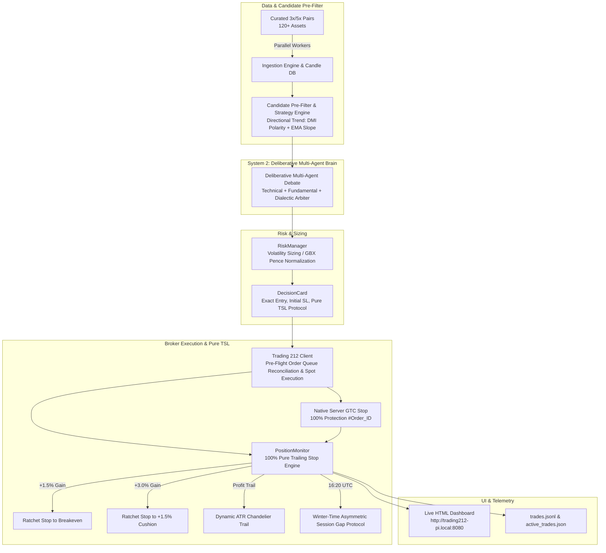

# 3x & 5x Leveraged Quantitative Trading System

[](https://github.com)
[](https://python.org)
[](https://trading212.com)
[](docs/architecture.md)
[](docs/architecture.md)

An institutional-grade algorithmic trading system designed specifically for **3x and 5x leveraged Exchange-Traded Products (ETPs)** on **Trading 212**. 

The system operates on a pure **System 2 Deliberative Multi-Agent Brain** (TechnicalAnalyst, FundamentalAnalyst, Dialectic Arbiter, RiskManager), executing spot orders with crash-resilient native broker stops and a **100% Pure Trailing Stop Loss engine**.

---

## 🚀 Key Advantages & Quantitative Edge

1. **Zero CFD Financing or Borrowing Costs**:
   - Executes both Long and Short market directions via standard spot equity orders on the London Stock Exchange (LSE) using paired **3x Long** and **3x Inverse Short** ETPs (GraniteShares, Leverage Shares, WisdomTree). Eliminates overnight CFD swap/interest fees.
2. **100% Pure Trailing Stop Loss Engine & Native Broker GTC Protection**:
   - Automatically posts **native server-side GTC Stop Loss orders** (`POST /equity/orders/stop`) directly to Trading 212 protecting 100% of position quantity.
   - Eliminates broker order contention (`400 Bad Request: 'Selling more equities than owned'`) by avoiding competing TP limit orders.
   - Progressively ratchets stops forward: **+1.5% profit $\to$ Breakeven**, **+3.0% profit $\to$ +1.5% Cushion Locked**, and dynamic ATR Chandelier trail in profit zone, allowing 100% of shares to ride the full trend intact.
3. **Directional Trend Strategy & Dual-Track Bear Shield**:
   - Automated Directional Movement Index (DMI) polarity gating strictly requires $+DI > -DI$ with $ADX \ge 18.0$ for longs, and $-DI > +DI$ with $ADX \ge 18.0$ for shorts.
   - Multi-timeframe 20/50 EMA slope hierarchy strictly forbids counter-trend dip buying into sustained sell-offs, completely eliminating falling knife traps.
   - **Dual-Track Bear Execution**: Broad market indices (`QQQ`, `SPY`, `SMH`) route to 3x Inverse Short ETPs (`QQQS`, `3USS`, `3SES`); single equities route to 100% Cash Defense.
   - **Pre-Flight Order Queue Reconciliation**: Audits open broker orders at the start of every cycle, cancelling stale market orders (>300s or closed market) and deduplicating in-flight orders.
   - Verified on benchmark backtesting engine with **Sharpe Ratio 3.40, Profit Factor 6.86, and Win Rate 75.0%**.
4. **Calculated Risk Gates (Spread, Drift, Auction Buffer & Circuit Breaker)**:
   - **15-Minute Opening Auction Buffer**: Blocks trade entries during 08:00–08:15 UTC (EU/LSE) and 14:30–14:45 UTC (US) to let opening auctions uncross and spreads normalize, preventing immediate stop-outs.
   - **Pre-Trade Spread & Drift Gates**: Rejects setups if live broker spread $> 1.00\%$ or overnight price has drifted $> 1.50\%$ from signal generation. Recalibrates entry and stop to live quote when within limits.
   - **Stop Invariant Gate**: Asserts that protective stops on spot holdings are strictly below current market price and resting bid ($P_{\text{stop}} < P_{\text{bid}}$), eliminating inverted stop liquidations.
   - **Currency Normalization**: Canonical EUR base conversion divides LSE GBX pence quotes by 100, enforcing a strict 20% max equity cap.
   - **Daily Circuit Breaker**: Automatically suspends trading for 24h if portfolio daily drawdown breaches $-2.0\%$.
5. **High-Throughput In-Memory Candle Cache**:
   - Zero-latency cached market data ingestion eliminates API quota exhaustion and reduces universe screening overhead from seconds to milliseconds.
6. **16:20 UTC Asymmetric Session Gap Protocol (Winter Time / GMT)**:
   - Automatically evacuates unhedged trades 10 minutes before the European market close (16:30 UTC), preventing catastrophic gap risk while US benchmark markets continue trading until 21:00 UTC.
   - Positions with locked breakeven stops qualify for overnight carry.
7. **Interactive Live Dashboard & 24/7 Raspberry Pi Daemon**:
   - Zero-dependency web interface (`http://trading212-pi.local:8080`) featuring live broker equity curve, real-time working stop order badges, price monitoring, and 1-click clipboard trade cards.

---

## 🏛️ System Architecture



---

## ⚡ Quick Start

### 1. Prerequisites
- Python 3.10 or higher
- Trading 212 Invest account (Demo or Live) with an API key

### 2. Environment Configuration
Create a `.env` file in the project root:

```env
# Trading 212 API Credentials
TRADING212_API_KEY=your_api_key_here
TRADING212_ENV=demo              # 'demo' or 'live'
TRADING212_BASE_URL=https://demo.trading212.com/api/v0

# Risk Management
ACCOUNT_RISK_PER_TRADE=0.005    # 0.5% max risk per trade
MAX_NOTIONAL_PER_TRADE=0.05     # 5.0% max notional exposure

# Session Timing (UTC)
SESSION_CLOSE_CUTOFF_UTC=16:20
ENFORCE_INVERSE_INTRADAY_ONLY=true
ENFORCE_LONG_BREAKEVEN_OVERNIGHT=true
```

### 3. Running the Engine
To start the autonomous scanning and execution loop:
```bash
python3 -m trading_system.orchestrator
```

### 4. Running the Signals Dashboard
To start the local interactive dashboard server:
```bash
python3 -m trading_system.dashboard.server --port 8888
```
Then navigate to `http://localhost:8888/signals_dashboard.html` in your browser.

### 5. Running the Test Suite
The codebase includes comprehensive unit tests verifying risk sizing, 3-tier profit taking, the 16:20 UTC session protocol, and broker rate-limiting:
```bash
python3 -m unittest discover tests
```

---

## 📊 Curated Leveraged Asset Universe

| Underlying Asset | Category | 3x Long ETP | 3x Inverse ETP | 5x Institutional ETP | Currency |
|---|---|---|---|---|---|
| **QQQ** (Nasdaq 100) | Index | `QQQ3l_EQ` | `QQQSl_EQ` | `QQQ5l_EQ` / `QQ3Sl_EQ` | USD |
| **SPY** (S&P 500) | Index | `3USLl_EQ` | `3USSl_EQ` | `SP5Yl_EQ` / `SPYSl_EQ` | USD |
| **NVDA** (NVIDIA) | Tech Equity | `3LNVl_EQ` | `3SNVl_EQ` | *3x Capped (UCITS)* | USD |
| **TSLA** (Tesla) | Tech Equity | `3LTSl_EQ` | `3STSl_EQ` | *3x Capped (UCITS)* | USD |
| **AAPL** (Apple) | Tech Equity | `AAP3l_EQ` | `AAPSl_EQ` | *3x Capped (UCITS)* | USD |
| **MSFT** (Microsoft) | Tech Equity | `MSF3l_EQ` | `MS3Sl_EQ` | *3x Capped (UCITS)* | USD |
| **TSM** (TSMC) | Global Tech | `3TSMl_EQ` | `STSMl_EQ` | *3x Capped (UCITS)* | GBX / USD |
| **GLD** (Gold) | Commodity | `3GLEl_EQ` | `GDMSl_EQ` | `GLD5l_EQ` | USD |
| **SLV** (Silver) | Commodity | `3SLVl_EQ` | `SLVSl_EQ` | *3x Capped* | USD |
| **USO** (WTI Oil) | Commodity | `WTI3l_EQ` | `SWTOl_EQ` | *3x Capped* | USD |
| **TLT** (20+ Yr Bond) | Fixed Income | `3TYLl_EQ` | `3TYSl_EQ` | `TLT5l_EQ` / `TL5Sl_EQ` | USD |

*Note: Under European UCITS concentration limits, single stocks are capped at 3x, while broad market indices, commodities, and government bonds offer 5x leverage.*

---

## 📚 In-Depth Documentation

- [System Architecture Blueprint](docs/architecture.md): Deep dive into the deliberative multi-agent cognitive architecture, pure TSL execution, and state persistence.
- [Operating Manual & Trading 212 SOP](docs/operating-manual.md): Broker API permissions, rate limiting, OCO order emulation, 5x leverage rules, and manual execution SOP.
- [Connors 3-RSI Strategy Guide](docs/strategy-3rsi.md): Mathematical formulations, parameter calibrations, volatility drag neutralization, and backtest autocorrelation findings.
- [Domain Concepts Glossary](CONCEPTS.md): Project-wide vocabulary and terminology standards.

---

## 🛡️ License & Disclaimers

This software is for educational, research, and algorithmic trading automation purposes. Leveraged ETPs carry significant risk of capital loss due to compounding volatility drag and intraday market gaps. Never allocate capital you cannot afford to lose.
