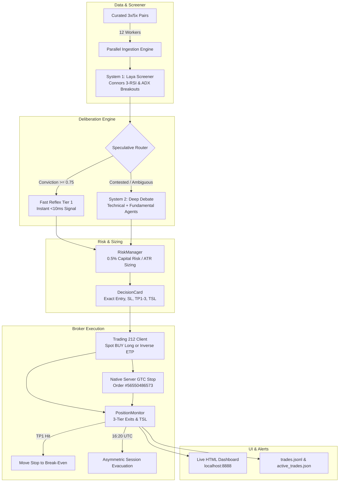

# 3x & 5x Leveraged Quantitative Trading System

[](https://github.com)
[](https://python.org)
[](https://trading212.com)
[](docs/strategy-3rsi.md)
[](docs/operating-manual.md)

An institutional-grade algorithmic trading system designed specifically for **3x and 5x leveraged Exchange-Traded Products (ETPs)** on **Trading 212**. 

The system pairs **System 1 (Laya Fast Reflex Screener, `<10ms` triage)** with **System 2 (TradingAgents Deliberative Engine)**, executing spot orders with crash-resilient native broker stops and automated multi-tier profit taking.

---

## 🚀 Key Advantages & Quantitative Edge

1. **Zero CFD Financing or Borrowing Costs**:
   - Executes both Long and Short market directions via standard spot equity orders on the London Stock Exchange (LSE) using paired **3x Long** and **3x Inverse Short** ETPs (GraniteShares, Leverage Shares, WisdomTree). Eliminates overnight CFD swap/interest fees.
2. **Crash-Resilient Hybrid Broker Execution**:
   - Automatically posts **native server-side GTC/DAY Stop Loss orders** (`POST /equity/orders/stop`) directly to Trading 212 upon trade entry. If your computer disconnects, restarts, or loses power, capital remains protected on the broker's matching engine.
3. **Volatility Drag & Beta Decay Shield**:
   - Neutralizes the mathematical decay inherent to daily rebalanced leveraged instruments ($\frac{L_t}{L_0} \approx (\frac{S_t}{S_0})^\beta e^{\frac{\beta - \beta^2}{2} V_t}$) via Larry Connors' **3-RSI Mean Reversion model** ($\text{RSI}_3 \le 20$, exit at 5-SMA or $+1.0\text{R}$) with a strict **$\le 4$-day holding cap** and **ADX $\ge 20$** trend gating.
4. **16:20 UTC Asymmetric Session Gap Protocol**:
   - Automatically evacuates unhedged trades 10 minutes before the European market close (16:30 UTC), preventing catastrophic gap risk while US benchmark markets continue trading until 21:00 UTC.
5. **Interactive Live Dashboard**:
   - Zero-dependency local web interface (`http://localhost:8888`) featuring live broker connection status, real-time working stop order badges, price monitoring, and 1-click clipboard trade cards.

---

## 🏛️ System Architecture



---

## ⚡ Quick Start

### 1. Prerequisites
- Python 3.10 or higher
- Trading 212 Invest account (Demo or Live) with an API key

### 2. Environment Configuration
Create a `.env` file in the project root:

```env
# Trading 212 API Credentials
TRADING212_API_KEY=your_api_key_here
TRADING212_ENV=demo              # 'demo' or 'live'
TRADING212_BASE_URL=https://demo.trading212.com/api/v0

# Risk Management
ACCOUNT_RISK_PER_TRADE=0.005    # 0.5% max risk per trade
MAX_NOTIONAL_PER_TRADE=0.05     # 5.0% max notional exposure

# Session Timing (UTC)
SESSION_CLOSE_CUTOFF_UTC=16:20
ENFORCE_INVERSE_INTRADAY_ONLY=true
ENFORCE_LONG_BREAKEVEN_OVERNIGHT=true
```

### 3. Running the Engine
To start the autonomous scanning and execution loop:
```bash
python3 -m trading_system.orchestrator
```

### 4. Running the Signals Dashboard
To start the local interactive dashboard server:
```bash
python3 -m trading_system.dashboard.server --port 8888
```
Then navigate to `http://localhost:8888/signals_dashboard.html` in your browser.

### 5. Running the Test Suite
The codebase includes comprehensive unit tests verifying risk sizing, 3-tier profit taking, the 16:20 UTC session protocol, and broker rate-limiting:
```bash
python3 -m unittest discover tests
```

---

## 📊 Curated Leveraged Asset Universe

| Underlying Asset | Category | 3x Long ETP | 3x Inverse ETP | 5x Institutional ETP | Currency |
|---|---|---|---|---|---|
| **QQQ** (Nasdaq 100) | Index | `QQQ3l_EQ` | `QQQSl_EQ` | `QQQ5l_EQ` / `QQ3Sl_EQ` | USD |
| **SPY** (S&P 500) | Index | `3USLl_EQ` | `3USSl_EQ` | `SP5Yl_EQ` / `SPYSl_EQ` | USD |
| **NVDA** (NVIDIA) | Tech Equity | `3LNVl_EQ` | `3SNVl_EQ` | *3x Capped (UCITS)* | USD |
| **TSLA** (Tesla) | Tech Equity | `3LTSl_EQ` | `3STSl_EQ` | *3x Capped (UCITS)* | USD |
| **AAPL** (Apple) | Tech Equity | `AAP3l_EQ` | `AAPSl_EQ` | *3x Capped (UCITS)* | USD |
| **MSFT** (Microsoft) | Tech Equity | `MSF3l_EQ` | `MS3Sl_EQ` | *3x Capped (UCITS)* | USD |
| **TSM** (TSMC) | Global Tech | `3TSMl_EQ` | `STSMl_EQ` | *3x Capped (UCITS)* | GBX / USD |
| **GLD** (Gold) | Commodity | `3GLEl_EQ` | `GDMSl_EQ` | `GLD5l_EQ` | USD |
| **SLV** (Silver) | Commodity | `3SLVl_EQ` | `SLVSl_EQ` | *3x Capped* | USD |
| **USO** (WTI Oil) | Commodity | `WTI3l_EQ` | `SWTOl_EQ` | *3x Capped* | USD |
| **TLT** (20+ Yr Bond) | Fixed Income | `3TYLl_EQ` | `3TYSl_EQ` | `TLT5l_EQ` / `TL5Sl_EQ` | USD |

*Note: Under European UCITS concentration limits, single stocks are capped at 3x, while broad market indices, commodities, and government bonds offer 5x leverage.*

---

## 📚 In-Depth Documentation

- [System Architecture Blueprint](docs/architecture.md): Deep dive into the two-tier cognitive model, speculative routing, and state persistence.
- [Operating Manual & Trading 212 SOP](docs/operating-manual.md): Broker API permissions, rate limiting, OCO order emulation, 5x leverage rules, and manual execution SOP.
- [Connors 3-RSI Strategy Guide](docs/strategy-3rsi.md): Mathematical formulations, parameter calibrations, volatility drag neutralization, and backtest autocorrelation findings.
- [Domain Concepts Glossary](CONCEPTS.md): Project-wide vocabulary and terminology standards.

---

## 🛡️ License & Disclaimers

This software is for educational, research, and algorithmic trading automation purposes. Leveraged ETPs carry significant risk of capital loss due to compounding volatility drag and intraday market gaps. Never allocate capital you cannot afford to lose.
