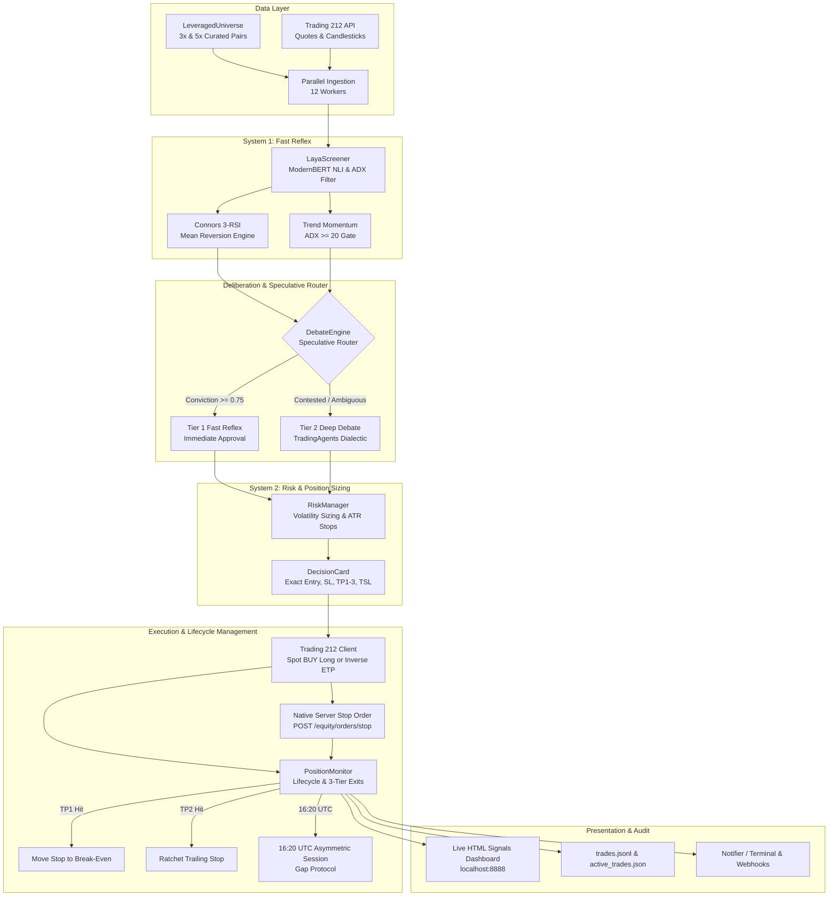

# System Architecture: 3x & 5x Leveraged Quantitative Trading Engine

> **High-Throughput Hybrid Trading System**  
> Combines **System 1 (Laya Fast Reflex Screener, <10ms NLI)** and **System 2 (TradingAgents Deliberative Engine)** with crash-resilient native broker execution on Trading 212.

---

## 1. Architectural Overview

The engine trades daily-leveraged (3x and 5x) Exchange-Traded Products (ETPs) listed on European exchanges (London Stock Exchange) via Trading 212. It employs a two-tier cognitive architecture:

1. **System 1 (Fast Reflex Ingestion & Screening)**:
   - Ingests multi-asset market data across 12 parallel workers.
   - Evaluates Connors 3-RSI Mean Reversion pullbacks and ADX trend breakouts.
   - Single forward-pass NLI triage categorizes setups in `<10ms`.
2. **System 2 (Deliberative Multi-Agent Debate & Risk Management)**:
   - High-conviction setups (`>= 0.75`) bypass deep debate via **Fast Reflex Routing**.
   - Borderline or contested setups trigger deep dialectic debate between Technical, Fundamental, and Risk agents.
   - Computes strict volatility-adjusted sizing (0.5% equity risk, 5% max notional).
3. **Execution & Lifecycle Engine (`PositionMonitor`)**:
   - Places **native server-side GTC/DAY Stop Loss orders** on Trading 212 at order fill time for crash protection.
   - Manages algorithmic 3-tier profit taking: **TP1 (+1.0R)**, **TP2 (+2.0R)**, **TP3 (+3.0R)** with dynamic Trailing Stops.
   - Enforces the **16:20 UTC Asymmetric Session Gap Protocol** to prevent overnight volatility drag.

---

## 2. Core Subsystems

### 2.1 Leveraged Asset Universe (`trading_system/data/leveraged_universe.py`)
- Maps underlying liquid global assets (`QQQ`, `SPY`, `NVDA`, `TSLA`, `AAPL`, `MSFT`, `TSM`, `GLD`, `SLV`, `USO`, etc.) to paired European ETPs.
- **Spot BUY Execution**: Long trades buy the 3x Long ETP (e.g. `QQQ3l_EQ`); Short trades buy the 3x Short Inverse ETP (e.g. `QQQSl_EQ`).
- **Zero Margin/Borrowing Fees**: Buying inverse ETPs avoids the high borrowing fees and swap rates typical of CFD shorting.
- **5x Extensions**: Indexes (`QQQ5l_EQ`, `SP5Yl_EQ`) and commodities (`GLD5l_EQ`) include institutional 5x leverage options where permitted by UCITS rules.

### 2.2 System 1: Fast Reflex Screener (`trading_system/screener/laya_screener.py`)
- Screenings run every 60 seconds across active pairs.
- Incorporates Larry Connors' 3-RSI Mean Reversion logic:
  - Macro filter: Price above 200-day SMA.
  - Multi-timeframe oversold: $\text{RSI}(3) \le 20$, $\text{RSI}(7) \le 40$.
  - Reversion target: 5-period Simple Moving Average ($\text{SMA}(5)$).
- Incorporates trend momentum logic:
  - Directional breakout with $\text{ADX} \ge 20$ (filters out choppy sideways chop to mitigate beta decay).

### 2.3 System 2: Deliberative Debate Engine (`trading_system/agents/debate_engine.py`)
- **Fast Reflex Path**: When candidate setup conviction is $\ge 0.75$, the speculative router bypasses multi-turn LLM deliberation, issuing instant signals in `<10ms`.
- **Deep Debate Path**: If signals are conflicted (e.g., strong macro downtrend but extreme short-term oversold), the engine instantiates a structured dialectic:
  - **Technical Agent**: Momentum, multi-timeframe RSI, volume profile.
  - **Fundamental Agent**: Earnings calendar blackouts (<= 48h blackout window), macro interest rates.
  - **Risk Manager**: Capital preservation, volatility scaling, ATR-based stops.

### 2.4 Execution & Lifecycle Monitor (`trading_system/execution/position_monitor.py`)
- **Hybrid Broker Execution**:
  1. **Native Server-Side Stops**: Submits `POST /equity/orders/stop` directly to Trading 212 servers. If the local system loses power, connectivity, or restarts, capital is protected server-side at the broker.
  2. **Software Multi-Stage Exits**: Because Trading 212 Invest API does not support simultaneous native Limit and Stop orders on the same shares (OCO), `PositionMonitor` monitors TP levels and executes market liquidations:
     - **TP1 (+1.0R)**: Sells 50% of shares (locking $+0.50R$ cash profit), moves broker stop to entry price (**Break-Even**), and arms **Schmitt-Trigger Hysteresis**.
     - **Schmitt Hysteresis Escape ($TP1 + 0.5 \times ATR$)**: Once price clears the escape threshold, the stop is safely elevated to **TP1**, eliminating Roll (1984) bid-ask bounce premature exits while locking in profit.
     - **TP2 (+2.0R)**: Sells 25% of shares, activates dynamic continuous Trailing Stop Loss (TSL).
     - **TP3 (+3.0R)**: Closes the remaining 25% runner at maximum extension.

### 2.5 16:20 UTC Asymmetric Session Protocol
- Resolves the time-zone mismatch between European exchanges (LSE closes at 16:30 UTC) and US cash markets (trades until 21:00 UTC).
- At **16:20 UTC**:
  - **3x Inverse / Short Positions**: Flatted 100% to eliminate catastrophic overnight compounding decay.
  - **3x Long Positions without TP1**: Flatted to prevent unhedged gap risk while the LSE is closed.
  - **3x Long Positions with TP1 Hit**: Retained for overnight swing only because their stop loss is locked at break-even (risk-free).

---

## 3. Data Structures & State Files

| File | Purpose | Update Frequency |
|---|---|---|
| `active_trades.json` | Live tracking state of all open positions, including native broker stop IDs (`broker_stop_order_id`), highest prices, and TP flags. | On every execution / target hit |
| `trades.jsonl` | Append-only persistent audit log of all trade lifecycle events (entry, TP1, TP2, TP3, SL, session liquidations). | On every trade event |
| `signals_dashboard.html` | Self-contained, zero-dependency interactive dashboard for real-time monitoring and manual execution. | Regenerated on demand or every scan |
| `CONCEPTS.md` | Authoritative domain glossary and project vocabulary. | Maintained via compounding |

---

## 4. Error Recovery & Safety Guarantees

1. **Broker Rate Limiting**: Exponential backoff with jitter handles Trading 212 HTTP 429 responses safely.
2. **Crash Resilience**: Server-side native GTC stops mean an unhandled daemon exception cannot leave open positions exposed to infinite downside.
3. **Graceful Fallbacks**: If external LLM APIs (OpenAI) or data feeds are unavailable, the engine automatically operates on calibrated quantitative rules.
