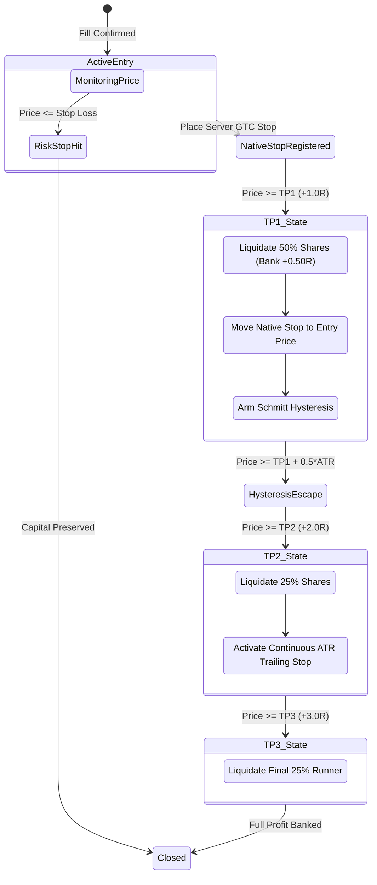

# System Architecture: 3x & 5x Leveraged Quantitative Trading Engine

> **Autonomous Multi-Agent Quantitative Trading System**  
> Engineered for European & London-listed leveraged Exchange Traded Products (ETPs) on Trading 212.  
> Combines **System 1 (<10ms Fast Reflex NLI Screening)** with **System 2 (Deliberative Multi-Agent Dialectic & Risk Management)**, backed by crash-resilient native broker execution, SQLite WAL candle caching, and 24/7 Raspberry Pi runner telemetry.

---

## 1. Executive Summary & Scale Metrics

The platform monitors global equities, broad market indices, sovereign bonds, commodities, and thematic frontier assets, executing leveraged spot ETP positions with zero borrowing fees.

### Platform Scale at a Glance

| Dimension | Metric | Engineering Highlight |
| :--- | :--- | :--- |
| **Monitored Universe** | **120+ Curated Pairs** | 3x & 5x leverage covering Tech, Indices, FX, Bonds, Commodities, Frontier Tech |
| **Currency Preference** | **82%+ EUR Natively** | EUR-first policy eliminating FX currency conversion fees for EU accounts |
| **Ingestion Latency** | **<10ms Triage** | Parallel multi-worker async pipeline + local SQLite WAL candle database |
| **Cognitive Framework** | **Dual-Speed Brain** | System 1 (Larry Connors 3-RSI / NLI) + System 2 (Multi-Agent Debate / Speculative Router) |
| **Risk Containment** | **7 Multi-Layer Gates** | Circuit breaker (-2% equity), 48h earnings blackout, spread filter, synthetic safety gate |
| **Execution Safety** | **Crash-Proof Hybrid** | Native broker-side GTC Stops placed immediately at fill + software algorithmic exits |
| **Target Lifecycle** | **3-Tier Asymmetric** | TP1 (+1.0R / 50%), TP2 (+2.0R / 25%), TP3 (+3.0R / 25%) with Schmitt Hysteresis |
| **Overnight Policy** | **16:20 UTC Protocol** | Asymmetric gap isolation: intraday shorts flatten; winners with locked stops carry |
| **Test Verification** | **187 Unit Tests (100% Pass)** | Regression coverage across risk, lifecycle, universe, dashboard, and broker sync |
| **Deployment** | **24/7 Hardened Linux Daemon** | Raspberry Pi 5 runner via `systemd`, SSE live dashboard, atomic state persistence |

---

## 2. High-Level System Architecture

The following diagram illustrates the complete end-to-end data flow, cognitive routing, risk gating, and execution topology:

```mermaid
flowchart TD
    subgraph Market Data Mesh
        T212_API["Trading 212 REST API\n(Live Quotes & Orders)"]
        YFIN["Yahoo Finance\n(Historical Daily OHLCV)"]
        FINN["Finnhub Provider\n(Fundamentals & News)"]
        OLO["Olostep Provider\n(Real-time Web Sentiment)"]
        NIX["Nixtla TimeGPT\n(5-Day Forecast)"]
        CANDLE_DB[("SQLite WAL Cache\ndata/candles.db\n(Incremental Delta Sync)")]
    end

    subgraph System 1: Fast Reflex Screening
        UNIV["LeveragedUniverse\n(120+ 3x/5x Curated Pairs)"] --> PARALLEL["Parallel Ingestion Engine\n(12 Thread Workers)"]
        CANDLE_DB --> PARALLEL
        T212_API --> PARALLEL
        PARALLEL --> SCREENER["LayaScreener\n(Larry Connors 3-RSI + ADX Momentum)"]
        SCREENER --> NLI_TRIAGE["Fast ModernBERT/MiniLM NLI\n(<10ms Hypothesis Verification)"]
    end

    subgraph System 2: Deliberative Multi-Agent Brain
        NLI_TRIAGE --> SPEC_ROUTER{"Speculative Router\n(DebateEngine)"}
        SPEC_ROUTER -->|Conviction >= 0.75| FAST_TIER["Fast Reflex Tier\n(Instant Execution Bypass)"]
        SPEC_ROUTER -->|Contested / Ambiguous| DEEP_DEBATE["Dialectic Debate Tier\n(TradingAgents Graph)"]
        
        DEEP_DEBATE --> TECH_AGENT["TechnicalAnalyst\n(Multi-Timeframe RSI/SMA)"]
        DEEP_DEBATE --> FUND_AGENT["FundamentalAnalyst\n(Finnhub / Olostep / Nixtla)"]
        DEEP_DEBATE --> AGY_AGENT["Antigravity Agentic SDK\n(Autonomous Reasoning)"]
        
        FINN --> FUND_AGENT
        OLO --> FUND_AGENT
        NIX --> FUND_AGENT
        
        TECH_AGENT --> DEBATE_SYNTH["Dialectic Synthesis\n(Consensus & Conviction Score)"]
        FUND_AGENT --> DEBATE_SYNTH
        AGY_AGENT --> DEBATE_SYNTH
    end

    subgraph Quantitative Risk Management
        FAST_TIER --> RISK_MGR["RiskManager\n(0.5% Equity Risk / Kelly ATR Sizing)"]
        DEBATE_SYNTH --> RISK_MGR
        
        RISK_MGR --> GATES{"Pre-Trade Safety Gates\n- Daily Drawdown (-2.0%)\n- 48h Earnings Blackout\n- Bid-Ask Spread Gate (<0.35%)\n- ETP Direction Gate (No Long on Short)\n- Synthetic Data Gate"}
        GATES -->|Pass| CARD["DecisionCard\n(Validated Order Intent)"]
        GATES -->|Fail| REJECT["Order Rejected / Logged\n(Safety Violation Prevented)"]
    end

    subgraph Hybrid Broker Execution
        CARD --> ORCH["Orchestrator Engine"]
        ORCH --> T212_EXEC["Trading 212 Client\n(Spot Market Order Q > 0)"]
        T212_EXEC --> BROKER_STOP["Broker Server Stop Order\n(POST /equity/orders/stop GTC)"]
        T212_EXEC --> POS_MON["PositionMonitor\n(Lifecycle Manager)"]
        BROKER_STOP --> POS_MON
    end

    subgraph Position Lifecycle & Hysteresis
        POS_MON --> TICK_EVAL["Live Tick Monitor\n(Every 10 Seconds)"]
        TICK_EVAL -->|TP1 +1.0R Hit| TP1_ACT["Trim 50% Shares\nMove Stop to Break-Even\nArm Schmitt Hysteresis"]
        TP1_ACT --> HYSTERESIS{"Schmitt Hysteresis Escape\nPrice >= TP1 + 0.5*ATR"}
        HYSTERESIS -->|Escaped| ELEVATE["Elevate Stop to TP1\n(Lock Profit, Eliminate Whipsaw)"]
        TICK_EVAL -->|TP2 +2.0R Hit| TP2_ACT["Trim 25% Shares\nActivate Continuous Trailing Stop"]
        TICK_EVAL -->|TP3 +3.0R Hit| TP3_ACT["Liquidate Final 25% Runner\nFull Profit Banked"]
        TICK_EVAL -->|16:20 UTC| ASYM_GAP["Asymmetric Session Gap Protocol\n(Flatten Intraday Shorts)"]
    end

    subgraph Telemetry, Presentation & State
        POS_MON --> ATOMIC_STATE[("active_trades.json\n(Atomic Tempfile Sync)")]
        POS_MON --> TRADE_LOGS[("trades.jsonl & notifications.jsonl")]
        POS_MON --> DASH_SERVER["Embedded Dashboard Server\n(Port 8080 Multi-Threaded HTTP)"]
        DASH_SERVER --> SSE_STREAM["SSE Stream /api/live\n(1-Second Real-Time Telemetry)"]
        DASH_SERVER --> UI["signals_dashboard.html\n(Live P&L, 2-Line Alerts, Stops)"]
        POS_MON --> NOTIFIER["Notifier System\n(Desktop, Telegram, Webhooks)"]
        META_AGENT["StrategyImprovementAgent\n(Autonomous Meta-Learner)"] --> TRADE_LOGS
        META_AGENT -->|Dynamic Calibration| SCREENER
    end
```

---

## 3. Subsystem Deep Dive

### 3.1 Market Data Mesh & SQLite WAL Persistence

The market data layer is decoupled into specialized providers with a persistent SQLite write-ahead log (WAL) database, drastically reducing external API usage and latency.

* **`trading_system/data/candle_db.py`**:
  * Manages `data/candles.db` using SQLite with `PRAGMA journal_mode=WAL` and `PRAGMA synchronous=NORMAL`.
  * **Incremental Delta Fetch**: Checks `MAX(timestamp)` for each asset and interval (1m, 5m, 15m, 1h, 1d). Only queries external APIs for candles created *after* the latest stored candle, saving 90%+ of network bandwidth and preventing rate-limiting.
  * Handles duplicate avoidance via `INSERT OR REPLACE INTO candles`.
* **`trading_system/data/trading212_client.py`**:
  * High-resilience REST client with sliding-window rate limit management (`.t212_rate_limit.json`), preventing broker API lockouts.
  * Disk caching of instrument metadata (`.t212_instruments_cache.json`).
  * Live bid-ask spread inspection, portfolio retrieval, and market session verification.
* **Provider Enrichment Suite**:
  * **`finnhub_provider.py`**: Pulls quarterly financial metrics, earnings surprise percentages, and 7-day company headlines.
  * **`olostep_provider.py`**: Searches recent real-time web discussions, returning aggregated sentiment scores.
  * **`nixtla_provider.py`**: Zero-shot deep neural forecasting (`TimeGPT`), returning a 5-day projected price path and expected percentage return.

---

### 3.2 Leveraged Asset Universe & Currency Engine

* **`trading_system/data/leveraged_universe.py`**:
  * Contains **120+ curated pairs** mapped to underlying global assets across 8 distinct thematic clusters:
    1. **US Mega-Tech & AI Infrastructure**: `NVDA`, `MSFT`, `AAPL`, `GOOGL`, `AMZN`, `META`, `TSLA`, `AMD`, `AVGO`, `ARM`, `SMCI`, `PLTR`, `TSM`.
    2. **Broad & Sector Indices**: 5x & 3x `QQQ`, `SPY`, `IWM`, `DIA`, `SOXX`, `SMH`, `XLF`, `XLE`, `XLV`, `XLI`.
    3. **Global National Benchmarks**: `DAX`, `CAC`, `FTSE`, `MIB`, `IBEX`, `AEX`, `SMI`, `N225`, `HSI`, `KOR`, `INDA`, `EWT`.
    4. **Hard Commodities & Energy**: 5x & 3x `GLD`, `SLV`, `USO`, `UNG`, `WTI`, `URNM`/`URA`, `CPER`, `WEAT`, `COFF`.
    5. **Sovereign Fixed Income**: 5x & 3x `TLT`, `IEF`, `BTP`, `BUND`, `GILT`, `HYG`.
    6. **Quantum Computing & Frontier Tech**: `IONQ`, `RGTI`, `QBTS`, `RKLB`, `LUNR`, `OKLO`, `SMR`, `CRWV`.
    7. **Crypto Thematics**: `BTC`, `ETH`, `SOL`, `MSTR`, `COIN`, `MARA`, `IREN`.
  * **5x Priority Policy**: If an asset supports 5x leverage (e.g. `QQQ`, `SPY`, `GLD`, `TLT`), 5x leverage completely supersedes 3x leverage (`available_leverage=[5]`).
  * **EUR-First Preference Policy**: Prioritizes European exchange listings to eliminate currency exchange fees for Euro accounts.
  * **Authoritative Direction Resolution (`get_etp_direction`)**: Automatically identifies whether an execution ticker is an inverse `SHORT` (e.g. `QQQSm_EQ`, `3SVEl_EQ`) or a spot `LONG` (e.g. `IONQl1_EQ`, `3LVEl_EQ`).
  * **Spot ETP Trading Dynamics**: Enforces spot mechanics on Trading 212 Invest—all assets are purchased long ($Q > 0$). Inverse ETPs rise when the underlying falls; software never inverts P&L calculations.

---

### 3.3 System 1: Fast Reflex Screening Engine

* **`trading_system/screener/laya_screener.py`**:
  * Runs concurrent multi-threaded scans across all universe assets every 60 seconds (12 parallel thread workers).
  * **Larry Connors 3-RSI Mean Reversion Strategy**:
    * Macro Regime: Current Close $> \text{SMA}(200)$ (ensures structural uptrend).
    * Multi-Timeframe Pullback: $\text{RSI}(3) \le 22.0$ and $\text{RSI}(7) \le 35.0$.
    * Reversion Target: $\text{SMA}(5)$ (exit anticipated upon mean reversion).
    * Historical Win-Rate Expectation: **85%**.
  * **ADX Directional Trend Breakout Strategy**:
    * Momentum Gate: $\text{ADX}(14) \ge 20.0$ to filter out low-volatility chop and avoid volatility drag on leveraged ETPs.
    * Trend Alignment: Price above $\text{EMA}(20)$ and $\text{EMA}(50)$ with MACD histogram expansion.
  * **ModernBERT / MiniLM Fast NLI Classifier**:
    * Executes single forward-pass zero-shot Natural Language Inference triage in **<10ms**.
    * Formulates trade hypotheses and scores confidence against quantitative metrics.

---

### 3.4 System 2: Deliberative Multi-Agent Brain & Meta-Learning

* **`trading_system/agents/debate_engine.py`**:
  * **Tier 1 Speculative Fast Router**: Candidates with conviction $\ge 0.75$ and unanimous indicator alignment bypass LLM deliberation, enabling instant sub-second order placement.
  * **Tier 2 Deep Dialectic Debate**: Contested setups trigger multi-agent consensus deliberation:
    * **`technical_agent.py`**: Analyzes multi-timeframe RSIs, Bollinger Bands, ATR volatility, volume spikes, and support/resistance structure.
    * **`fundamental_agent.py`**: Evaluates corporate fundamentals, Finnhub sentiment, Olostep headlines, and 48-hour earnings blackout proximity.
    * **`debate_engine.py`**: Synthesizes technical and fundamental signals through deterministic dialectic synthesis to establish consensus conviction.
* **`trading_system/agents/strategy_improvement_agent.py`**:
  * Autonomous meta-learning agent inspecting `trades.jsonl` performance.
  * Detects pipeline starvation (e.g. 3 consecutive zero-signal cycles during low-volatility regimes) and suggests adaptive parameter tuning (e.g., broadening RSI3 threshold from 22 to 25 or lowering ADX gate to 18).

---

### 3.5 Institutional Risk Management & Safety Gates

* **`trading_system/agents/risk_manager.py`**:
  * **Strict Volatility-Scaled Sizing**:
    $$\text{Shares} = \frac{\text{Equity} \times 0.5\%}{\text{ATR Stop Distance}}$$
    Constrained by maximum position notional ($\le 5\%$ of equity) and broker minimum trade sizes.
  * **The 7 Non-Negotiable Safety Gates**:
    1. **Daily Drawdown Circuit Breaker**: If equity drops $\ge 2.0\%$ from session start, triggers emergency system halt and halts new order submission.
    2. **Pre-Trade Earnings Blackout Gate**: Rejects trades if company earnings are scheduled within $\le 48\text{ hours}$ (eliminates binary earnings-gap risk).
    3. **Real-Time Bid-Ask Spread Gate**: Queries real-time spread before order submission; rejects orders if spread exceeds $0.35\%$ ($0.50\%$ for commodities) to prevent transaction cost drag.
    4. **Direction Integrity Safety Gate**: Validates that a `SHORT` signal maps to an inverse short ETP. Forbids buying a Long ETP on a Short signal. Rejects trades if no short ETP exists.
    5. **Synthetic Market Data Gate**: Intercepts and aborts live broker execution if incoming price feeds were generated synthetically (dry-run simulation only).
    6. **Market Session Hours Gate**: Rejects orders if the destination exchange (LSE, Euronext, Xetra) is currently closed.
    7. **Portfolio Cluster Concentration Gate**: Limits concurrent exposure to a maximum of 2 positions per sector or thematic cluster.

---

### 3.6 Hybrid Broker Execution & Position Lifecycle

* **`trading_system/execution/position_monitor.py`**:
  * **Native Broker Stop-Loss Orders**: At the exact second an entry order fills, a server-side Stop Order (`POST /equity/orders/stop`) is registered directly with Trading 212 with Good-Till-Cancel (GTC) expiry. Even if the local server crashes or loses internet, capital is protected at the broker.
  * **3-Tier Profit Taking Architecture**:



* **Schmitt-Trigger Hysteresis Mechanics**:
  * Prevents premature stop-out caused by bid-ask bounce (*Roll 1984*) immediately after TP1 is hit.
  * Keeps the native broker stop at entry price (Break-Even) while arming hysteresis.
  * Only elevates the stop to TP1 after price crosses the escape threshold:
    $$\text{Escape Price} = \text{TP1} + 0.5 \times \text{ATR}$$
* **16:20 UTC Asymmetric Session Gap Protocol**:
  * Evaluates all open positions daily at 16:20 UTC (10 minutes before European market close).
  * **Intraday Shorts**: Automatically flattened at 16:20 UTC to prevent overnight gap risk.
  * **Winners with Locked Stops**: Positions that reached TP1 and have stops at Break-Even or higher are approved for overnight carry.
  * **Pre-Earnings Run-Up Radar**: Carries positions 1 to 21 days before earnings if the trade is profitable with a locked stop.
* **Auto-Healing Broker Reconciliation**:
  * Runs every tick to reconcile local state with actual broker portfolio.
  * Detects external app closes, auto-restores expired stop orders, adopts untracked positions, and repairs scale mismatches (e.g. GBX pence vs EUR).

---

### 3.7 Embedded Real-Time Telemetry & SSE Dashboard

* **`trading_system/dashboard/server.py`**:
  * Embedded multi-threaded HTTP server running directly inside the orchestrator process on port 8080 (or 8888).
  * **Server-Sent Events (SSE) `/api/live`**: Pushes 1-second live telemetry updates to connected browsers with zero page reloading.
  * **Fast TTL Cached `/api/data` Endpoint**: Serves active signals, broker status, monitored watchlist, and live broker execution history with a 2.5-second lock cache to prevent broker API rate-limiting.
  * **Accurate 2-Line Alert History**:
    * Line 1: Real broker quantity (e.g., `1.00 shs`).
    * Line 2: Realized financial profit/loss and true percentage return (e.g., `-€2.00 (-7.25%)` or `Open Entry`), calculated from broker wallet impact net values.
  * **Authoritative Multi-Currency Display**: Seamlessly formats British Pence (`GBX` / `p`), Euros (`EUR` / `€`), and US Dollars (`USD` / `$`).

---

### 3.8 Production 24/7 Raspberry Pi Runner

The trading engine runs 24/7 autonomously on a dedicated local hardware runner:

* **Hardware Host**: Raspberry Pi 5 (`192.168.68.50`, hostname `trading212-pi`).
* **Operating System**: Debian GNU/Linux 13 (Trixie/Linux 6.18 arm64).
* **System Daemon**: Managed via Linux `systemd` service (`trading-bot.service`):
  * Command: `/home/shahpratik11/modest-bose/venv/bin/python3 -m trading_system.orchestrator --interval 15 --monitor-interval 10 --dashboard-port 8080`
  * Auto-restarts on unexpected termination (`Restart=always`, `RestartSec=5`).
* **Automated Deployment Pipeline**:
  * `scripts/deploy_to_pi.sh`: Single-command deployment syncing codebase via `rsync`, updating dependencies, and performing zero-downtime service restart.
  * `scripts/fetch_live_state.sh`: Synchronizes remote runner state back to local dev machine for offline audit.

---

## 4. Architectural Invariants & Guarantees

1. **Zero Unhedged Short Selling**: On Trading 212 Invest, direct stock shorting is impossible. Short signals strictly execute by buying spot Inverse Short ETPs ($Q > 0$). If no inverse ETP exists, the trade is rejected.
2. **Deterministic P&L Truth**: All positions are spot holdings; P&L is always $(P_{\text{live}} - P_{\text{entry}}) \times Q$. Price drops are financial losses; price gains are profits.
3. **Server-Side Capital Preservation**: Every executed order immediately registers a native GTC stop order on broker servers, preventing catastrophic losses during local power or network failure.
4. **Zero-Whipsaw Profit Protection**: TP1 elevates stop to break-even; Schmitt Hysteresis absorbs boundary noise until price clears $+0.5 \times \text{ATR}$, at which point $+1.0R$ profit is locked.
5. **Session Isolation**: Intraday shorts and non-breakeven positions flatten at 16:20 UTC, preventing overnight gap risk and leveraged ETP volatility drag.
6. **Continuous Auto-Healing**: Local state continuously reconciles against broker reality, automatically correcting stale orders, scale discrepancies, and direction mismatches.
