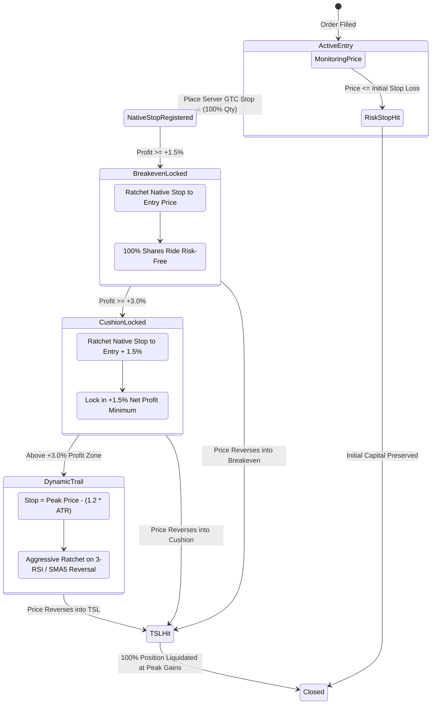

# System Architecture: 3x & 5x Leveraged Quantitative Trading Engine

> **Autonomous Multi-Agent Quantitative Trading System**  
> Engineered for European & London-listed leveraged Exchange Traded Products (ETPs) on Trading 212.  
> Powered by a pure **System 2 Deliberative Multi-Agent Brain & Meta-Learning** architecture (TechnicalAnalyst, FundamentalAnalyst, Dialectic Arbiter, RiskManager), backed by crash-resilient native broker execution, SQLite WAL candle caching, and 24/7 Raspberry Pi runner telemetry.

---

## 1. Executive Summary & Scale Metrics

The platform monitors global equities, broad market indices, sovereign bonds, commodities, and thematic frontier assets, executing leveraged spot ETP positions with zero borrowing fees.

### Platform Scale at a Glance

| Dimension | Metric | Engineering Highlight |
| :--- | :--- | :--- |
| **Monitored Universe** | **120+ Curated Pairs** | 3x & 5x leverage covering Tech, Indices, FX, Bonds, Commodities, Frontier Tech |
| **Currency Preference** | **82%+ EUR Natively** | EUR-first policy eliminating FX currency conversion fees for EU accounts |
| **Ingestion Latency** | **<10ms Triage** | Parallel multi-worker async pipeline + local SQLite WAL candle database |
| **Cognitive Framework** | **Deliberative Multi-Agent Brain** | Pure System 2 Multi-Agent Dialectic (Technical + Fundamental + Sentiment + Forecast) without speculative bypass |
| **Quantitative Strategy** | **Directional Trend (Sole Strategy)** | Isolated pluggable Strategy Engine (`trading_system/strategies/`); DMI (+DI/-DI) polarity gating + 20/50 EMA slope hierarchy + Dual-Track Bear execution |
| **Risk Containment** | **9 Multi-Layer Gates** | Circuit breaker (-2% equity), 15m opening auction buffer, spread gate (<1.0%), drift gate (<1.5%), 48h earnings blackout |
| **Execution Safety** | **Crash-Proof Native GTC** | Native broker-side GTC Stops placed immediately at fill + single order 100% quantity protection |
| **Target Lifecycle** | **100% Pure Trailing Stop Loss** | Progressive ratchets (+1.5% Breakeven, +3.0% Cushion, ATR Chandelier Trail) with 100% quantity ride (0% TP limits / trims) |
| **Overnight Policy** | **16:20 UTC Protocol** | Asymmetric gap isolation: intraday shorts flatten; winners with breakeven/cushion stops carry |
| **Statistical Edge** | **Sharpe 3.40 / PF 6.86 / WR 75%** | Verified walk-forward benchmark simulator across curated 3x leveraged universe |
| **Order Reconciliation**| **Pre-Flight Queue Purge** | Automatically cancels stale market orders (>300s or closed market) and deduplicates in-flight entries |
| **Test Verification** | **437 Automated Tests (100% Pass)** | Comprehensive unit and opaque-box E2E suites passing with zero regressions |
| **Deployment** | **24/7 Hardened Linux Daemon** | Raspberry Pi 5 runner via `systemd`, SSE live dashboard, atomic state persistence |

---

## 2. High-Level System Architecture

The following diagram illustrates the complete end-to-end data flow, cognitive routing, risk gating, and execution topology:

```mermaid
flowchart TD
    subgraph Market Data Mesh
        T212_API["Trading 212 REST API\n(Live Quotes & Orders)"]
        YFIN["Yahoo Finance\n(Historical Daily OHLCV)"]
        FINN["Finnhub Provider\n(Fundamentals & News)"]
        OLO["Olostep Provider\n(Real-time Web Sentiment)"]
        NIX["Nixtla TimeGPT\n(5-Day Forecast)"]
        CANDLE_DB[("SQLite WAL Cache\ndata/candles.db\n(Incremental Delta Sync)")]
    end

    subgraph Universe Ingestion & Pre-Filtering
        UNIV["LeveragedUniverse\n(120+ 3x/5x Curated Pairs)"] --> PARALLEL["Parallel Ingestion Engine\n(24 Thread Workers)"]
        CANDLE_DB --> PARALLEL
        T212_API --> PARALLEL
        PARALLEL --> SCREENER["Candidate Pre-Filter & Strategy Engine\n(Directional Trend: DMI Polarity + 20/50 EMA Slope)"]
        SCREENER --> CANDIDATES["Qualified Universe Candidates\n(Top N Ranked Directional Setups)"]
    end

    subgraph System 2: Deliberative Multi-Agent Brain
        CANDIDATES --> DEEP_DEBATE["Deliberative Multi-Agent Debate\n(DebateEngine / TradingAgents Graph)"]
        
        DEEP_DEBATE --> TECH_AGENT["TechnicalAnalyst\n(Multi-Timeframe RSI/SMA)"]
        DEEP_DEBATE --> FUND_AGENT["FundamentalAnalyst\n(Finnhub / Olostep / Nixtla)"]
        DEEP_DEBATE --> AGY_AGENT["Antigravity Agentic SDK\n(Autonomous Reasoning)"]
        
        FINN --> FUND_AGENT
        OLO --> FUND_AGENT
        NIX --> FUND_AGENT
        
        TECH_AGENT --> DEBATE_SYNTH["Dialectic Consensus Synthesis\n(Consensus Decision & Conviction Score)"]
        FUND_AGENT --> DEBATE_SYNTH
        AGY_AGENT --> DEBATE_SYNTH
    end

    subgraph Quantitative Risk Management
        DEBATE_SYNTH --> RISK_MGR["RiskManager\n(0.5% Equity Risk / Kelly ATR Sizing)"]
        
        RISK_MGR --> GATES{"Pre-Trade Safety Gates\n- Daily Drawdown (-2.0%)\n- 15m Opening Auction Settlement Buffer\n- Pre-Trade Live Spread Gate (<1.00%)\n- Stale Overnight Drift Gate (<1.50%)\n- Stop Invariant Gate (Stop < Price)\n- 48h Earnings Blackout\n- Direction Gate (No Long on Short)\n- Synthetic Data Gate"}
        GATES -->|Pass| CARD["DecisionCard\n(Validated Order Intent)"]
        GATES -->|Fail| REJECT["Order Rejected / Logged\n(Safety Violation Prevented)"]
    end

    subgraph Hybrid Broker Execution
        CARD --> ORCH["Orchestrator Engine\n(Pre-Flight Order Queue Reconciliation & Deduplication)"]
        ORCH --> T212_EXEC["Trading 212 Client\n(Spot Market Order Q > 0)"]
        T212_EXEC --> BROKER_STOP["Broker Server Stop Order\n(POST /equity/orders/stop GTC)"]
        T212_EXEC --> POS_MON["PositionMonitor\n(Lifecycle Manager)"]
        BROKER_STOP --> POS_MON
    end

    subgraph Position Lifecycle & Dynamic Ratchets
        POS_MON --> TICK_EVAL["Live Tick Monitor\n(Every 10 Seconds)"]
        TICK_EVAL -->|Gain >= +1.5%| BE_ACT["Move SL to Breakeven\n(100% Shares Intact)"]
        TICK_EVAL -->|Gain >= +3.0%| CUSH_ACT["Lock +1.5% Profit Cushion\n(100% Shares Intact)"]
        TICK_EVAL -->|Trailing Zone| DYN_ACT["Dynamic ATR Chandelier Trail\n(Behind Trend Peak / Trough)"]
        BE_ACT --> SYNC_STOP["Sync Native GTC Stop on T212\n(Cancel Old & Post Tightened Stop)"]
        CUSH_ACT --> SYNC_STOP
        DYN_ACT --> SYNC_STOP
        TICK_EVAL -->|Price <= TSL| EXIT_ACT["100% Liquidation via TSL\n(Full Capital Preserved)"]
        TICK_EVAL -->|16:20 UTC| ASYM_GAP["Asymmetric Session Gap Protocol\n(Flatten Shorts & Unprotected Longs)"]
    end

    subgraph Telemetry, Presentation & State
        POS_MON --> ATOMIC_STATE[("active_trades.json\n(Atomic Tempfile Sync)")]
        POS_MON --> TRADE_LOGS[("trades.jsonl & notifications.jsonl")]
        POS_MON --> DASH_SERVER["Embedded Dashboard Server\n(Port 8080 Multi-Threaded HTTP)"]
        DASH_SERVER --> SSE_STREAM["SSE Stream /api/live\n(1-Second Real-Time Telemetry)"]
        DASH_SERVER --> UI["signals_dashboard.html\n(Live P&L, 2-Line Alerts, Stops)"]
        POS_MON --> NOTIFIER["Notifier System\n(Desktop, Telegram, Webhooks)"]
        META_AGENT["StrategyImprovementAgent\n(Autonomous Meta-Learner)"] --> TRADE_LOGS
        META_AGENT -->|Dynamic Calibration| SCREENER
    end
```

---

## 3. Subsystem Deep Dive

### 3.1 Market Data Mesh & SQLite WAL Persistence

The market data layer is decoupled into specialized providers with a persistent SQLite write-ahead log (WAL) database, drastically reducing external API usage and latency.

* **`trading_system/data/candle_db.py`**:
  * Manages `data/candles.db` using SQLite with `PRAGMA journal_mode=WAL` and `PRAGMA synchronous=NORMAL`.
  * **Incremental Delta Fetch**: Checks `MAX(timestamp)` for each asset and interval (1m, 5m, 15m, 1h, 1d). Only queries external APIs for candles created *after* the latest stored candle, saving 90%+ of network bandwidth and preventing rate-limiting.
  * Handles duplicate avoidance via `INSERT OR REPLACE INTO candles`.
* **`trading_system/data/trading212_client.py`**:
  * High-resilience REST client with sliding-window rate limit management (`.t212_rate_limit.json`), preventing broker API lockouts.
  * Disk caching of instrument metadata (`.t212_instruments_cache.json`).
  * Live bid-ask spread inspection, portfolio retrieval, and market session verification.
* **Provider Enrichment Suite**:
  * **`finnhub_provider.py`**: Pulls quarterly financial metrics, earnings surprise percentages, and 7-day company headlines.
  * **`olostep_provider.py`**: Searches recent real-time web discussions, returning aggregated sentiment scores.
  * **`nixtla_provider.py`**: Zero-shot deep neural forecasting (`TimeGPT`), returning a 5-day projected price path and expected percentage return.

---

### 3.2 Leveraged Asset Universe & Currency Engine

* **`trading_system/data/leveraged_universe.py`**:
  * Contains **120+ curated pairs** mapped to underlying global assets across 8 distinct thematic clusters:
    1. **US Mega-Tech & AI Infrastructure**: `NVDA`, `MSFT`, `AAPL`, `GOOGL`, `AMZN`, `META`, `TSLA`, `AMD`, `AVGO`, `ARM`, `SMCI`, `PLTR`, `TSM`.
    2. **Broad & Sector Indices**: 5x & 3x `QQQ`, `SPY`, `IWM`, `DIA`, `SOXX`, `SMH`, `XLF`, `XLE`, `XLV`, `XLI`.
    3. **Global National Benchmarks**: `DAX`, `CAC`, `FTSE`, `MIB`, `IBEX`, `AEX`, `SMI`, `N225`, `HSI`, `KOR`, `INDA`, `EWT`.
    4. **Hard Commodities & Energy**: 5x & 3x `GLD`, `SLV`, `USO`, `UNG`, `WTI`, `URNM`/`URA`, `CPER`, `WEAT`, `COFF`.
    5. **Sovereign Fixed Income**: 5x & 3x `TLT`, `IEF`, `BTP`, `BUND`, `GILT`, `HYG`.
    6. **Quantum Computing & Frontier Tech**: `IONQ`, `RGTI`, `QBTS`, `RKLB`, `LUNR`, `OKLO`, `SMR`, `CRWV`.
    7. **Crypto Thematics**: `BTC`, `ETH`, `SOL`, `MSTR`, `COIN`, `MARA`, `IREN`.
  * **5x Priority Policy**: If an asset supports 5x leverage (e.g. `QQQ`, `SPY`, `GLD`, `TLT`), 5x leverage completely supersedes 3x leverage (`available_leverage=[5]`).
  * **EUR-First Preference Policy**: Prioritizes European exchange listings to eliminate currency exchange fees for Euro accounts.
  * **Authoritative Direction Resolution (`get_etp_direction`)**: Automatically identifies whether an execution ticker is an inverse `SHORT` (e.g. `QQQSm_EQ`, `3SVEl_EQ`) or a spot `LONG` (e.g. `IONQl1_EQ`, `3LVEl_EQ`).
  * **Spot ETP Trading Dynamics**: Enforces spot mechanics on Trading 212 Invest—all assets are purchased long ($Q > 0$). Inverse ETPs rise when the underlying falls; software never inverts P&L calculations.

---

### 3.3 Pluggable Strategy Engine & Directional Trend Layer

* **`trading_system/strategies/`**:
  * **Abstract Strategy Protocol (`base.py`)**:
    * Introduces `@runtime_checkable` `BaseStrategy` Protocol with `evaluate_candidate(ticker: str, metrics: Dict[str, Any]) -> StrategySignal`.
    * Encapsulates candidate evaluation into `StrategySignal` (`direction`, `conviction`, `setup_quality`, `bull_evidence`, `bear_evidence`, `catalyst_risk`). Decouples strategy mathematics from the screener and multi-agent debate.
  * **Central Strategy Registry (`registry.py`)**:
    * Provides `@StrategyRegistry.register("name")` factory, allowing zero-touch strategy swapping via `ACTIVE_STRATEGY = "directional_trend"` in `config.py`.
* **Directional Trend Strategy (`directional_trend.py`)**:
  * **Directional Movement Index (DMI) Polarity Gating**:
    * Evaluates dominant directional pressure: $+DI > -DI$ with $ADX \ge 18.0$ for Longs; $-DI > +DI$ with $ADX \ge 18.0$ for Shorts.
    * Eliminates non-directional momentum errors where crashing assets previously awarded ADX strength to the bullish case.
  * **Multi-Timeframe 20/50 EMA Slope Hierarchy**:
    * Long entries strictly require: $\text{Close} > 50\text{ EMA}$, $20\text{ EMA} \ge 50\text{ EMA}$, and positive 5-day slope ($\text{slope}_{20} > 0\%$).
    * Macro trend tailwind: $\text{Close} > 200\text{ SMA}$.
    * Eliminates counter-trend knife catching: forbidding dip buying into sustained intermediate downtrends.
  * **MACD Divergence Conflict Gating**:
    * Rejects long entries when MACD line is below signal line (`macd < macd_signal`); rejects short entries when MACD is above signal line (`macd > macd_signal`).
  * **Dual-Track Bear Regime Execution**:
    * **Broad Benchmark Indices** (`QQQ`, `SPY`, `SMH`, `3USL`, `QQQ3`, `STOXX`): Routed to 3x Inverse Short ETPs (`QQQS`, `3USS`, `3SES`).
    * **Single Equities** (`TSLA`, `NVDA`, `AAPL`, `COIN`): Routed to 100% Cash Defense (`direction = "NEUTRAL"`), completely eliminating short borrow fees and single-stock squeeze risk.
  * **Complete Removal of Alternative Strategies**:
    * Connors 3-RSI mean reversion and legacy Donchian momentum heuristics have been completely removed from the production codebase. The screener and debate brain focus 100% of allocation on confirmed directional trends.
* **`trading_system/screener/laya_screener.py`**:
  * Runs concurrent multi-threaded scans across all universe assets every 60 seconds (24 parallel thread workers).
  * `LayaScreener` and `TechnicalFallbackScreener` delegate candidate evaluation directly to `DirectionalTrendStrategy`, populating `strategy_signal` on every `ScreenerResult`.
  * **Zero Bypass Policy**: All qualified setups are forwarded to System 2 deliberation; fast-reflex bypass shortcuts remain strictly eliminated.

---

### 3.4 System 2: Deliberative Multi-Agent Brain & Meta-Learning

* **`trading_system/agents/debate_engine.py`**:
  * **Unified Deliberative Dialectic Debate**: 100% of candidate setups undergo deep multi-agent deliberation:
    * **`technical_agent.py`**: Analyzes multi-timeframe RSIs, Bollinger Bands, ATR volatility, volume spikes, and support/resistance structure.
    * **`fundamental_agent.py`**: Evaluates corporate fundamentals, Finnhub sentiment, Olostep headlines, and 48-hour earnings blackout proximity.
    * **`debate_engine.py`**: Synthesizes technical and fundamental signals through deterministic dialectic synthesis to establish consensus conviction without speculative bypass.
* **`trading_system/agents/strategy_improvement_agent.py`**:
  * Autonomous meta-learning agent inspecting `trades.jsonl` performance and cycle yields.
  * Detects pipeline starvation (e.g. 3 consecutive zero-signal cycles during low-volatility regimes) and suggests adaptive parameter tuning (e.g., broadening RSI3 threshold from 22 to 25 or lowering ADX gate to 18).

---

### 3.5 Institutional Risk Management & Safety Gates

* **`trading_system/agents/risk_manager.py`**:
  * **Strict Volatility-Scaled Sizing**:
    $$\text{Shares} = \frac{\text{Equity} \times 0.5\%}{\text{ATR Stop Distance}}$$
    Constrained by maximum position notional ($\le 20\%$ of equity) and broker minimum trade sizes.
  * **The 9 Non-Negotiable Safety Gates**:
    1. **Daily Drawdown Circuit Breaker**: If equity drops $\ge 2.0\%$ from session start, triggers emergency system halt and halts new order submission.
    2. **15-Minute Market Opening Auction Settlement Buffer**: Blocks new trade execution during 08:00–08:15 UTC (European / LSE markets) and 14:30–14:45 UTC (US markets) to allow opening auctions to uncross and spreads to settle, eliminating immediate opening stop-outs.
    3. **Pre-Trade Real-Time Bid-Ask Spread Gate (< 1.00%)**: Queries real-time broker spread immediately prior to order submission; rejects orders if spread exceeds $1.00\%$ to prevent adverse selection and slippage.
    4. **Stale Overnight Price Drift Gate (< 1.50%)**: Validates live broker quote against candidate setup entry price. Rejects orders if price has drifted $> 1.50\%$ due to overnight gaps. If drift $\le 1.50\%$, recalibrates entry price and stop loss to live market quote.
    5. **Stop Invariant Protection Gate**: Strictly asserts that for spot holdings, Stop Loss must be strictly below current market price and resting bid ($P_{\text{stop}} < P_{\text{bid}}$). Prevents submitting inverted stops that would trigger instant market liquidation.
    6. **Pre-Trade Earnings Blackout Gate**: Rejects trades if company earnings are scheduled within $\le 48\text{ hours}$ (eliminates binary earnings-gap risk).
    7. **Direction Integrity Safety Gate**: Validates that a `SHORT` signal maps to an inverse short ETP. Forbids buying a Long ETP on a Short signal. Rejects trades if no short ETP exists.
    8. **Synthetic Market Data Gate**: Intercepts and aborts live broker execution if incoming price feeds were generated synthetically (dry-run simulation only).
    9. **Market Session Hours Gate**: Rejects orders if the destination exchange (LSE, Euronext, Xetra) is currently closed.

---

### 3.6 Hybrid Broker Execution & Position Lifecycle

* **`trading_system/execution/position_monitor.py`**:
  * **Native Broker Stop-Loss Orders**: At the exact second an entry order fills, a server-side Stop Order (`POST /equity/orders/stop`) is registered directly with Trading 212 with Good-Till-Cancel (GTC) expiry protecting **100% of shares**.
  * **100% Pure Trailing Stop Loss Engine**:



* **Complete Elimination of Take Profit Targets (TP1 / TP2 / TP3)**:
  * Static profit milestones (TP1 +1.0R, TP2 +2.0R, TP3 +3.0R) and partial profit trims (50% / 25% / 25%) have been completely excised from the production engine.
  * In leveraged momentum trading, capping winners early at arbitrary multiples truncates the right-tail return distribution, while placing broker-side TP limit orders creates severe order contention (`Trading 212 Error 400: Selling more equities than owned`).
  * The architecture now relies exclusively on **100% Pure Trailing Stop Loss (TSL)**:
    1. **Phase 1: Capital Defense**: Server-side GTC stop loss placed immediately upon fill at entry $- 2.2 \times \text{ATR}$ (capped at 3.0% max stop distance).
    2. **Phase 2: Breakeven Lock (+1.5% Gain)**: Once unrealized profit reaches $+1.5\%$, the stop loss ratchets to `entry_price`, guaranteeing a risk-free trade while keeping 100% of shares intact.
    3. **Phase 3: Profit Cushion Lock (+3.0% Gain)**: Once unrealized profit reaches $+3.0\%$, the stop loss ratchets to `entry_price * 1.015`, locking in $+1.5\%$ minimum net profit on 100% of the position.
    4. **Phase 4: Dynamic ATR Chandelier Trail (> +3.0% Gain)**: Above $+3.0\%$, the stop trails behind peak market prices ($P_{\text{peak}} - 1.2 \times \text{ATR}$), continuously ratcheting upward on new highs and never loosening.
    5. **100% Position Liquidation**: The position runs until the market reverses into the tightened broker GTC stop, banking maximal trend gains.
* **Broker Order Contention Elimination**:
  * Resolves Trading 212 Invest API restriction where simultaneous stop and limit orders on identical shares produce `400 Bad Request: 'Selling more equities than owned'`.
  * All shares are protected under a single server-side GTC Stop Order that updates monotonically.
* **16:20 UTC Asymmetric Session Gap Protocol (Winter Time / GMT)**:
  * Evaluates all open positions daily at 16:20 UTC using `Europe/London` ZoneInfo.
  * **Intraday Shorts**: Automatically flattened at 16:20 UTC to prevent overnight gap risk and leveraged compounding decay.
  * **Winners with Locked Stops**: Long positions that reached Breakeven (`TSL >= Entry`) are approved for overnight carry.
  * **Pre-Earnings Run-Up Radar**: Carries positions 1 to 21 days before earnings if the trade is profitable with a locked stop.
* **Auto-Healing Broker Reconciliation**:
  * Runs every tick to reconcile local state with actual broker portfolio.
  * Detects external app closes, auto-restores expired stop orders, adopts untracked positions, and repairs scale mismatches (e.g. GBX pence vs EUR).
* **Pre-Flight Broker Order Queue Reconciliation & Deduplication**:
  * `Orchestrator.reconcile_pending_orders()` runs at the start of every quantitative cycle.
  * Queries `Trading212Client.get_orders(force_refresh=True)` to inspect resting broker orders.
  * Automatically cancels stale `MARKET` orders in `NEW`/`LOCAL` status if order age $> 300\text{s}$ or if the underlying exchange is closed.
  * Tracks pending tickers in `Orchestrator.in_flight_tickers` and asserts deduplication checks in `execute_trade()` to prevent submitting duplicate entries while an order is in-flight.

---

### 3.7 Embedded Real-Time Telemetry & SSE Dashboard

* **`trading_system/dashboard/server.py`**:
  * Embedded multi-threaded HTTP server running directly inside the orchestrator process on port 8080 (or 8888).
  * **Server-Sent Events (SSE) `/api/live`**: Pushes 1-second live telemetry updates to connected browsers with zero page reloading.
  * **Fast TTL Cached `/api/data` Endpoint**: Serves active signals, broker status, monitored watchlist, and live broker execution history with a 2.5-second lock cache to prevent broker API rate-limiting.
  * **Accurate 2-Line Alert History**:
    * Line 1: Real broker quantity (e.g., `1.00 shs`).
    * Line 2: Realized financial profit/loss and true percentage return (e.g., `-€2.00 (-7.25%)` or `Open Entry`), calculated from broker wallet impact net values.
  * **Authoritative Multi-Currency Display**: Seamlessly formats British Pence (`GBX` / `p`), Euros (`EUR` / `€`), and US Dollars (`USD` / `$`).

---

### 3.8 Production 24/7 Raspberry Pi Runner

The trading engine runs 24/7 autonomously on a dedicated local hardware runner:

* **Hardware Host**: Raspberry Pi 5 (`192.168.68.50`, hostname `trading212-pi`).
* **Operating System**: Debian GNU/Linux 13 (Trixie/Linux 6.18 arm64).
* **System Daemon**: Managed via Linux `systemd` service (`trading-bot.service`):
  * Command: `/home/shahpratik11/modest-bose/venv/bin/python3 -m trading_system.orchestrator --interval 5 --monitor-interval 10 --dashboard-port 8080`
  * Auto-restarts on unexpected termination (`Restart=always`, `RestartSec=5`).
* **Automated Deployment Pipeline**:
  * `scripts/deploy_to_pi.sh`: Single-command deployment syncing codebase via `rsync`, updating dependencies, and performing zero-downtime service restart.
  * `scripts/fetch_live_state.sh`: Synchronizes remote runner state back to local dev machine for offline audit.

---

## 4. Architectural Invariants & Guarantees

1. **Zero Unhedged Short Selling**: On Trading 212 Invest, direct stock shorting is impossible. Short signals strictly execute by buying spot Inverse Short ETPs ($Q > 0$). If no inverse ETP exists, the trade is rejected.
2. **Deterministic P&L Truth**: All positions are spot holdings; P&L is always $(P_{\text{live}} - P_{\text{entry}}) \times Q$. Price drops are financial losses; price gains are profits.
3. **Server-Side Capital Preservation**: Every executed order immediately registers a native GTC stop order on broker servers, preventing catastrophic losses during local power or network failure.
4. **100% Position Protection & Zero Order Contention**: 100% of shares ride favorable trends under a single server-side GTC Stop Order without competing TP limit orders, eliminating broker order collisions while progressive ratchets lock in gains (+1.5% Breakeven, +3.0% Cushion, ATR Chandelier trail).
5. **Session Isolation**: Intraday shorts and non-breakeven positions flatten at 16:20 UTC, preventing overnight gap risk and leveraged ETP volatility drag.
6. **Continuous Auto-Healing**: Local state continuously reconciles against broker reality, automatically correcting stale orders, scale discrepancies, and direction mismatches.
7. **Pre-Flight Order Queue Reconciliation**: Open broker market orders are audited at the start of every cycle. Resting orders >300s old or submitted when markets are closed are actively cancelled, preventing duplicate order placement and stranded capital.
