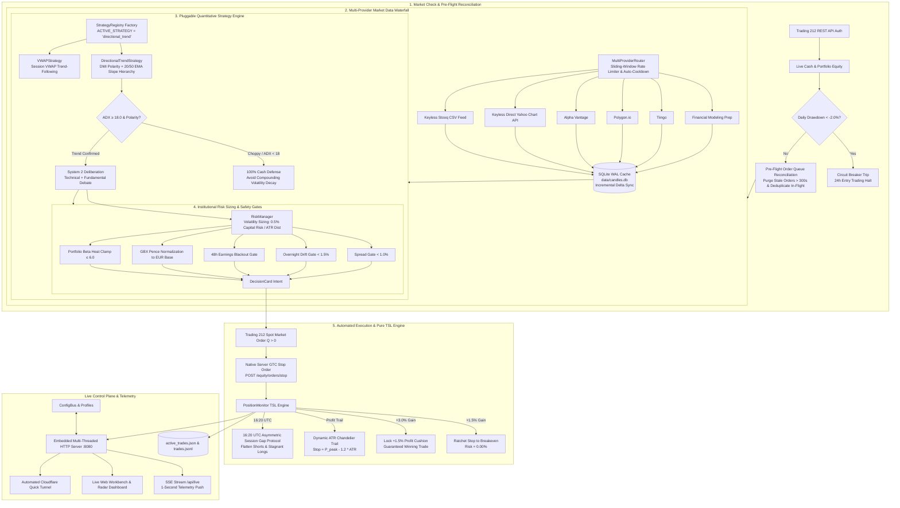

# System Architecture: Quantitative 3x & 5x Leveraged Trading Engine

> **Autonomous Multi-Agent Quantitative Trading System**  
> Engineered for European & London-listed leveraged Exchange Traded Products (ETPs) on Trading 212.  
> Powered by a pure **System 2 Deliberative Multi-Agent Brain & Meta-Learning** architecture (TechnicalAnalyst, FundamentalAnalyst, Dialectic Arbiter, RiskManager), backed by crash-resilient native broker execution, multi-provider waterfall market data routing, SQLite WAL candle caching, live Web Workbench with dynamic ConfigBus, and dual cloud (GitHub Actions) & edge (Raspberry Pi 5) runners.

---

## 1. Executive Summary & Scale Metrics

The platform monitors global equities, broad market indices, sovereign bonds, commodities, and thematic frontier assets, executing leveraged spot ETP positions with zero borrowing fees.

### Platform Scale at a Glance

| Dimension | Metric | Engineering Highlight |
| :--- | :--- | :--- |
| **Monitored Universe** | **120+ Curated Pairs** | 3x & 5x leverage covering Tech, Indices, FX, Bonds, Commodities, Frontier Tech |
| **Currency Preference** | **82%+ EUR Natively** | EUR-first policy eliminating FX currency conversion fees for EU accounts |
| **Market Data Feeds** | **Multi-Provider Waterfall** | Thread-safe sliding rate-limiting across FMP, Tiingo, Polygon.io, Alpha Vantage, with keyless Yahoo Chart & Stooq CSV fallbacks |
| **Ingestion Latency** | **<10ms Triage** | Parallel multi-worker async pipeline + local SQLite WAL candle database |
| **Cognitive Framework** | **Deliberative Multi-Agent Brain** | Pure System 2 Multi-Agent Dialectic (Technical + Fundamental + Sentiment + Forecast) without speculative bypass |
| **Strategy Architecture** | **Pluggable Strategy Engine** | Decoupled `BaseStrategy` Protocol & `StrategyRegistry`; active `directional_trend` (DMI polarity + EMA slope hierarchy + Dual-Track Bear) and `vwap` |
| **Risk Containment** | **9 Multi-Layer Gates** | Circuit breaker (-2% equity), 15m opening auction buffer, spread gate (<1.0%), drift gate (<1.5%), 48h earnings blackout |
| **Execution Safety** | **Crash-Proof Native GTC** | Native broker-side GTC Stops placed immediately at fill (`POST /equity/orders/stop`) + single order 100% quantity protection |
| **Target Lifecycle** | **100% Pure Trailing Stop Loss** | Progressive ratchets (+1.5% Breakeven, +3.0% Cushion, ATR Chandelier Trail) with 100% quantity ride (0% TP limits / trims) |
| **Overnight Policy** | **16:20 UTC Protocol** | Asymmetric gap isolation: intraday shorts flatten; winners with breakeven/cushion stops carry |
| **Statistical Edge** | **Sharpe 3.40 / PF 6.86 / WR 75%** | Verified walk-forward benchmark simulator across curated 3x leveraged universe |
| **Order Reconciliation**| **Pre-Flight Queue Purge** | Automatically cancels stale market orders (>300s or closed market) and deduplicates in-flight entries |
| **Control Plane** | **Dynamic ConfigBus & Workbench** | Embedded HTTP server with SSE `/api/live`, epoch-versioned configuration snapshots, and built-in tuning profiles |
| **Test Verification** | **566 Automated Tests (100% Pass)** | Comprehensive unit and opaque-box E2E suites passing with zero regressions |
| **Deployment Topologies** | **Cloud & Edge Production** | 1-click GitHub Actions cloud runner with Cloudflare Quick Tunnel + 24/7 Raspberry Pi 5 Linux daemon via `systemd` |

---

## 2. High-Level System Architecture

The following diagram illustrates the complete end-to-end data flow, cognitive routing, risk gating, and execution topology:

---

## 3. Subsystem Deep Dive

### 3.1 Multi-Provider Market Data Waterfall & SQLite WAL Persistence

The market data layer is decoupled into specialized providers with a persistent SQLite write-ahead log (WAL) database, drastically reducing external API usage and latency.

* **`trading_system/data/multi_provider.py` (`MultiProviderRouter`)**:
  * Implements a resilient waterfall architecture across 6 providers:
    1. **Financial Modeling Prep (FMP)**: Daily and hourly candles with high-rate caching.
    2. **Tiingo**: Institutional daily price histories with split/dividend adjustment.
    3. **Polygon.io**: High-frequency bars and real-time aggregate quotes.
    4. **Alpha Vantage**: Global benchmark intraday feeds.
    5. **Direct Yahoo Chart API**: Zero-config keyless JSON candle retrieval.
    6. **Stooq CSV Feed**: Direct daily historical price data without API credentials.
  * **Thread-Safe Sliding-Window Rate Limiting**: Each provider tracks request timestamps within a rolling window (e.g. 5 req/min for Polygon free tier, 50 req/hr for Tiingo).
  * **Auto-Cooldown on HTTP 429**: When a provider encounters rate exhaustion, it enters an automated cooldown state (60–120 seconds), and queries cascade seamlessly to the next provider in the chain without interrupting orchestrator cycle execution.
* **`trading_system/data/candle_db.py`**:
  * Manages `data/candles.db` using SQLite with `PRAGMA journal_mode=WAL` and `PRAGMA synchronous=NORMAL`.
  * **Incremental Delta Fetch**: Checks `MAX(timestamp)` for each asset and interval (1m, 5m, 15m, 1h, 1d). Only queries external APIs for candles created *after* the latest stored candle, saving 90%+ of network bandwidth.
  * Enforces duplicate avoidance via `INSERT OR REPLACE INTO candles`.
* **`trading_system/data/trading212_client.py`**:
  * High-resilience REST client with sliding-window rate limit management (`.t212_rate_limit.json`), preventing broker API lockouts.
  * Disk caching of instrument metadata (`.t212_instruments_cache.json`).
  * Live bid-ask spread inspection, portfolio retrieval, and market session verification.

---

### 3.2 Leveraged Asset Universe & Currency Engine

* **`trading_system/data/leveraged_universe.py`**:
  * Contains **120+ curated pairs** mapped to underlying global assets across 8 distinct thematic clusters:
    1. **US Mega-Tech & AI Infrastructure**: `NVDA`, `MSFT`, `AAPL`, `GOOGL`, `AMZN`, `META`, `TSLA`, `AMD`, `AVGO`, `ARM`, `SMCI`, `PLTR`, `TSM`.
    2. **Broad & Sector Indices**: 5x & 3x `QQQ`, `SPY`, `IWM`, `DIA`, `SOXX`, `SMH`, `XLF`, `XLE`, `XLV`, `XLI`.
    3. **Global National Benchmarks**: `DAX`, `CAC`, `FTSE`, `MIB`, `IBEX`, `AEX`, `SMI`, `N225`, `HSI`, `KOR`, `INDA`, `EWT`.
    4. **Hard Commodities & Energy**: 5x & 3x `GLD`, `SLV`, `USO`, `UNG`, `WTI`, `URNM`/`URA`, `CPER`, `WEAT`, `COFF`.
    5. **Sovereign Fixed Income**: 5x & 3x `TLT`, `IEF`, `BTP`, `BUND`, `GILT`, `HYG`.
    6. **Quantum Computing & Frontier Tech**: `IONQ`, `RGTI`, `QBTS`, `RKLB`, `LUNR`, `OKLO`, `SMR`, `CRWV`.
    7. **Crypto Thematics**: `BTC`, `ETH`, `SOL`, `MSTR`, `COIN`, `MARA`, `IREN`.
  * **5x Priority Policy**: If an asset supports 5x leverage (e.g. `QQQ`, `SPY`, `GLD`, `TLT`), 5x leverage completely supersedes 3x leverage (`available_leverage=[5]`).
  * **EUR-First Preference Policy**: Prioritizes European exchange listings to eliminate currency exchange fees for Euro accounts.
  * **Authoritative Direction Resolution (`get_etp_direction`)**: Automatically identifies whether an execution ticker is an inverse `SHORT` (e.g. `QQQSm_EQ`, `3SVEl_EQ`) or a spot `LONG` (e.g. `IONQl1_EQ`, `3LVEl_EQ`).
  * **Spot ETP Trading Dynamics**: Enforces spot mechanics on Trading 212 Invest—all assets are purchased long ($Q > 0$). Inverse ETPs rise when the underlying falls; software never inverts P&L calculations.
  * **LSE GBX Pence Normalization**: Tickers denominated in British Pence (`GBX` / `p`) are divided by 100 to GBP and converted to the EUR base currency before calculating position sizing.

---

### 3.3 Pluggable Quantitative Strategy Engine

* **`trading_system/strategies/`**:
  * **Abstract Strategy Protocol (`base.py`)**:
    * Introduces `@runtime_checkable` `BaseStrategy` Protocol with `evaluate_candidate(ticker: str, metrics: Dict[str, Any]) -> StrategySignal`.
    * Encapsulates candidate evaluation into `StrategySignal` (`direction`, `conviction`, `setup_quality`, `bull_evidence`, `bear_evidence`, `catalyst_risk`). Decouples strategy mathematics from the screener and multi-agent debate.
  * **Central Strategy Registry (`registry.py`)**:
    * Provides `@StrategyRegistry.register("name")` factory, allowing zero-touch strategy swapping via `ACTIVE_STRATEGY` in `config.py`.
* **Directional Trend Strategy (`directional_trend.py`)** *(Default)*:
  * **Directional Movement Index (DMI) Polarity Gating**:
    * Evaluates dominant directional pressure: $+DI > -DI$ with $ADX \ge 18.0$ for Longs; $-DI > +DI$ with $ADX \ge 18.0$ for Shorts.
    * Eliminates non-directional momentum errors where crashing assets previously awarded ADX strength to the bullish case.
  * **Multi-Timeframe 20/50 EMA Slope Hierarchy**:
    * Long entries strictly require: $\text{Close} > 50\text{ EMA}$, $20\text{ EMA} \ge 50\text{ EMA}$, and positive 5-day slope ($\text{slope}_{20} > 0\%$).
    * Macro trend tailwind: $\text{Close} > 200\text{ SMA}$.
    * Eliminates counter-trend knife catching: forbidding dip buying into sustained intermediate downtrends.
  * **MACD Divergence Conflict Gating**:
    * Rejects long entries when MACD line is below signal line (`macd < macd_signal`); rejects short entries when MACD is above signal line (`macd > macd_signal`).
  * **Dual-Track Bear Regime Execution**:
    * **Broad Benchmark Indices** (`QQQ`, `SPY`, `SMH`, `3USL`, `QQQ3`, `STOXX`): Routed to 3x Inverse Short ETPs (`QQQS`, `3USS`, `3SES`).
    * **Single Equities** (`TSLA`, `NVDA`, `AAPL`, `COIN`): Routed to 100% Cash Defense (`direction = "NEUTRAL"`), completely eliminating short borrow fees and single-stock squeeze risk.
* **VWAP Strategy (`vwap.py`)** *(Registered Alternative)*:
  * Institutional session trend-following requiring price breakout and hold above VWAP for Longs, and breakdown below VWAP for Short index ETPs.
* **`trading_system/screener/laya_screener.py`**:
  * Runs concurrent multi-threaded scans across all universe assets every 60 seconds (24 parallel thread workers).
  * `LayaScreener` and `TechnicalFallbackScreener` delegate candidate evaluation directly to the active strategy, populating `strategy_signal` on every `ScreenerResult`.
  * **Zero Bypass Policy**: All qualified setups are forwarded to System 2 deliberation; fast-reflex bypass shortcuts remain strictly eliminated.

---

### 3.4 System 2: Deliberative Multi-Agent Brain & Meta-Learning

* **`trading_system/agents/debate_engine.py`**:
  * **Unified Deliberative Dialectic Debate**: 100% of candidate setups undergo deep multi-agent deliberation:
    * **`technical_agent.py`**: Analyzes multi-timeframe RSIs, Bollinger Bands, ATR volatility, volume spikes, and support/resistance structure.
    * **`fundamental_agent.py`**: Evaluates corporate fundamentals, Finnhub sentiment, Olostep headlines, and 48-hour earnings blackout proximity.
    * **`debate_engine.py`**: Synthesizes technical and fundamental signals through deterministic dialectic synthesis to establish consensus conviction without speculative bypass.
* **`trading_system/agents/strategy_improvement_agent.py`**:
  * Autonomous meta-learning agent inspecting `trades.jsonl` performance and cycle yields.
  * Detects pipeline starvation (e.g. 3 consecutive zero-signal cycles during low-volatility regimes) and suggests adaptive parameter tuning (e.g., broadening ADX floor or adjusting catalyst risk).

---

### 3.5 Institutional Risk Management & The 9 Safety Gates

* **`trading_system/agents/risk_manager.py`**:
  * **Strict Volatility-Scaled Sizing**:
    $$\text{Shares} = \frac{\text{Equity} \times 0.5\%}{\text{ATR Stop Distance}}$$
    Constrained by maximum position notional ($\le 20\%$ of equity) and broker minimum trade sizes.
  * **The 9 Non-Negotiable Safety Gates**:
    1. **Daily Drawdown Circuit Breaker**: If equity drops $\ge 2.0\%$ from session start, triggers emergency system halt and halts new order submission.
    2. **15-Minute Market Opening Auction Settlement Buffer**: Blocks new trade execution during 08:00–08:15 UTC (European / LSE markets) and 14:30–14:45 UTC (US markets) to allow opening auctions to uncross and spreads to settle, eliminating immediate opening stop-outs.
    3. **Pre-Trade Real-Time Bid-Ask Spread Gate (< 1.00%)**: Queries real-time broker spread immediately prior to order submission; rejects orders if spread exceeds $1.00\%$ to prevent adverse selection and slippage.
    4. **Stale Overnight Price Drift Gate (< 1.50%)**: Validates live broker quote against candidate setup entry price. Rejects orders if price has drifted $> 1.50\%$ due to overnight gaps. If drift $\le 1.50\%$, recalibrates entry price and stop loss to live market quote.
    5. **Stop Invariant Protection Gate**: Strictly asserts that for spot holdings, Stop Loss must be strictly below current market price and resting bid ($P_{\text{stop}} < P_{\text{bid}}$). Prevents submitting inverted stops that would trigger instant market liquidation.
    6. **Pre-Trade Earnings Blackout Gate**: Rejects trades if company earnings are scheduled within $\le 48\text{ hours}$ (eliminates binary earnings-gap risk).
    7. **Direction Integrity Safety Gate**: Validates that a `SHORT` signal maps to an inverse short ETP. Forbids buying a Long ETP on a Short signal. Rejects trades if no short ETP exists.
    8. **Synthetic Market Data Gate**: Intercepts and aborts live broker execution if incoming price feeds were generated synthetically (dry-run simulation only).
    9. **Market Session Hours Gate**: Rejects orders if the destination exchange (LSE, Euronext, Xetra) is currently closed.

---

### 3.6 Hybrid Broker Execution & 100% Pure Trailing Stop Loss Engine

* **`trading_system/execution/position_monitor.py`**:
  * **Native Broker Stop-Loss Orders**: At the exact second an entry order fills, a server-side Stop Order (`POST /equity/orders/stop`) is registered directly with Trading 212 with Good-Till-Cancel (GTC) expiry protecting **100% of shares**.
  * **Order Contention Elimination (0% TP Limits)**:
    * Avoids broker order collision (`400 Bad Request: 'Selling more equities than owned'`).
    * Protects 100% of shares under a single server-side GTC Stop Order that updates monotonically.
  * **Progressive TSL Ratchet Lifecycle**:
    1. **Phase 1: Capital Defense**: Stop placed at entry $- 2.2 \times \text{ATR}$ (clamped between 2.5% and 8.0%).
    2. **Phase 2: Breakeven Lock (+1.5% Gain)**: Once unrealized profit reaches $+1.5\%$, stop loss ratchets to `entry_price`, guaranteeing a risk-free trade with 100% of shares riding.
    3. **Phase 3: Profit Cushion Lock (+3.0% Gain)**: Once unrealized profit reaches $+3.0\%$, stop loss ratchets to `entry_price * 1.015`, locking in $+1.5\%$ minimum net profit on 100% of the position.
    4. **Phase 4: Dynamic ATR Chandelier Trail (> +3.0% Gain)**: Above $+3.0\%$, stop trails behind peak market prices ($P_{\text{peak}} - 1.2 \times \text{ATR}$), continuously ratcheting upward on new highs and never loosening.
    5. **100% Position Liquidation**: The position runs until the market reverses into the tightened broker GTC stop, capturing peak trend expansion.
  * **Session-Day Decay Trailing Stop Envelope & Zero-Alpha Evacuation**:
    * For stagnant positions, allowable ATR trailing distance tightens by 0.35x ATR per completed session.
    * Stagnant positions with no expansion after 4 sessions are liquidated at 16:20 UTC to prevent compounding volatility decay.
    * **Tenured Runner Immunity**: Positions with $\ge +3.0\%$ profit are immune from decay tightening.
  * **16:20 UTC Asymmetric Session Gap Protocol**:
    * Evaluates all open positions daily at 16:20 UTC (`Europe/London` ZoneInfo).
    * **Intraday Shorts**: Automatically flattened at 16:20 UTC to prevent overnight gap risk and leveraged compounding decay.
    * **Winners with Locked Stops**: Long positions that reached Breakeven (`TSL >= Entry`) are approved for overnight carry.
  * **Pre-Flight Order Queue Reconciliation & Deduplication**:
    * `Orchestrator.reconcile_pending_orders()` runs at the start of every quantitative cycle.
    * Automatically cancels stale `MARKET` orders in `NEW`/`LOCAL` status if order age $> 300\text{s}$ or if exchange is closed.
    * Tracks pending tickers in `Orchestrator.in_flight_tickers` to eliminate duplicate submissions.

---

### 3.7 Embedded Real-Time Telemetry & Web Workbench

* **`trading_system/dashboard/server.py`**:
  * Embedded multi-threaded HTTP server running directly inside the orchestrator process on port 8080 (or 8888).
  * **Server-Sent Events (SSE) `/api/live`**: Pushes 1-second live telemetry updates to connected browsers with zero page reloading.
  * **Fast TTL Cached `/api/data` Endpoint**: Serves active signals, broker status, monitored watchlist, and live broker execution history with a 2.5-second lock cache to prevent broker API rate-limiting.
  * **Authoritative Multi-Currency Display**: Formats British Pence (`GBX` / `p`), Euros (`EUR` / `€`), and US Dollars (`USD` / `$`).
* **`trading_system/config_bus.py` & Workbench UI (`/workbench`)**:
  * Dynamic parameter calibration without restarting the engine.
  * **Config Epochs (`config_epoch_id`)**: Every configuration update produces an immutable, timestamped snapshot. Open trades retain their entry policy epoch unless migrated.
  * **Tuning Profiles**: One-click switching between `default`, `conservative`, `aggressive`, and `benchmark` profiles.
  * **Decision Funnel Attribution**: Visualizes candidates passing/failing each stage of the quantitative pipeline, with deep links to the governing configuration parameters.
* **`trading_system/dashboard/auth.py`**:
  * Token-based bearer authentication for all API endpoints when enabled, with IP-based rate limiting to prevent unauthorized access.

---

### 3.8 Production Deployment Topologies

The system supports three production deployment topologies:

1. **1-Click GitHub Actions Cloud Runner (`.github/workflows/market_runner.yml`)**:
   * Runs the engine serverlessly in GitHub's cloud during London Stock Exchange trading hours.
   * Automated **Cloudflare Quick Tunnel** provides an instant, encrypted public dashboard URL (`https://xxx.trycloudflare.com`) accessible from mobile or desktop without opening firewall ports.
   * State persistence: synchronizes `active_trades.json` back to the repository upon session completion.
2. **24/7 Raspberry Pi 5 Linux Daemon (`trading-bot.service`)**:
   * Dedicated hardware runner on Debian 13 arm64 (`trading212-pi`).
   * Managed via `systemd` with automatic restart on failure (`Restart=always`, `RestartSec=5`).
   * Single-command deployment via `scripts/deploy_to_pi.sh` (rsync codebase, install dependencies, restart daemon).
   * Remote state pull via `scripts/fetch_live_state.sh`.
3. **Local CLI Runner & Backtesting Engine**:
   * Run live or paper trading locally via `python3 -m trading_system.orchestrator`.
   * Run historical backtest simulations via `python3 -m trading_system.orchestrator --backtest`.

---

## 4. Architectural Invariants & Guarantees

1. **Zero Unhedged Short Selling**: On Trading 212 Invest, direct stock shorting is impossible. Short signals strictly execute by buying spot Inverse Short ETPs ($Q > 0$). If no inverse ETP exists, the trade is rejected.
2. **Deterministic P&L Truth**: All positions are spot holdings; P&L is always $(P_{\text{live}} - P_{\text{entry}}) \times Q$. Price drops are financial losses; price gains are profits.
3. **Server-Side Capital Preservation**: Every executed order immediately registers a native GTC stop order on broker servers, preventing catastrophic losses during local power or network failure.
4. **100% Position Protection & Zero Order Contention**: 100% of shares ride favorable trends under a single server-side GTC Stop Order without competing TP limit orders, eliminating broker order collisions while progressive ratchets lock in gains (+1.5% Breakeven, +3.0% Cushion, ATR Chandelier trail).
5. **Session Isolation**: Intraday shorts and non-breakeven positions flatten at 16:20 UTC, preventing overnight gap risk and leveraged ETP volatility drag.
6. **Continuous Auto-Healing**: Local state continuously reconciles against broker reality, automatically correcting stale orders, scale discrepancies, and direction mismatches.
7. **Pre-Flight Order Queue Reconciliation**: Open broker market orders are audited at the start of every cycle. Resting orders >300s old or submitted when markets are closed are actively cancelled, preventing duplicate order placement and stranded capital.
8. **Thread-Safe Multi-Provider Waterfall**: External market data feeds are isolated behind sliding-window rate limiters with auto-cooldown, ensuring uninterrupted scanning even during upstream vendor outages.
