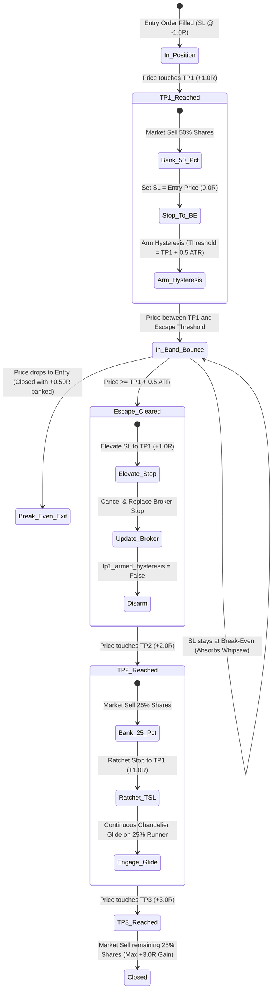

## Goal Capsule

- **Objective**: Protect unrealized gains and eliminate premature bid-ask whipsaw liquidation on 3x leveraged ETP positions by introducing dynamic milestone trailing stop loss ratcheting.
- **Means**:
  1. At TP1 (+1.0R): Bank 50% shares upfront as cold cash, move active stop to Break-Even (0.0R) guaranteeing a full 1.0R volatility cushion, and arm the Schmitt Hysteresis trigger (`tp1_armed_hysteresis = True`).
  2. Escape Elevation to TP1 (+1.0R): Once price advances beyond the escape threshold ($P \ge \text{TP1} + 0.5 \times \text{ATR}_{\text{etp}}$), ratchet the active stop floor up to TP1 (+1.0R), safely locking in +1.0R without zero-distance execution collisions.
  3. At TP2 (+2.0R): Bank an additional 25% shares, ratchet active trailing stop to TP1 (+1.0R) or $\text{TP2} - 1.0R$, and engage continuous Chandelier Glide tracking the high-water mark.
  4. At TP3 (+3.0R): Liquidate final 25% runner at maximum target.
  5. Broker Synchronization: Update native server-side stops on Trading 212 API atomically upon stop elevation without share-blocking deadlocks.
  6. Dashboard Telemetry: Expose live Schmitt Hysteresis state (ARMED / ELEVATED / TRAILING) in `signals_dashboard.html`.
- **Authority Hierarchy**:
  1. Risk Envelope & Capital Preservation (Hard stops and 16:20 UTC cutoff override all profit ratchets).
  2. Product Contract (50% upfront trim at TP1, 25% trim at TP2, 25% runner at TP3).
  3. Schmitt Hysteresis Execution Logic (Dead-band prevents zero-distance bid-ask bounce stops).
- **Stop Conditions**: Implementation stops if Trading 212 API rejects stop updates with non-recoverable errors or if test isolation cannot prevent desktop notification leaks.

## Product Contract

### Problem Frame
On 3x daily leveraged ETPs, setting the Stop Loss equal to Take Profit 1 (TP1) the exact moment price hits TP1 causes an immediate self-liquidation bug:
1. **Zero-Distance Execution Loop**: In `position_monitor.py`, if `stop_loss = tp1` when price touches TP1, the active distance to the stop is $0.00. On the very next tick, any non-positive price increment or resting bid below the ask triggers immediate liquidation of the remaining shares.
2. **Roll (1984) Bid-Ask Bounce**: LSE-listed 3x ETPs have typical spreads of 15–45 bps. Touching the Ask at TP1 means the resting Bid is already lower than TP1. A stop at TP1 fills immediately on the bid side.
3. **Broker Rejection**: Trading 212 API throws HTTP 400 when attempting to place a resting stop order within the broker's minimum tick distance of market price.

### Requirements

- R1. The system must trim exactly 50% of original shares when price touches Take Profit 1 (+1.0R), banking +0.50R profit into account equity immediately.
- R2. Upon reaching TP1, the active stop loss must be moved to the Entry Price (Break-Even, 0.0R), providing an invariant 1.0R volatility buffer, and arm the Schmitt Hysteresis trigger.
- R3. The stop loss must remain at Break-Even while price fluctuates between TP1 and the Escape Threshold ($P_{\text{escape}} = \text{TP1} + 0.5 \times \text{ATR}_{\text{etp}}$ for longs, $\text{TP1} - 0.5 \times \text{ATR}_{\text{etp}}$ for shorts), completely absorbing bid-ask bounce and market noise.
- R4. Once price clears the Escape Threshold ($P \ge P_{\text{escape}}$ for longs, $P \le P_{\text{escape}}$ for shorts), the stop loss must be elevated to TP1 (+1.0R), disarming hysteresis, updating the Trading 212 server-side stop order, and dispatching an alert.
- R5. Upon reaching TP2 (+2.0R), the system must trim an additional 25% of original shares, disarm hysteresis if still pending, ratchet the trailing stop to TP1 (+1.0R), and engage high-water mark trailing for the remaining 25% runner.
- R6. The Signals Dashboard (`signals_dashboard.html`) and live background daemon must display live hysteresis status (`ARMED (Break-Even)` vs `ELEVATED (+1.0R Locked)`) and sync with the audit log.

### Scope Boundaries

- **In Scope**:
  - Updating `RiskManager` with configurable hysteresis buffer and asymmetric tranche percentages.
  - Updating `PositionMonitor` state machine with `tp1_armed_hysteresis`, `tp1_escape_threshold`, and elevation checks.
  - Updating broker-native stop management to replace resting stops upon elevation.
  - Adding telemetry badges and table columns to `signals_dashboard.html` and `server.py`.
  - Comprehensive unit and regression tests verifying long and short symmetric mechanics with zero desktop notification leakage.
- **Out of Scope**:
  - Modifying entry screening models (Laya NLI or 3-RSI setup detection).
  - Changing overnight 16:20 UTC cutoff logic.
  - Adding multi-broker execution outside Trading 212.

### Key Product Decisions

- **KP1. 50% Upfront Trim vs 33% Tranches**: (Governs R1, R5)
  - *Decision*: Trim 50% at TP1, 25% at TP2, leave 25% runner to TP3.
  - *Rationale*: Banking 50% at +1.0R captures +0.50R cash in hand immediately. Even if the position stops out at Break-Even, the trade is guaranteed net profitable (+0.50R), mathematically eliminating downside.
- **KP2. Schmitt Hysteresis vs Instant Elevation**: (Governs R2, R3, R4)
  - *Decision*: Maintain stop at Break-Even until price clears an escape threshold of $+0.5 \times \text{ATR}_{\text{etp}}$.
  - *Rationale*: Prevents zero-distance stop liquidations and Trading 212 HTTP 400 order rejections while achieving the exact goal of locking TP1 as the stop floor as soon as momentum confirms.

## Planning Contract

### Key Technical Decisions

- KTD1. `TrackedPosition` state persistence: Add `tp1_armed_hysteresis: bool`, `tp1_escape_threshold: float`, and `tp1_stop_elevated: bool` to `TrackedPosition` dataclass, serialized in `active_trades.json` so daemon restarts preserve hysteresis state.
- KTD2. Configurable parameters in `Settings`:
  - `TP1_TRIM_PCT: float = 0.50`
  - `TP2_TRIM_PCT: float = 0.25`
  - `TP3_TRIM_PCT: float = 0.25`
  - `TSL_HYSTERESIS_ATR_MULT: float = 0.5`
- KTD3. Atomic Broker Stop Replacement: When hysteresis elevates the stop or TP2 ratchets it, call `self.place_broker_stop(pos, stop_price=new_stop)`, which automatically cancels the old resting order before placing the new one to prevent share-blocking conflicts.
- KTD4. Notification & Audit Log Integration: Dispatch `notify_tsl()` and log event `HYSTERESIS_TP1_RATCHET` to `notifications.jsonl` with locked-in P&L percentage so the event appears on the live dashboard.

### High-Level Technical Design

## Implementation Units

### U1. Configuration Flags & Risk Target Formulas
- **Goal**: Add configuration parameters for asymmetric tranches and hysteresis offsets into `config.py` and helper methods into `RiskManager`.
- **Requirements**: R1, R2, R3
- **Dependencies**: None
- **Files**:
  - `trading_system/config.py`
  - `trading_system/agents/risk_manager.py`
- **Approach**:
  1. In `trading_system/config.py`, add `TP1_TRIM_PCT: float = 0.50`, `TP2_TRIM_PCT: float = 0.25`, `TP3_TRIM_PCT: float = 0.25`, and `TSL_HYSTERESIS_ATR_MULT: float = 0.5`.
  2. In `trading_system/agents/risk_manager.py`, add `calculate_escape_threshold(tp1: float, atr: float, direction: str, multiplier: float = 0.5) -> float`.
- **Patterns to follow**: Existing `ATR_SL_MULTIPLIER` and `calculate_exit_targets()` conventions in `risk_manager.py`.
- **Test scenarios**:
  - Unit test `calculate_escape_threshold` for LONG direction: `tp1 = 105.0, atr = 4.0, mult = 0.5` -> returns `107.0`.
  - Unit test `calculate_escape_threshold` for SHORT direction: `tp1 = 95.0, atr = 4.0, mult = 0.5` -> returns `93.0`.

### U2. Position Monitor Hysteresis State Machine & Escape Ratcheting
- **Goal**: Implement Schmitt Hysteresis lifecycle in `PositionMonitor` so TP1 triggers 50% trim + break-even stop + armed hysteresis, and crossing escape threshold elevates stop to TP1.
- **Requirements**: R1, R2, R3, R4, R5
- **Dependencies**: U1
- **Files**:
  - `trading_system/execution/position_monitor.py`
- **Approach**:
  1. Ensure `TrackedPosition` carries `tp1_armed_hysteresis: bool = False`, `tp1_escape_threshold: float = 0.0`, and `tp1_stop_elevated: bool = False`.
  2. In `_handle_tp1_hit()`, sell `pos.original_quantity * settings.TP1_TRIM_PCT` (50%), move `stop_loss` to `entry_price`, set `tp1_armed_hysteresis = True`, and calculate `pos.tp1_escape_threshold`.
  3. In `monitor_tick()`, check if `tp1_armed_hysteresis` is True:
     - If price clears escape threshold ($P \ge P_{\text{escape}}$ for LONG, $P \le P_{\text{escape}}$ for SHORT): elevate `stop_loss` and `trailing_stop_loss` to `tp1`, set `tp1_armed_hysteresis = False`, `tp1_stop_elevated = True`, log event, notify, and update broker stop.
  4. In `_handle_tp2_hit()`, sell `pos.original_quantity * settings.TP2_TRIM_PCT` (25%), disarm hysteresis, and ratchet stop to `tp1`.
- **Patterns to follow**: Existing `_handle_tp1_hit`, `_handle_tp2_hit` in `position_monitor.py`.
- **Test scenarios**:
  - Scenario 1: TP1 touch triggers exactly 50% sell, stop moves to entry price, hysteresis flag is armed.
  - Scenario 2: In-band oscillation between TP1 and escape threshold does NOT trigger stop exit or elevation.
  - Scenario 3: Price crosses escape threshold elevates stop to TP1 (+1.0R) and emits `HYSTERESIS_TP1_RATCHET` event.
  - Scenario 4: Price pullback to Break-Even before escape threshold exits remaining 50% at $0 loss, leaving net trade +0.50R profitable.

### U3. Broker-Native Stop Order Cancellation & Re-Placement
- **Goal**: Guarantee that when a stop is elevated or ratcheted, resting stop orders on Trading 212 API are updated without share-locking deadlocks.
- **Requirements**: R4, R5
- **Dependencies**: U2
- **Files**:
  - `trading_system/execution/position_monitor.py`
  - `trading_system/data/trading212_client.py`
- **Approach**:
  1. In `place_broker_stop()`, check if an existing `pos.broker_stop_order_id` is present.
  2. If present and stop price differs from resting stop, call `t212.cancel_order()` first to release the blocked shares.
  3. Place new stop sell order for `remaining_quantity` at new elevated stop price.
- **Patterns to follow**: Existing `place_broker_stop` and `cancel_order` patterns in `position_monitor.py`.
- **Test scenarios**:
  - Verify `cancel_order` is called before `place_stop_order` when updating stop level.
  - Verify dry-run mode simulates stop order replacement without broker network calls.

### U4. Dashboard Telemetry & Live State Badges
- **Goal**: Visually surface the hysteresis state and active stop floor on `signals_dashboard.html` and in `server.py`.
- **Requirements**: R6
- **Dependencies**: U2
- **Files**:
  - `trading_system/dashboard/server.py`
  - `signals_dashboard.html`
- **Approach**:
  1. In `load_active_signals()` in `server.py`, extract `tp1_armed_hysteresis` and `tp1_stop_elevated`.
  2. Set status string:
     - If `tp1_armed_hysteresis`: `TP1 HIT: Break-Even (Hysteresis Armed @ $P_escape)`
     - If `tp1_stop_elevated`: `TP1 LOCKED (+1.0R Stop Active)`
     - If `tp2_hit`: `TP2 HIT: Trailing Runner Active`
  3. Render status badge with distinct Tailwind styling on dashboard cards.
- **Patterns to follow**: Existing badge layout in `signals_dashboard.html`.
- **Test scenarios**:
  - Verify `server.py` exports `tp1_armed_hysteresis` and formatted status string into dashboard JSON.

### U5. Comprehensive Unit & Regression Test Suite
- **Goal**: Maintain 100% test coverage of milestone TSL and Schmitt Hysteresis without leaking desktop notifications.
- **Requirements**: R1 through R6
- **Dependencies**: U1, U2, U3, U4
- **Files**:
  - `tests/test_milestone_tsl_hysteresis.py`
- **Approach**:
  1. Verify all 6 test cases in `tests/test_milestone_tsl_hysteresis.py` pass cleanly.
  2. Ensure `Notifier(enable_desktop=False)` and isolated `tempfile.TemporaryDirectory()` are enforced.
- **Patterns to follow**: `tests/test_milestone_tsl_hysteresis.py`.
- **Test scenarios**:
  - Run `python3 -m unittest discover tests` with 0 failures and 0 desktop alerts.

## Verification Contract

- **Automated Tests**:
  - `python3 -m unittest tests/test_milestone_tsl_hysteresis.py`
  - `python3 -m unittest discover tests`
- **Quality Gates**:
  - All 41+ tests passing with 0 errors.
  - `active_trades.json` remains isolated during test execution.
  - Dashboard generated cleanly with zero JavaScript console errors.

## Definition of Done

- All 5 Implementation Units (U1–U5) completed and verified.
- Schmitt Hysteresis reliably prevents zero-distance stop liquidations.
- Upfront 50% trim banks profit at TP1 while runner rides safely.
- Broker-native stops update cleanly on Trading 212 API.
- Dashboard server serves updated visual telemetry at `http://localhost:8888/signals_dashboard.html`.
