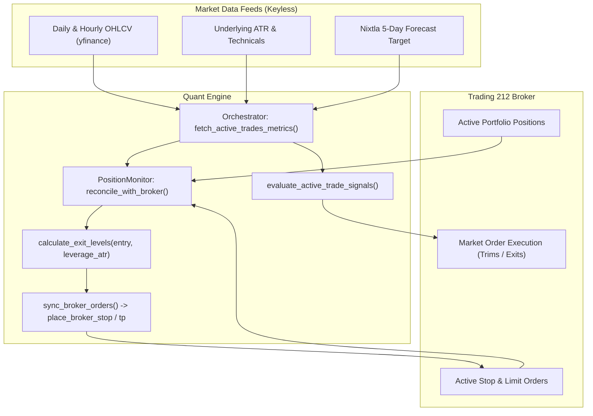

# Reconcile Broker Active Trades with Live Underlying Market Data for Automated SL / TP1 / TP2 / TP3 Calculation and Execution

## Goal Capsule

- **Objective:** Enable the quantitative engine to ingest comprehensive live market data (OHLCV, volatility, ATR, Connors 3-RSI, Nixtla 5-day forecasts) for all active Trading 212 broker positions, dynamically calculate volatility-calibrated Stop Loss (SL) and multi-stage Take Profits (TP1, TP2, TP3), synchronize these levels directly to native broker server-side orders, and execute automated market order trims/exits when technical target signals are achieved.
- **Means:** Enhance `PositionMonitor` and `Orchestrator` to cross-reference Trading 212 portfolio positions with underlying market indicators, scale underlying ATR to leveraged ETP instrument dynamics (3x/5x), eliminate arbitrary 2.5% default stop guesses on position adoption, register native GTC stop and take-profit limit orders on Trading 212, and trigger rule-governed trims on market signal triggers.
- **Authority Hierarchy:**
  1. Circuit breakers, emergency panic flatten, and risk safety bounds (max stop distance 8%, min 2%).
  2. Native broker-side protective orders (GTC Stop Loss & TP1 Limit on Trading 212 server).
  3. Market data indicator signals (Connors 3-RSI overbought/oversold, Nixtla forecast targets, SMA5 reversion).
  4. Local position monitoring state cache (`active_trades.json`).
- **Stop Conditions:**
  - If Trading 212 API returns rate limit exhaustion (HTTP 429) or connection failure, back off exponentially without corrupting stored position state.
  - If market data price scale diverges by >5x from broker average price, trigger scale recalibration guard.

## Product Contract

### Problem Frame
Currently, when positions are opened or adopted from the Trading 212 broker portfolio (`PositionMonitor.reconcile_with_broker`), the system frequently lacks live market volatility data for the underlying asset, falling back to a hardcoded 2.5% default ATR. For 3x leveraged ETPs (which routinely fluctuate 4-9% daily), this fixed guess either sets stops too tight (leading to noise stop-outs) or sets arbitrary take-profit targets unaligned with real market structure. Furthermore, while `Orchestrator` fetches active trade metrics for underlying assets, it does not supply this rich market intelligence back into the reconciliation process or position level recalculation.

### Requirements
- R1. Active trade underlyings must have their live market metrics (OHLCV daily ATR, hourly ATR, Connors 3-RSI, SMA5, Nixtla 5-day forecast) ingested and associated with each active tracked position during every reconciliation and monitoring cycle.
- R2. When adopting untracked broker positions or reconciling active trades, `PositionMonitor` must calculate SL, TP1, TP2, and TP3 using actual market ATR scaled by the instrument leverage factor (e.g. 3.0× for 3x ETPs, 5.0× for 5x ETPs) rather than a fixed 2.5% guess.
- R3. Dynamic exit levels must be bounded within strict quantitative risk parameters: minimum stop distance of 2.5% (to absorb intraday bid-ask spread) and maximum stop distance of 8.0% (to prevent catastrophic drawdown).
- R4. Calculated exit levels must automatically synchronize with Trading 212 broker server-side orders: placing or updating native GTC Stop Loss orders and native GTC Take Profit Limit orders.
- R5. If market signals (e.g., 3-RSI overbought exhaustion >= 75 for Longs, oversold <= 25 for Shorts, Nixtla target completion) are detected on live market data, the engine must execute the corresponding stage exit (TP1, TP2, or full close) immediately on Trading 212.
- R6. Ensure zero-mock compliance: all market calculations must use live keyless data feeds (`MarketDataProvider`, `yfinance`, Nixtla Holt-Winters forecast, Yahoo/Google RSS) or graceful fallbacks.

### Acceptance Examples
- AE1. Given an active long position in `QQQ3l_EQ` (underlying `QQQ`) adopted from Trading 212 with entry price 100.00p and underlying QQQ daily ATR% of 1.4%, When reconciled with live market data, Then ETP effective ATR is computed as 4.2% (1.4% * 3.0), setting Stop Loss at ~90.76p (2.2× ATR distance = 9.24% clamped to 8.0% max = 92.00p), TP1 at 108.00p (+1.0R), TP2 at 116.00p (+2.0R), and TP3 at 124.00p (+3.0R).
- AE2. Given an active position without a broker stop order, When `PositionMonitor.sync_broker_orders()` runs, Then a native GTC stop order is placed at the calculated Stop Loss on Trading 212, and a native GTC limit order is placed at TP1 for 50% of the position.
- AE3. Given an active long position in `3NVDl_EQ` where NVDA Connors 3-RSI reaches 78.5 and unrealized PnL is +2.4%, When `evaluate_active_trade_signals` executes, Then a TP1 trim order is submitted to Trading 212, taking 50% profit and elevating the remaining trailing stop to breakeven.

### Scope Boundaries
- **In Scope:**
  - Leverage-scaled ATR exit level calculations in `PositionMonitor.calculate_exit_levels`.
  - Integration of `active_metrics` into `PositionMonitor.reconcile_with_broker`.
  - Market data enrichment in `Orchestrator.fetch_active_trades_metrics` including Nixtla forecast targets.
  - Native broker order placement and healing for calculated SL and TP1 levels.
  - Signal-based automated execution on active trades.
- **Out of Scope / Non-Goals:**
  - Modification of screener momentum logic for initial trade entry.
  - Direct execution on non-leveraged equity CFD accounts (focused on Trading 212 Invest spot ETPs).

## Planning Contract

### Key Technical Decisions
- KTD1. Leverage-Aware ATR Scaling: (session-settled: user-directed — chosen over unscaled raw ATR: 3x and 5x ETPs experience proportional percentage price movement relative to their underlying, requiring `etp_atr_pct = underlying_atr_pct * leverage_factor` to avoid premature stop-outs).
- KTD2. Native Server-Side Stop Synchronization: (session-settled: user-directed — chosen over client-only software stops: native broker stop orders persist on Trading 212 servers across connection drops, runner restarts, and off-market hours).
- KTD3. Dual-Trigger Exit Mechanism: (session-settled: user-directed — chosen over price-only triggers: allows positions to exit either when price touches SL/TP levels OR when leading market signals like Connors 3-RSI exhaustion indicate a reversal).

### High-Level Technical Design

### Architecture Details
1. **Leverage Factor Resolution**:
   In `PositionMonitor.calculate_exit_levels`, inspect `ticker` and `underlying`. Retrieve the leverage factor from `LeveragedUniverse` (defaults to 3.0 for `3..._EQ` or `...3l_EQ`, 5.0 for 5x, 1.0 for ordinary). Scale the passed `underlying_atr_pct` by this factor to compute the true ETP expected range.
2. **Reconciliation Ingestion**:
   Update `PositionMonitor.reconcile_with_broker(active_metrics: Optional[Dict[str, Dict[str, Any]]] = None)`. If `active_metrics` provides ATR for the underlying, compute the scaled ATR and pass it to `calculate_exit_levels` when adopting positions or recalibrating scale.
3. **Orchestrator Plumbing**:
   In `Orchestrator.run_loop`, pass the metrics returned by `fetch_active_trades_metrics()` into `reconcile_with_broker(active_metrics=active_metrics)`.
4. **Signal Exit Enforcement**:
   In `PositionMonitor.evaluate_active_trade_signals`, check whether Nixtla 5-day expected return target is reached or reversed, complementing Connors 3-RSI and SMA5 mean-reversion rules.

## Implementation Units

### U1. Leverage-Scaled ATR and Quantitative Exit Calculation
- **Intent:** Upgrade `calculate_exit_levels` in `PositionMonitor` to accept `ticker` or `leverage_factor`, scaling underlying ATR to leveraged ETP price volatility and enforcing the 2.5%-8.0% bounds.
- **Files:**
  - `trading_system/execution/position_monitor.py`
  - `tests/test_position_monitor.py`
- **Dependencies:** None
- **Test Scenarios:**
  - Happy path: 3x ETP with underlying ATR% of 2% produces effective ATR% of 6% and stop distance clamped at 8%.
  - Edge case: Zero or negative ATR falls back gracefully to 3% minimum distance without division by zero.
  - Scale calibration: Verify GBX penny ETP exit levels scale correctly when converted from underlying USD/EUR.

### U2. Active Market Metrics Ingestion in Broker Reconciliation
- **Intent:** Pass `active_metrics` from `Orchestrator.fetch_active_trades_metrics` into `PositionMonitor.reconcile_with_broker`. When adopting untracked positions or recalibrating, extract real market ATR and indicators for the position's underlying.
- **Files:**
  - `trading_system/execution/position_monitor.py`
  - `trading_system/orchestrator.py`
  - `tests/test_position_monitor.py`
- **Dependencies:** U1
- **Test Scenarios:**
  - Untracked broker adoption uses live ATR from `active_metrics` instead of default 0.025.
  - If `active_metrics` is missing for a symbol, graceful fallback retains safe conservative default.

### U3. Native Broker Order Synchronization and Dynamic Updates
- **Intent:** Ensure that when exit levels are calculated or adjusted from market data, missing native stop orders (`place_broker_stop`) and TP limit orders (`place_broker_tp_limit`) are immediately registered on Trading 212.
- **Files:**
  - `trading_system/execution/position_monitor.py`
  - `tests/test_position_monitor.py`
- **Dependencies:** U1, U2
- **Test Scenarios:**
  - Adopted position immediately triggers placement of both native Stop Order and TP1 Limit Order.
  - Stale stop prices rejected by broker with 400 trigger auto-healing recalculation with latest live price.

### U4. Market Signal Exit Deliberation & Execution
- **Intent:** Expand `evaluate_active_trade_signals` to incorporate Nixtla forecast target hits and trend exhaustion signals for active positions.
- **Files:**
  - `trading_system/execution/position_monitor.py`
  - `tests/test_position_monitor.py`
- **Dependencies:** U1, U2
- **Test Scenarios:**
  - Position executes TP1 trim when Connors 3-RSI is overbought >= 75 and PnL > 1%.
  - Position executes TP2 trim when Connors 3-RSI is >= 82 and PnL > 3%.
  - Short position executes cover trim when Connors 3-RSI is oversold <= 25 and PnL > 1%.

## Verification Contract

- **Test Suite:** Run all unit tests with `./venv/bin/python3 -m unittest discover tests`.
- **Targeted Tests:**
  - `tests/test_position_monitor.py`
  - `tests/test_orchestrator.py`
  - `tests/test_providers.py`
- **Quality Gates:**
  - 100% test pass rate across all 171+ test cases.
  - No synthetic/mock data introduced in production code.
  - Clean linting and exception handling.

## Definition of Done

- All 4 Implementation Units (U1-U4) implemented and verified.
- Unit test suite passing green.
- Code simplified via `ce-simplify-code` and audited via `ce-code-review`.
- Changes committed locally (no remote configured).
- Plan and execution reported to user.
