# Raspberry Pi Runner Deployment Auto-Discovery and Keyless Multi-Factor Backtesting Engine

## Goal Capsule

- **Objective:**
  1. Solve remote Raspberry Pi runner deployment failures by implementing network auto-discovery (`trading212-pi.local` / dynamic DHCP IP fallback between `192.168.68.50`, `192.168.68.61`, etc.), deploy the latest quantitative updates to the live Pi runner, and verify operational service health at `http://192.168.68.50:8080`.
  2. Expand `trading_system/backtest/engine.py` into an automated historical backtesting engine that simulates multi-factor keyless signals—integrating rolling Nixtla 5-day Holt-Winters price forecasting, Finnhub fundamental valuation filters, and Olostep news/sentiment scoring—evaluating win rate, profit factor, and Sharpe ratio improvements over standard technical baselines.
- **Means:**
  - Enhance `scripts/deploy_to_pi.sh` with automatic target probe (`trading212-pi.local` -> cached IPs) and auto-deploy master.
  - Implement rolling quantitative time-series forecasting and sentiment/fundamental filtering in `BacktestEngine`.
  - Add CLI and test suites to benchmark multi-factor keyless strategies on historical ETP underlyings (QQQ, SPY, NVDA).
- **Authority Hierarchy:**
  1. Production safety and remote service uptime (Raspberry Pi runner).
  2. Zero-mock requirement: all backtesting indicators and signals must compute deterministically from historical candle time series and real market metrics.
  3. Risk management constraints: max risk per trade, volatility budget scaling, and max hold duration.
- **Stop Conditions:**
  - If Pi is unreachable across all probed addresses, report connectivity details without stalling local backtest execution.
  - If historical data has fewer than 30 candles, fail fast.

## Product Contract

### Problem Frame
1. **Dynamic IP Deployment Fragility**: The Raspberry Pi runner's IP address shifted from `192.168.68.61` to `192.168.68.50` due to DHCP renewal, causing `./scripts/deploy_to_pi.sh` to fail with port 22 connection timeouts. Deployment scripts must auto-resolve `trading212-pi.local` and fall back gracefully across known subnet IPs.
2. **Backtesting Blindspot for New Keyless Signals**: While the live engine now ingests Finnhub fundamentals, Olostep sentiment, and Nixtla 5-day forecasts, `BacktestEngine` only simulates simple 3-RSI and 20-day breakouts. Quantitative traders need empirical proof that adding Nixtla 5-day forecast confirmation and sentiment filters improves risk-adjusted returns (Sharpe ratio and win rate) across historical regimes.

### Requirements
- R1. `scripts/deploy_to_pi.sh` must automatically discover the active Raspberry Pi host by checking `trading212-pi.local`, `192.168.68.50`, and `192.168.68.61`, successfully syncing code, updating dependencies, and restarting `trading-bot.service`.
- R2. `BacktestEngine` in `trading_system/backtest/engine.py` must support a `multi_factor` strategy mode that computes:
  - Rolling 5-day Holt-Winters exponential smoothing price forecasts (Nixtla quantitative model).
  - Sentiment & catalyst proxy filters derived from candle price action and historical momentum regimes.
  - Valuation & volatility filters (realized volatility vs target volatility budget).
- R3. In `multi_factor` mode:
  - Long entries require both 3-RSI oversold conditions AND positive Nixtla 5-day projected return (`expected_return_pct > 0`).
  - Short entries require both 3-RSI overbought conditions AND negative Nixtla 5-day projected return (`expected_return_pct < 0`).
  - Exit simulation includes forecast-driven trims when projected returns reverse or hit target thresholds.
- R4. Provide a comparative backtest report generator comparing `3rsi_baseline` vs `multi_factor_keyless` across liquid underlyings (`QQQ`, `SPY`, `NVDA`).
- R5. Strict zero-mock compliance: all mathematical forecasting models must run on actual candle sequences.

### Acceptance Examples
- AE1. When running `./scripts/deploy_to_pi.sh` without arguments, it probes `trading212-pi.local` and `192.168.68.50`, connects to the active address, rsyncs master, restarts `trading-bot.service`, and outputs `active`.
- AE2. When running `BacktestEngine.run(symbol="QQQ", candles=candles, strategy_filter="multi_factor")`, trades are filtered by Nixtla 5-day forecast alignment, achieving higher win rate or lower max drawdown compared to raw 3-RSI.
- AE3. When running unit tests in `tests/test_backtest_engine.py`, both baseline and multi-factor strategy runs complete deterministically with full performance metric outputs (Sharpe, profit factor, win rate).

### Scope Boundaries
- **In Scope:**
  - `scripts/deploy_to_pi.sh` auto-discovery and deployment execution.
  - Multi-factor backtest simulation in `trading_system/backtest/engine.py`.
  - Automated comparative test harness in `tests/test_backtest_engine.py`.
- **Out of Scope / Non-Goals:**
  - Modifying live broker order submission signatures.
  - Intraday tick-level orderbook microsecond simulation (daily candle simulation is the design standard).

## Planning Contract

### Key Technical Decisions
- KTD1. Host Probing Hierarchy in Deploy Script: (session-settled: user-directed — chosen over hardcoded IP: probe `trading212-pi.local` first via mDNS, then fallback to common DHCP leases `192.168.68.50` and `192.168.68.61` using quick 2-second netcat/ssh timeouts).
- KTD2. Rolling Holt's Linear Exponential Smoothing for Historical Nixtla Simulation: (session-settled: user-directed — chosen over lookahead bias: for every candle index `i`, compute the 5-day forecast strictly from `candles[:i+1]`, mirroring real-time Nixtla keyless prediction without future data contamination).
- KTD3. Confirmation Filter Architecture: (session-settled: user-directed — chosen over standalone forecast trading: use Nixtla forecast and sentiment as a directional conviction confirmation layer on top of established 3-RSI mean-reversion, pruning false-positive counter-trend dips).

### High-Level Technical Design

```mermaid
flowchart TD
    subgraph DeployPipeline ["Raspberry Pi Auto-Deploy"]
        D_START["deploy_to_pi.sh"] --> D_PROBE{"Probe Target"}
        D_PROBE -->|"1. trading212-pi.local"| D_SYNC["rsync to Pi"]
        D_PROBE -->|"2. 192.168.68.50"| D_SYNC
        D_PROBE -->|"3. 192.168.68.61"| D_SYNC
        D_SYNC --> D_RESTART["Restart trading-bot.service"]
        D_RESTART --> D_VERIFY["Verify active status & HTTP 8080"]
    end

    subgraph BacktestEnginePipeline ["Historical Multi-Factor Backtest"]
        CANDLES["Daily OHLCV Candles"] --> IND_CALC["Compute Technicals: 3-RSI, SMA200, ATR"]
        CANDLES --> NIX_ROLL["Rolling 5-Day Holt-Winters Forecast (Nixtla)"]
        IND_CALC --> MF_EVAL{"Multi-Factor Filter"}
        NIX_ROLL --> MF_EVAL
        MF_EVAL -->|"3-RSI Oversold + 5d Forecast > 0"| LONG_ENTRY["Execute Long Trade (+1R / +2R / +3R)"]
        MF_EVAL -->|"3-RSI Overbought + 5d Forecast < 0"| SHORT_ENTRY["Execute Short Trade"]
        LONG_ENTRY --> PERF["Compute Metrics: Win Rate, Sharpe, Max DD, Profit Factor"]
        SHORT_ENTRY --> PERF
    end
```

## Implementation Units

### U1. Deployment Script Host Auto-Discovery
- **Intent:** Update `scripts/deploy_to_pi.sh` to automatically detect the reachable Pi host among `trading212-pi.local`, `192.168.68.50`, and `192.168.68.61`.
- **Files:**
  - `scripts/deploy_to_pi.sh`
- **Dependencies:** None
- **Test Scenarios:**
  - Auto-discovery selects `192.168.68.50` when `trading212-pi.local` or `.50` responds.
  - Manual destination argument override (`./scripts/deploy_to_pi.sh user@host`) is preserved.

### U2. Rolling Nixtla 5-Day Forecast & Multi-Factor Indicators in Backtester
- **Intent:** Implement rolling 5-day Holt-Winters exponential smoothing and multi-factor confirmation in `trading_system/backtest/engine.py`.
- **Files:**
  - `trading_system/backtest/engine.py`
- **Dependencies:** None
- **Test Scenarios:**
  - Rolling forecast computes 5-day slope and expected return strictly from prior candles (zero lookahead bias).
  - `strategy_filter="multi_factor"` filters out long trades when forecast slope is negative.

### U3. Multi-Factor Backtest Automated Test Suite & Comparison
- **Intent:** Expand `tests/test_backtest_engine.py` to validate multi-factor backtesting, comparing baseline 3-RSI against multi-factor keyless forecast filtering.
- **Files:**
  - `tests/test_backtest_engine.py`
- **Dependencies:** U2
- **Test Scenarios:**
  - Synthetic and historical candle series successfully generate `BacktestResult` with positive win rates.
  - Verification of metrics calculation (Sharpe ratio, profit factor, max drawdown).

### U4. Remote Raspberry Pi Deployment & Live Health Verification
- **Intent:** Execute deployment to the live Raspberry Pi runner (`192.168.68.50`), update remote repository files, verify systemd service status, and confirm HTTP 8080 health.
- **Files:**
  - Remote deployment via `./scripts/deploy_to_pi.sh`
- **Dependencies:** U1
- **Test Scenarios:**
  - Remote `systemctl is-active trading-bot.service` returns `active`.
  - Remote dashboard HTTP endpoint responds `200 OK`.

## Verification Contract

- **Test Suite:** Run `./venv/bin/python3 -m unittest discover tests`.
- **Targeted Test:** `./venv/bin/python3 -m unittest tests/test_backtest_engine.py`.
- **Deployment Verification:** Run `./scripts/deploy_to_pi.sh` and verify remote service status `active`.
- **Quality Gates:** 100% test pass rate across all unit tests; clean linting; no synthetic mocks in production modules.

## Definition of Done

- All 4 units implemented and verified.
- Unit tests green.
- Raspberry Pi remote runner updated and active on master.
- Changes committed locally.
