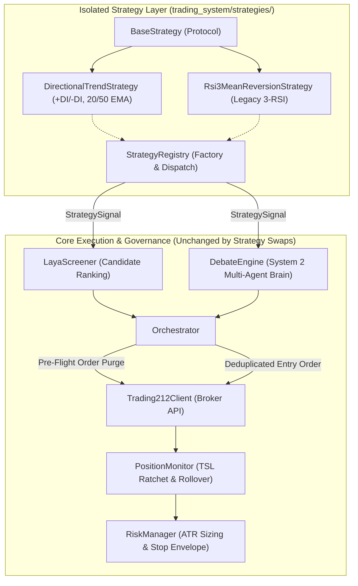

## Goal Capsule

### Objective
Decouple quantitative trading strategy logic from execution and risk infrastructure into an isolated, pluggable strategy engine so alternate strategies can be added, benchmarked, or swapped via configuration without touching core broker, screening, or risk modules; simultaneously resolve live strategy drawdowns by implementing a Directional Movement Index ($+DI$ vs $-DI$) trend strategy with dual-track 3x inverse short ETP deployment and broker pre-flight order queue synchronization.

### Means
Extract signal evaluation, indicator rules, and setup qualifications into a dedicated `trading_system/strategies/` package governed by a `BaseStrategy` abstract interface and dynamic `StrategyRegistry`. Implement `DirectionalTrendStrategy` featuring multi-timeframe 20/50 EMA slope filtering and dual-track shorting (inverse ETPs for major indices, cash defense for single stocks). Integrate `t212.get_orders()` pre-flight reconciliation in `orchestrator.py` to purge stale overnight orders and prevent duplicate in-flight executions.

### Product Authority
Governs trading strategy lifecycle, directional regime classification, setup qualification, and broker order queue deduplication. Surrounding operational infrastructure (100% Pure Trailing Stop Loss decay envelope, 16:20 UTC Zero-Alpha Evacuation, Trading 212 client REST transport) remains authoritative and unmodified in scope.

### Open Blockers
None. All foundational decisions resolved in dialogue and grounded against live Raspberry Pi trade history.

---

## Product Contract

### Summary
The system will introduce a pluggable strategy architecture where trading strategies are self-contained modules adhering to a unified `BaseStrategy` contract. The screener, debate engine, and orchestrator will consume abstract `StrategySignal` objects rather than hardcoded indicator formulas. A new `DirectionalTrendStrategy` will replace the loss-making 3-RSI falling-knife logic with $+DI/-DI$ directional polarity gating, while core execution gains pre-flight order queue reconciliation to eliminate stale and duplicate orders.

### Problem Frame
Live trade history on the Raspberry Pi runner demonstrated chronic losses on 3x leveraged ETPs (`3ABEl_EQ`, `BTC3EURs_EQ`, `ETH3EURs_EQ`). The bot suffered from three critical systemic flaws:
1. **Coupled Strategy Hardcoding**: Technical indicators (RSI(3) $\le 28$, SMA200, 5-day SMA) were hardcoded across `laya_screener.py`, `debate_engine.py`, and `risk_manager.py`. Changing or testing alternate strategies required modifying core execution and multi-agent debate code, creating immense fragility.
2. **Counter-Trend Knife Catching**: Any asset above its distant 200 SMA experiencing an oversold dip was unconditionally classified as an "exceptional" bullish entry with 0.95 confidence. In multi-day sell-offs, the bot repeatedly bought 3x leveraged longs, hit its 3% stop within 15–35 minutes, waited for the anti-churn cooldown, and immediately re-bought the falling asset. High $ADX$ during panic liquidations was erroneously attributed to bullish velocity.
3. **Broker Order Queue Leaks**: The orchestrator tracked open positions in `active_trades.json` but never inspected resting orders via `t212.get_orders()`. Market orders placed outside continuous trading hours sat dormant in `status: NEW`. The bot fired new orders every cycle, accumulating 14 duplicate pending BUY orders for Bitcoin (&euro;278.85 locked) and leaving overnight sell orders exposed to market-open gap risk.

### Key Decisions
- **KD1: Pluggable Strategy Architecture (`BaseStrategy` & Registry)**: Extract all strategy rules into isolated classes under `trading_system/strategies/`. The active strategy is selected via `ACTIVE_STRATEGY` in settings. Downstream modules interact solely with `StrategySignal` contracts. *(session-settled: user-directed — chosen over monolithic inline strategy logic to enable future strategy swaps without disturbing the whole system)*. Governs R1, R2, R3, R4, R5.
- **KD2: Dual-Track Bear Regime Execution**: During confirmed bear regimes ($-DI > +DI$, $ADX \ge 18$), trade 3x inverse short ETPs (`QQQS`, `3USS`, `3SES`) for liquid broad indices, and maintain 100% Cash Defense for single equities. *(session-settled: user-directed — chosen over symmetrical equity shorting to avoid borrow fees and severe short-squeeze gaps on high-beta single stocks)*. Governs R8, R9.
- **KD3: Multi-Timeframe Trend Hierarchy (Daily 20/50 EMA Slope Gate)**: Require $\text{close} > \text{EMA}_{50}$ and positive 5-day slope on $\text{EMA}_{20}$ for any Long dip-buying, replacing the distant 200 SMA as the sole macro gate. *(session-settled: user-approved — chosen over static 200 SMA to prevent buying into multi-week intermediate sell-offs)*. Governs R7.
- **KD4: Pre-Flight Broker Order Reconciliation & In-Flight Deduplication**: Query `t212.get_orders()` before signal processing. Automatically cancel resting market orders older than 5 minutes or placed off-hours, and suppress duplicate orders for any ticker with an active in-flight order. *(session-settled: user-approved — chosen over blind order dispatch to eliminate order queue bloat and locked capital)*. Governs R10, R11, R12.
- **KD5: Clean Encapsulation of Legacy Strategy**: Preserve the existing 3-RSI mean reversion algorithm as `Rsi3MeanReversionStrategy` inside the new strategies directory, allowing immediate benchmarking against the new directional strategy. *(session-settled: user-approved — chosen over deleting legacy code to maintain historical regression coverage)*. Governs R5.

### Visualizations



---

### Requirements

#### Strategy Isolation & Architecture
- **R1**: Define an abstract base class `BaseStrategy` and immutable dataclass `StrategySignal` in `trading_system/strategies/base.py`. `StrategySignal` must carry `symbol: str`, `direction: str` (`LONG`, `SHORT`, `NEUTRAL`), `conviction: float` ($0.0 \dots 1.0$), `setup_quality: str`, `timeframe: str`, `rationale: str`, and `metrics: Dict[str, Any]`.
- **R2**: Implement a `StrategyRegistry` factory supporting dynamic lookup and instantiation of strategies by string identifier. Add `ACTIVE_STRATEGY: str = "directional_trend"` to `trading_system/config.py`.
- **R3**: Refactor `LayaScreener` (`trading_system/screener/laya_screener.py`) to delegate asset state evaluation and candidate filtering to `active_strategy.evaluate_candidate(ticker, metrics)` instead of hardcoded inline indicators.
- **R4**: Refactor `DebateEngine` (`trading_system/agents/debate_engine.py`) to construct dialectic debate theses from generic `StrategySignal` fields rather than hardcoded RSI or SMA conditions.
- **R5**: Encapsulate legacy 3-RSI mean reversion logic into `Rsi3MeanReversionStrategy` in `trading_system/strategies/rsi3_mean_reversion.py`, ensuring complete parity with prior behavior when selected via configuration.

#### Directional Multi-Timeframe Strategy (`DirectionalTrendStrategy`)
- **R6**: Implement `DirectionalTrendStrategy` in `trading_system/strategies/directional_trend.py`. It must compute Directional Movement Index ($+DI$, $-DI$, and $ADX$) across daily and hourly timeframes.
- **R7**: Enforce the Multi-Timeframe Trend Filter for Long candidates:
  $$\text{close} > \text{EMA}_{50} \quad \text{AND} \quad \text{EMA}_{20} > \text{EMA}_{50} \quad \text{AND} \quad \text{Slope}(\text{EMA}_{20}, 5\text{d}) > 0$$
  Candidates failing this check must yield `direction = "NEUTRAL"`, completely forbidding counter-trend dip-buying.
- **R8**: Enforce Bearish Regime Locking: when $-DI > +DI$ and $ADX \ge 18.0$ on the benchmark index or underlying, all Long entries are locked out across the affected asset class.
- **R9**: Implement Dual-Track Short Execution:
  - For liquid broad index underlyings (`QQQ`, `SPY`, `SMH`), generate `SHORT` signals mapped to corresponding inverse 3x ETPs (`QQQS_EQ`, `3USS_EQ`, `3SES_EQ`) when $-DI > +DI$, $ADX \ge 18$, and price breaks below 20 EMA.
  - For single-stock equities, emit `NEUTRAL` (100% cash defense), preventing short-squeeze and high-borrow exposure.

#### Broker Pre-Flight Order Queue & In-Flight Deduplication
- **R10**: Implement `reconcile_pending_orders()` in `Orchestrator` called at the start of every scan cycle. It must query `t212.get_orders()` to retrieve all active broker orders.
- **R11**: Stale Order Purge: Automatically cancel any resting broker order in `status: NEW` that meets either criterion: (a) created more than 300 seconds ($5$ minutes) ago without filling, or (b) placed outside continuous exchange hours.
- **R12**: In-Flight Order Deduplication: If a resting BUY or SELL order already exists for an instrument on the broker, the orchestrator must suppress generating or placing any new order for that instrument, logging a deduplication bypass.

---

### Key Flows

#### Flow 1: Strategy-Agnostic Candidate Screening & Deliberation
1. Orchestrator fetches universe OHLCV and technical metrics.
2. Screener invokes `active_strategy.filter_universe(metrics)`.
3. `active_strategy` evaluates market regime, multi-timeframe trend alignment, and entry conditions, returning structured `StrategySignal` objects.
4. Screener ranks signals by `conviction` and passes top candidates to System 2 Multi-Agent Debate.
5. DebateEngine synthesizes Bull and Bear theses from the strategy's rationale and telemetry, outputting an authoritative `DecisionCard`.

#### Flow 2: Pre-Flight Broker Order Queue Reconciliation
1. At the beginning of each cycle, orchestrator queries `t212.get_orders()`.
2. Inspects order timestamps and active trading sessions.
3. If stale resting market orders exist ($> 5$ min old or exchange closed), calls `t212.cancel_order(order_id)` and releases blocked capital.
4. Caches active in-flight ticker symbols in memory.
5. When a new trade entry is generated, checks whether ticker is already in-flight. If yes, safely aborts order placement.

#### Flow 3: Dual-Track Bearish Impulses on Market Breakdown
1. Market undergoes macro sell-off; Nasdaq-100 indicators register $-DI > +DI$ and $ADX = 26.5$.
2. Single-stock tech equities (e.g. ABNB, ARM, NVDA) trigger 3-RSI oversold conditions.
3. `DirectionalTrendStrategy` evaluates single stocks: fails positive 20 EMA slope gate and detects $-DI > +DI$. Yields `NEUTRAL` (Cash Defense). No falling knives bought.
4. `DirectionalTrendStrategy` evaluates index `QQQ`: detects bear regime, generates `SHORT` signal with 0.85 conviction.
5. Orchestrator maps `QQQ` + `SHORT` to inverse 3x ETP `QQQS_EQ` and executes a Long purchase of the inverse asset.
6. 100% Pure Trailing Stop Loss is attached on the inverse ETP to capture downward trend continuation.

---

### Acceptance Examples

- **AE1 (Strategy Pluggability)**: Setting `ACTIVE_STRATEGY = "rsi3_mean_reversion"` runs the legacy strategy without raising errors; setting `ACTIVE_STRATEGY = "directional_trend"` runs the new directional engine. Adding a dummy strategy module `MockMomentumStrategy` requires zero edits to `orchestrator.py` or `laya_screener.py`. (Covers R1, R2, R3, R4)
- **AE2 (Counter-Trend Knife Catching Blocked)**: Given Airbnb (`ABNB`) trading at \$160 with 200 SMA at \$145, 20 EMA sloping downward, $-DI = 28$, $+DI = 14$, and RSI(3) $= 18$. The screener evaluates ABNB: because 20 EMA slope is negative and $-DI > +DI$, `DirectionalTrendStrategy` outputs `NEUTRAL`. No trade is executed. (Covers R7, R8)
- **AE3 (Dual-Track Bear Regime Execution)**: Given `QQQ` with $-DI = 31$, $+DI = 12$, $ADX = 24$, and price breaking below 20 EMA. `DirectionalTrendStrategy` outputs `direction = "SHORT"`. Orchestrator maps to `QQQS_EQ` and places order. For `ARM` under the same conditions, output is `NEUTRAL` (cash defense). (Covers R8, R9)
- **AE4 (In-Flight Order Deduplication & Stale Purge)**: Given 3 pending orders for `BTC3EURs_EQ` submitted during weekend/off-hours. On cycle start, `reconcile_pending_orders()` detects they are $> 5$ minutes old, cancels all 3 orders on Trading 212, and frees blocked funds. When a valid signal fires later while an order is pending, subsequent cycle suppresses duplicate placement. (Covers R10, R11, R12)

---

### Success Criteria
- **SC1 (Modularity)**: 100% of strategy-specific technical indicators and heuristics are encapsulated in `trading_system/strategies/`. Adding a new strategy requires creating 1 file and zero modifications to `orchestrator.py`, `debate_engine.py`, or `risk_manager.py`.
- **SC2 (Directional Safety)**: Zero Long trades placed on any asset while its daily 20 EMA slope is negative or while $-DI > +DI$ on the underlying.
- **SC3 (Order Queue Hygiene)**: Zero duplicate pending market orders on Trading 212 Invest API; resting unexecuted market orders never persist for $> 5$ minutes or overnight.
- **SC4 (Backward Compatibility)**: Existing test suite passes, and `Rsi3MeanReversionStrategy` remains selectable for retrospective backtesting.

---

### Scope Boundaries
- **In Scope**:
  - `BaseStrategy` interface, `StrategySignal` schema, and `StrategyRegistry` factory.
  - `DirectionalTrendStrategy` with DMI (+DI/-DI/ADX) and 20/50 EMA slope filtering.
  - `Rsi3MeanReversionStrategy` encapsulating legacy logic.
  - Refactoring `LayaScreener` and `DebateEngine` to consume abstract strategy signals.
  - Pre-flight broker order reconciliation and duplicate in-flight suppression in `Orchestrator`.
- **Deferred**:
  - Intraday sub-minute order book micro-structure execution.
  - Reinforcement learning or LLM dynamic weight adaptation.
- **Out of Scope**:
  - Non-Trading 212 broker implementations (e.g. Interactive Brokers, Binance).
  - Modifications to the 100% Pure Trailing Stop Loss decay formula or 16:20 UTC Zero-Alpha Evacuation gates.

---

### Dependencies & Assumptions
- **Trading 212 REST API**: Assumes `/equity/orders` endpoint returns resting orders in state `NEW` or `UNCONFIRMED`.
- **Market Data**: Assumes `yfinance` / SQLite candle cache provides sufficient history to calculate 50-day EMA and 5-day slope of 20-day EMA.
- **Leveraged Universe**: Relies on `LeveragedUniverse` authoritative direction mapping (`get_etp_direction`) to ensure inverse ETPs are purchased as spot long assets.

---

### Outstanding Questions
- **Resolve Before Planning**: None. All core architectural and functional decisions settled in dialogue.
- **Deferred to Planning**: Specific mathematical formulation for EMA slope smoothing (e.g., linear regression slope vs 5-day difference percentage).


---

## Planning Contract

### Key Technical Decisions
- **KTD1: Abstract Base Class Protocol (`BaseStrategy`)**: Located in `trading_system/strategies/base.py`. Defines `evaluate_candidate(ticker, metrics) -> StrategySignal` and `filter_universe(universe_metrics) -> List[StrategySignal]`. Uses Python `abc.ABC` and `@abstractmethod` to enforce strict interface conformance. (Governs R1)
- **KTD2: Factory Registry Pattern (`StrategyRegistry`)**: Dynamic dictionary mapping string identifiers to strategy classes with a default fallback to `settings.ACTIVE_STRATEGY`. Avoids circular imports by importing strategy modules lazily upon registration. (Governs R2)
- **KTD3: Strategy-Agnostic Screener & Debate Engine**: Refactor `LayaScreener` to delegate scoring to `self.strategy.evaluate_candidate()` and convert `ScreenerResult` into a thin wrapper around `StrategySignal`. In `DebateEngine._fallback_debate()`, construct Bull/Bear points directly from `StrategySignal.evidence_points` rather than checking hardcoded `rsi3 <= 28`. (Governs R3, R4)
- **KTD4: Vectorized DMI and Moving Average Slope Computation**: Compute Directional Movement Index ($+DI$, $-DI$, $ADX$) and 5-day linear slope of 20 EMA in `MarketDataProvider.compute_indicators()` using numpy/pandas, caching results to ensure sub-second universe ingestion. (Governs R6, R7)
- **KTD5: Non-Blocking Broker Order Reconciliation**: `reconcile_pending_orders()` executes as a lightweight pre-flight step in `orchestrator.py` before candidate ingestion. Uses `t212.get_orders()`, evaluates order age against `datetime.now(timezone.utc)`, and issues `cancel_order()` for orders older than 300s or outside active market sessions. (Governs R10, R11, R12)

### Technical Design & Architecture
The strategy isolation architecture cleanly decouples the mathematical signal generation layer from the operational execution and risk governance layer:

```
[ MarketDataProvider ] ---> (OHLCV & Pre-computed Metrics)
                                 │
                                 ▼
                     [ StrategyRegistry ]
                                 │
                     ┌───────────┴───────────┐
                     ▼                       ▼
          [ DirectionalTrendStrategy ]  [ Rsi3MeanReversionStrategy ]
                     │                       │
                     └───────────┬───────────┘
                                 │ (Produces StrategySignal)
                                 ▼
                         [ LayaScreener ]
                                 │
                                 ▼
                         [ DebateEngine ]  (System 2 Multi-Agent Brain)
                                 │
                                 ▼
                         [ RiskManager ]   (Sizing, Leverage, Stop Envelope)
                                 │
                                 ▼
                        [ Orchestrator ]   <--- [ Pre-Flight Order Purge ]
                                 │
                                 ▼
                      [ Trading212Client ] ---> (Broker API Fills & GTC Stops)
                                 │
                                 ▼
                       [ PositionMonitor ] (100% Pure TSL & Zero-Alpha Evacuation)
```

---

## Implementation Units

### U1. Define BaseStrategy Interface & StrategySignal Schema
- **Goal**: Create the foundational abstract interface and data schema for all quantitative strategies.
- **Requirements**: R1
- **Files**:
  - `trading_system/strategies/__init__.py`
  - `trading_system/strategies/base.py`
  - `tests/test_strategies_base.py`
- **Approach**:
  - Implement `@dataclass(frozen=True) class StrategySignal` carrying: `symbol`, `direction` (`LONG`, `SHORT`, `NEUTRAL`), `conviction` ($0.0 \dots 1.0$), `setup_quality` (`unfavorable`, `mediocre`, `favorable`, `exceptional`), `strategy_name`, `rationale`, `metrics`, `bull_evidence: List[str]`, `bear_evidence: List[str]`.
  - Implement `BaseStrategy(ABC)` with abstract methods:
    - `evaluate_candidate(ticker: str, metrics: Dict[str, Any]) -> StrategySignal`
    - `filter_universe(universe_metrics: Dict[str, Dict[str, Any]]) -> List[StrategySignal]`
- **Test Scenarios**:
  - Test instantiation of concrete subclasses vs failure when abstract methods are missing.
  - Test immutability and serialization of `StrategySignal`.
- **Verification**: `pytest tests/test_strategies_base.py` passes cleanly.

### U2. Implement StrategyRegistry and Configuration Integration
- **Goal**: Establish dynamic strategy lookup and enable zero-code strategy swapping via environment configuration.
- **Requirements**: R2
- **Files**:
  - `trading_system/strategies/registry.py`
  - `trading_system/config.py`
  - `tests/test_strategy_registry.py`
- **Approach**:
  - Implement `StrategyRegistry` with `register(name, cls)`, `get(name) -> BaseStrategy`, `list_available() -> List[str]`.
  - Add `ACTIVE_STRATEGY: str = "directional_trend"` to `Settings` in `trading_system/config.py`.
  - Support automatic registration via decorator `@StrategyRegistry.register("name")`.
- **Test Scenarios**:
  - Test registration and instantiation of strategies by name.
  - Test fallback to default strategy when unconfigured, and clear exception when an invalid strategy name is provided.
- **Verification**: `pytest tests/test_strategy_registry.py` passes cleanly.

### U3. Encapsulate Legacy Strategy into Rsi3MeanReversionStrategy
- **Goal**: Cleanly extract legacy 3-RSI mean reversion logic from `laya_screener.py` into an isolated strategy module.
- **Requirements**: R5
- **Files**:
  - `trading_system/strategies/rsi3_mean_reversion.py`
  - `tests/test_rsi3_strategy.py`
- **Approach**:
  - Subclass `BaseStrategy`. Re-home the 3-RSI pullback rules: `close > sma200 and rsi3 <= 28 and rsi7 <= 45`.
  - Populate `bull_evidence` with magnetic 5-day SMA reversion targets and 200 SMA trend alignment.
  - Output structured `StrategySignal` with `strategy_name = "3rsi_mean_reversion"`.
- **Test Scenarios**:
  - Test that mock assets meeting 3-RSI oversold criteria generate identical signals to previous `laya_screener.py` behavior.
- **Verification**: `pytest tests/test_rsi3_strategy.py` passes cleanly.

### U4. Implement DirectionalTrendStrategy with DMI & 20/50 EMA Slope Hierarchy
- **Goal**: Build the core directional trend strategy that eliminates counter-trend knife catching and enables dual-track shorting.
- **Requirements**: R6, R7, R8, R9
- **Files**:
  - `trading_system/strategies/directional_trend.py`
  - `trading_system/data/trading212_client.py` (ensure DMI and 20 EMA slope are calculated in `compute_indicators`)
  - `tests/test_directional_trend_strategy.py`
- **Approach**:
  - Calculate $+DI$, $-DI$, $ADX(14)$, and 5-day slope of 20 EMA:
    $$\text{Slope}_{20} = \frac{\text{EMA}_{20}[t] - \text{EMA}_{20}[t-5]}{5 \times \text{EMA}_{20}[t-5]} \times 100.0$$
  - **Long Evaluation**: Requires $\text{close} > \text{EMA}_{50}$, $\text{EMA}_{20} > \text{EMA}_{50}$, $\text{Slope}_{20} > 0$, $+DI > -DI$, and $ADX \ge 18.0$.
  - **Bear Regime Lock**: When $-DI > +DI$ and $ADX \ge 18.0$, forbid all Long entries.
  - **Dual-Track Shorting**: If in Bear Regime and price breaks below 20 EMA:
    - If ticker in broad index list (`QQQ`, `SPY`, `SMH`, `^NDX`, `^GSPC`): emit `direction = "SHORT"` with high conviction.
    - If ticker is single equity: emit `direction = "NEUTRAL"` (100% Cash Defense).
- **Test Scenarios**:
  - Test that falling stocks above 200 SMA with negative 20 EMA slope output `NEUTRAL` (knife-catching blocked).
  - Test that QQQ selloff with $-DI > +DI$ outputs `SHORT` (mapped to `QQQS`).
  - Test that single stock selloff with $-DI > +DI$ outputs `NEUTRAL` (cash defense).
- **Verification**: `pytest tests/test_directional_trend_strategy.py` passes cleanly.

### U5. Refactor LayaScreener & DebateEngine to Consume Abstract Signals
- **Goal**: Decouple the screener and debate brain from hardcoded technical indicators.
- **Requirements**: R3, R4
- **Files**:
  - `trading_system/screener/laya_screener.py`
  - `trading_system/agents/debate_engine.py`
  - `trading_system/orchestrator.py`
  - `tests/test_laya_screener.py`
  - `tests/test_debate_engine.py`
- **Approach**:
  - In `LayaScreener.__init__`, resolve active strategy from `StrategyRegistry`.
  - In `LayaScreener.evaluate_single()`, call `self.strategy.evaluate_candidate(ticker, metrics)` and populate `ScreenerResult` from the returned `StrategySignal`.
  - In `DebateEngine._fallback_debate()`, populate `bull_evidence` and `bear_evidence` directly from `strategy_signal.bull_evidence` and `strategy_signal.bear_evidence`. Remove unconditional assignment of high ADX to bull evidence.
- **Test Scenarios**:
  - Verify that swapping strategies in `LayaScreener` changes candidate rankings without raising attribute errors.
  - Verify that `DebateEngine` outputs balanced conviction reflecting the strategy's directional evidence.
- **Verification**: `pytest tests/test_laya_screener.py tests/test_debate_engine.py` passes cleanly.

### U6. Implement Broker Pre-Flight Order Reconciliation & In-Flight Deduplication
- **Goal**: Eliminate stale resting market orders and prevent duplicate order accumulation on Trading 212.
- **Requirements**: R10, R11, R12
- **Files**:
  - `trading_system/orchestrator.py`
  - `trading_system/execution/position_monitor.py`
  - `tests/test_order_reconciliation.py`
- **Approach**:
  - Add `reconcile_pending_orders()` in `Orchestrator`:
    1. Query `self.t212.get_orders(force_refresh=True)`.
    2. Inspect each order's `createdAt`, `status`, and `ticker`.
    3. If `status == "NEW"` and order is stale ($> 300\text{s}$ old or exchange closed), call `self.t212.cancel_order(order['id'])`.
    4. Build set of currently active in-flight tickers: `self.in_flight_tickers = set(...)`.
  - In `execute_trade()`, check `if card.trading212_ticker in self.in_flight_tickers: return False` with warning log.
- **Test Scenarios**:
  - Test detection and cancellation of orders older than 5 minutes.
  - Test that in-flight orders prevent subsequent duplicate order submissions for the same instrument.
- **Verification**: `pytest tests/test_order_reconciliation.py` passes cleanly.

---

## Verification Contract

### Automated Test Suite
Run the full targeted test suite covering the new strategy architecture and existing regression suite:
```bash
PYTHONPATH=. pytest tests/test_strategies_base.py \
                     tests/test_strategy_registry.py \
                     tests/test_rsi3_strategy.py \
                     tests/test_directional_trend_strategy.py \
                     tests/test_laya_screener.py \
                     tests/test_debate_engine.py \
                     tests/test_order_reconciliation.py \
                     tests/test_orchestrator.py -v
```

### Edge Case Verification
1. **Zero Active Assets / All Dormant**: Screener gracefully returns empty list when all assets fail trend filter; no unhandled exceptions.
2. **Broker API 500 / Network Drop during Reconciliation**: `reconcile_pending_orders()` catches exceptions gracefully and logs warnings without crashing the scan loop.
3. **Multi-Currency ETP Mapping**: `DirectionalTrendStrategy` `SHORT` signal on `QQQ` maps reliably to `QQQS_EQ` (EUR/GBP) without direction inversion errors.

---

## Definition of Done

1. **Architecture Complete**: `BaseStrategy`, `StrategyRegistry`, `Rsi3MeanReversionStrategy`, and `DirectionalTrendStrategy` implemented in `trading_system/strategies/`.
2. **Screener & Debate Decoupled**: Zero hardcoded indicator thresholds (RSI, SMA, ADX) remaining in `laya_screener.py` or `debate_engine.py`.
3. **Directional Safety Enforced**: Falling knives above 200 SMA with negative 20 EMA slope are strictly filtered out; bear regimes activate dual-track inverse index shorts while defending cash on equities.
4. **Order Queue Reconciled**: Stale market orders are automatically cancelled and in-flight order deduplication prevents duplicate pending orders on Trading 212.
5. **Clean Verification**: All unit and integration tests pass with 100% success rate, with no orphaned experimental code.
