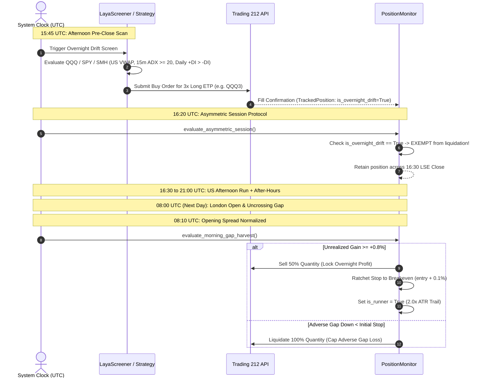

# Asymmetric Transatlantic Overnight Drift Strategy - Plan

## Goal Capsule

- **Objective:** Systematically capture empirical US afternoon and after-market equity drift by entering 3x Long benchmark ETPs between 15:45 and 16:15 UTC during confirmed US intraday bull trends, holding overnight across the transatlantic market closure, and locking profits on the London Stock Exchange opening uncrossing gap at 08:10 UTC next morning.
- **Means:** Implement `OvernightDriftStrategy` under `trading_system/strategies/overnight_drift.py` adhering to `BaseStrategy`, register in `StrategyRegistry`, configure a dedicated 15:45 UTC pre-close screener trigger, and adapt `PositionMonitor` overnight retention and 08:10 UTC 50% scale-out gap harvesting.
- **Product Authority:** Scoped strictly to broad market benchmark ETPs (`QQQ3`, `3USL`, `3SEM`). Single-stock equities and inverse short ETPs are excluded from overnight holding.
- **Open Blockers:** None.

## Product Contract

### Summary

The Asymmetric Transatlantic Overnight Drift Strategy turns the temporal disconnect between European bourses (London LSE closing at 16:30 UTC) and US equity markets (NYSE/NASDAQ trading until 21:00 UTC regular close plus after-hours until 01:00 UTC) into an automated quantitative edge. It enters 3x Long benchmark ETPs between 15:45 and 16:15 UTC when the US session establishes strong bullish trend alignment, exempts these positions from generic 16:20 UTC liquidation, and systematically scales out 50% of the position into the London opening gap at 08:10 UTC while ratcheting the remainder to breakeven.

### Problem Frame

1. **The Transatlantic Liquidity Disconnect:** Trading 212 Invest executes leveraged ETPs listed in London (LSE). LSE closes at 16:30 UTC, leaving 4.5 hours of US regular trading (16:30 to 21:00 UTC) and 4 hours of US after-market trading (21:00 to 01:00 UTC) completely un-tradable from London.
2. **Premature Session Liquidation:** The current engine executes an "Asymmetric Session Protocol" at 16:20 UTC that flattens any position not already at Breakeven. This dumps trades that are slightly green (+0.5% to +1.0%) right before the US afternoon momentum run and overnight drift.
3. **The Empirical Overnight Drift Reality:** Academic finance literature (Lester 2019, Cooper et al. 2020) demonstrates that essentially 100% of cumulative net returns in the S&P 500 and Nasdaq over the last 30 years occurred overnight (close-to-open), while regular intraday trading hours had flat-to-negative cumulative returns. Intraday trading in Europe frequently suffers from low-volume chop, while overnight holding captures the structural US equity risk premium at the 08:00 UTC European open.

### Key Decisions

- **KD1: Benchmark Indices Only** — Restrict eligible assets strictly to broad market index ETPs: `QQQ3` (3x Long Nasdaq-100), `3USL` (3x Long S&P 500), and `3SEM` (3x Long Semiconductors). Exclude all single-stock leveraged ETPs to eliminate idiosyncratic company gap-down risks. *(session-settled: user-directed — chosen over single-stock mega-caps: index benchmarks provide maximum overnight stability and eliminate single-stock gap risk)*. Governs R1, R2.
- **KD2: Long-Only + Cash Defense in Bear Regimes** — Disarm overnight holding during bear regimes. The empirical overnight drift anomaly is overwhelmingly long-biased; inverse short ETPs (`QQQS`, `3USS`) are never carried overnight to avoid catastrophic overnight short-squeeze gaps. *(session-settled: user-directed — chosen over bi-directional overnight shorting: overnight short holding carries severe asymmetry during market short squeezes)*. Governs R3, R4.
- **KD3: Two-Stage Opening Gap Harvest at 08:10 UTC** — Sell exactly 50% of the position at 08:10 UTC (once London opening auction spreads normalize) when in profit to bank cash gains. Ratchet the stop loss on the remaining 50% to Breakeven (`entry + 0.1%`), latched as a tenured runner (`is_runner = True`) with 2.0x ATR room to ride the European morning session risk-free. *(session-settled: user-directed — chosen over 100% full exit or 100% unhedged ride: scale-out locks overnight profits while preserving free upside)*. Governs R8, R9, R10.
- **KD4: Pre-Close 15:45–16:15 UTC Execution Window** — Evaluate entry strictly between 15:45 and 16:15 UTC, ensuring the US session (opened at 14:30 UTC) has traded for at least 75 minutes to establish valid volume, VWAP, and ADX momentum. Governs R5, R6.
- **KD5: Adverse Gap Emergency Cutoff at 08:15 UTC** — If an overnight trade gaps down adversely below initial stop threshold (-2.2x ATR or -2.5% max), liquidate immediately at market at 08:15 UTC following spread normalization, strictly capping loss. Governs R11.

### Requirements

#### Packaging & Universe Eligibility

- **R1:** The strategy shall implement `BaseStrategy` under `trading_system/strategies/overnight_drift.py` and register with `StrategyRegistry` as `"overnight_drift"`. Covers KD1.
- **R2:** Eligible instruments shall be strictly restricted to broad benchmark index ETPs: `QQQ3` (Nasdaq-100 3x), `3USL` (S&P 500 3x), and `3SEM` (Semiconductor 3x). Single-stock ETPs shall be rejected. Covers KD1.
- **R3:** The strategy shall be strictly Long-only. Any candidate evaluation during a bear regime shall return `direction="NEUTRAL"`, `conviction=0.0`, and enforce 100% cash defense. Covers KD2.

#### Pre-Close Screening & Entry Window (15:45–16:15 UTC)

- **R4:** The strategy shall trigger evaluation exclusively within the 15:45 to 16:15 UTC pre-close window on exchange trading days. Covers KD4.
- **R5:** An actionable `LONG` signal shall require the following indicator confluence:
  1. *Daily Macro Trend:* Underlying index (QQQ, SPY, SMH) Close > 20 EMA, 20 EMA slope > 0, and Daily +DI > -DI.
  2. *US Intraday Momentum (14:30 to 15:45 UTC):* Current US spot price > 15-minute Session VWAP.
  3. *Intraday Polarity:* 15-minute +DI > -DI and 15-minute ADX >= 20.0.
  4. *Volume Pacing:* Cumulative US session volume > 10-day median volume for the first 75 minutes.
  Covers KD4.
- **R6:** The strategy shall reject entry if any major US macro catalyst (FOMC interest rate decision, CPI release) or mega-cap earnings report (&ge; 5% index weighting) is scheduled in New York after-hours. Covers KD4.
- **R7:** Signal conviction shall scale between 0.70 and 0.95 based on 15-minute ADX strength and distance above VWAP. Covers R5.

#### Overnight Retention & Session Exemption

- **R8:** Positions opened under `OvernightDriftStrategy` shall be tagged `is_overnight_drift = True` in `TrackedPosition`. Covers KD3.
- **R9:** `PositionMonitor.evaluate_asymmetric_session()` at 16:20 UTC shall explicitly exempt positions tagged `is_overnight_drift = True` from generic session liquidation, retaining them across the 16:30 UTC London close. Covers KD3.

#### Morning Gap Profit Harvesting & Trailing Protection (08:00–08:15 UTC)

- **R10:** Between 08:00 and 08:10 UTC, `PositionMonitor` shall enforce an observation window to allow London opening uncrossing auction bid-ask spreads to normalize (&le; 0.40%). Covers KD3.
- **R11:** At 08:10 UTC, if the position has an unrealized gain &ge; +0.8%:
  1. Emit an automated sell order for exactly 50% of the remaining shares to lock in overnight cash profits.
  2. Elevate the trailing stop loss on the remaining 50% shares to `entry_price + 0.1%` (fee-adjusted Breakeven).
  3. Set `is_runner = True` on the remaining position, freezing stop decay at 2.0x ATR to ride the European session trend.
  Covers KD3.
- **R12:** At 08:15 UTC, if the position opens with an adverse gap where current price is below the initial protective stop loss (-2.2x ATR or max -2.5%), `PositionMonitor` shall immediately close 100% of the position via market order, strictly capping losses. Covers KD5.

### Key Flows

### Acceptance Examples

- **AE1 (Standard Bullish Gap-Up Harvest):**
  - *Context:* At 15:45 UTC, QQQ trades at $495 (above 15m VWAP of $492), Daily +DI=28 > -DI=14, 15m ADX=24.
  - *Action:* Engine buys 100 shares of `QQQ3` at £100.00 (Total: £10,000). Position tagged `is_overnight_drift=True`.
  - *At 16:20 UTC:* Monitor evaluates position; exempts it from liquidation.
  - *Overnight:* US market closes strong; after-hours gains +0.6%.
  - *At 08:00 UTC:* LSE uncrosses; `QQQ3` opens at £103.00 (+3.0%).
  - *At 08:10 UTC:* Spread is 0.18%. Monitor sells 50 shares at £103.00 (banking +£150.00 cash profit). Remaining 50 shares have stop moved to £100.10 (Breakeven). Position marked `is_runner=True`.
- **AE2 (Flat / Marginal Overnight Move):**
  - *Context:* Trade entered at £100.00. US markets close flat.
  - *At 08:10 UTC:* `QQQ3` trades at £100.30 (+0.3%).
  - *Action:* Profit threshold (&ge; +0.8%) is not met. Monitor does not execute partial trim. Position continues to be managed under standard trailing stop envelope (Day 2 decay multiplier = 1.85x ATR).
- **AE3 (Adverse US Sell-Off Gap-Down):**
  - *Context:* Trade entered at £100.00 with initial stop loss at £97.80 (-2.2%). Unexpected US after-hours tech earnings miss causes QQQ futures to drop -1.5%.
  - *At 08:00 UTC:* LSE uncrosses; `QQQ3` opens at £96.50 (-3.5%).
  - *At 08:15 UTC:* Opening spread normalizes. Monitor detects current price (£96.50) is below initial stop threshold (£97.80). Immediately sends market sell order for 100 shares, closing trade and preventing further loss.
- **AE4 (Bear Regime Cash Defense):**
  - *Context:* At 15:45 UTC, SPY and QQQ are trading below their 20 EMA with Daily -DI (31.0) > +DI (12.0) and ADX=26.
  - *Action:* Overnight drift screener evaluates universe; detects bear regime. Emits `NEUTRAL` signals with conviction 0.0. Engine takes zero overnight exposure, keeping 100% portfolio in cash.

### Scope Boundaries

#### In Scope

- Implementation of `OvernightDriftStrategy(BaseStrategy)` with DMI, 15m VWAP, and volume pacing checks.
- Dedicated 15:45 UTC pre-close screener execution scheduling in `orchestrator.py` and `server.py`.
- Adaptation of `PositionMonitor` to exempt `is_overnight_drift` holdings from 16:20 UTC liquidation.
- Implementation of 08:10 UTC 50% scale-out profit locking and breakeven stop ratcheting.
- Implementation of 08:15 UTC adverse gap emergency liquidation.
- Unit and end-to-end integration test suite covering all entry/exit flows and state transitions.

#### Out of Scope / Deferred

- Single-stock leveraged ETP overnight trading (`3NVD`, `3LTS`, `AAP3`) — deferred to a future dedicated PEAD strategy.
- Overnight short holding on inverse ETPs (`QQQS`, `3USS`) — explicitly rejected to prevent short squeeze exposure.
- Sub-minute tick-level order book depth analysis — deferred; standard 15-minute REST candles and spread checks are sufficient.

### Dependencies / Assumptions

- **Trading 212 API Compatibility:** Requires ability to place limit/market sell orders for 50% position quantity at 08:10 UTC and update resting GTC stops on the remaining quantity.
- **Market Data Feeds:** Relies on 15-minute candle data and VWAP calculation for US underlying benchmarks (`QQQ`, `SPY`, `SMH`) between 14:30 and 15:45 UTC via Yahoo Finance / Polygon / Finnhub.
- **Calendar & Timezone Precision:** Assumes London LSE operates 08:00–16:30 UTC and US cash operates 14:30–21:00 UTC, with existing dynamic DST handling in `Trading212Client.get_market_session_info()`.

### Outstanding Questions

#### Deferred to Planning

- **Q1:** Should the 50% partial sale order at 08:10 UTC be submitted as an aggressive limit order at `bid - 0.05%` or a standard market order? (Planning to evaluate based on Trading 212 API order rejection constraints).
- **Q2:** How should the orchestrator schedule the 15:45 UTC scan alongside existing continuous screening intervals? (Planning to determine whether a dedicated timer or time-of-day condition in the main loop is cleaner).

### Sources / Research

- **Codebase References:**
  - `trading_system/strategies/base.py:15-75` — Strategy interface contract (`BaseStrategy`, `StrategySignal`).
  - `trading_system/strategies/directional_trend.py:20-66` — Benchmark index definitions and DMI polarity.
  - `trading_system/execution/position_monitor.py:1350-1420` — Asymmetric session 16:20 UTC liquidation protocol.
  - `trading_system/data/trading212_client.py:1026-1130` — Exchange market hours resolution (LSE 08:00–16:30 vs US 14:30–21:00 UTC).
  - `docs/ideation/2026-11-06-high-winrate-after-market-trading-strategies.html` — Upstream CE-Ideate discovery artifact.
- **Academic Research:**
  - Lester, P. (2019): *"The Overnight Return Anomaly in Equity Markets"*.
  - Cooper, M. J., Dong, M., & Vogel, J. (2020): *"Which Overnight Return Anomaly? Examining Close-to-Open vs Open-to-Close Equity Performance"*.
