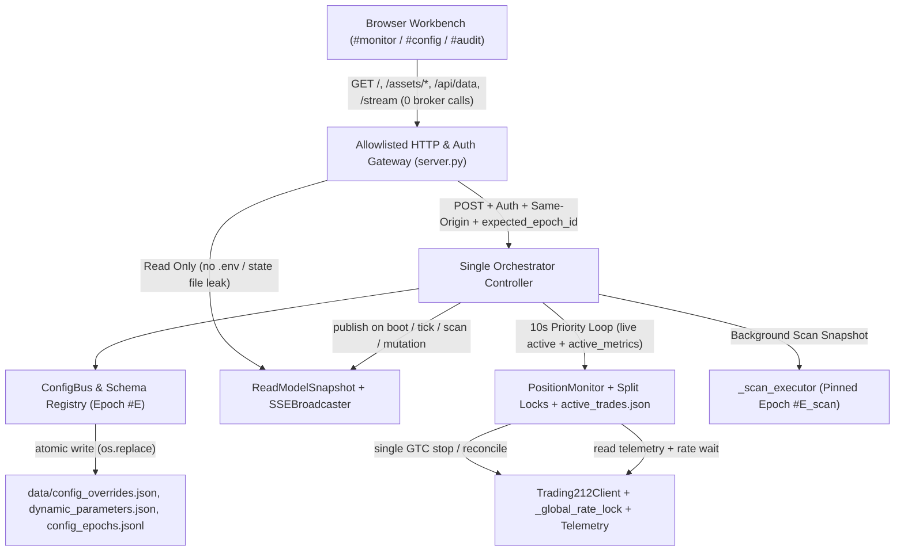
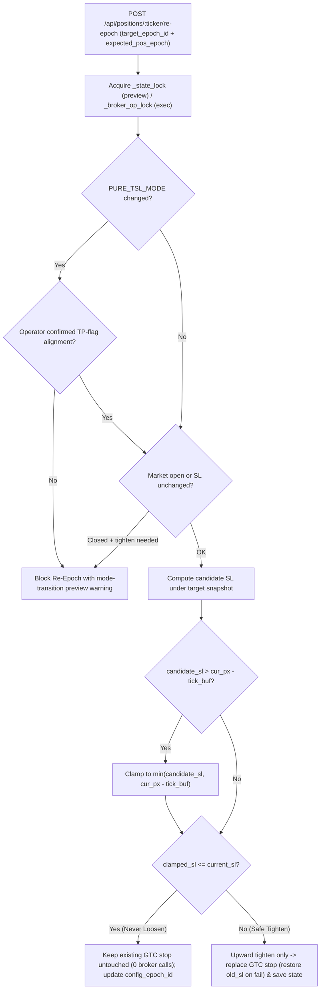

# Core Live Web Control Plane - Plan

## Goal Capsule

- **Objective:** Enable an operator on the Raspberry Pi LAN to inspect every pipeline decision gate, tune or add strategy and risk parameters safely without restarts or API-quota drain, and trigger emergency controls through an authenticated single-controller web console.
- **Means:** Generation-stamped immutable epoch snapshots (`ConfigBus`), fail-closed HTTP write routing through the active `Orchestrator`, orchestrator-published SSE read-model snapshots, and a self-hosted zero-build SPA workbench (`KTD1`, `KTD2`, `KTD3`).
- **Authority hierarchy:** `Product Contract` Requirements (`R1`–`R21`) govern behavior; `Planning Contract` Key Technical Decisions (`KTD1`–`KTD8`) govern implementation within those requirements; Execution Units implement within both and never override stops or broker safety invariants.
- **Execution profile:** Autonomous `/lfg` code pipeline implementing `U1`–`U7`, verified via stdlib `unittest`, E2E suite, and live local browser checks.
- **Stop conditions:** Stop if any live broker order invariant (single GTC stop per instrument, negative stop quantity, spot-long inverse ETP direction) conflicts with control-plane changes or cannot pass full regression suites.

---

## Product Contract

### Summary

This plan replaces startup-locked parameters and the polling read-only status viewer with an epoch-versioned `ConfigBus`, a schema metadata gateway, and a fail-closed single-orchestrator control API backing a zero-build multi-workspace web workbench. Operators can diagnose skipped candidates via live funnel telemetry, deep-link from blocked gates to inline parameter controls, preview validation and gate impact in a Staged-Intent Diff Drawer, add new parameters safely, and manage open-position config epochs without restarting the bot or burning Trading 212 API quota.

### Problem Frame

Across the current trading engine, key strategy, screener, risk, and exit parameters are copied onto `self.*` attributes inside component constructors at process startup or hardcoded directly inside methods. Meanwhile, `trading_system/dashboard/server.py` creates an uncoordinated secondary `Trading212Client` on every `3.5s` UI poll, mutates `active_trades.json` without atomic replacement, allows unauthenticated `/api/panic` requests when `PANIC_FLATTEN_TOKEN` is blank, and instantiates throwaway `PositionMonitor` objects that bypass live execution locks. Because candidate rejections and `StrategyImprovementAgent` audits are written only to logs rather than surfaced to the browser, the operator cannot see why trades were skipped or tune parameters live on the Raspberry Pi without editing files over SSH and restarting `systemd`.

### Key Decisions

- **Area 1 scoped ahead of Universe CRUD and Historical Replay** `(session-settled: user-directed — chosen over bundling Area 2 Dynamic Universe Registry or Area 3 Pre-Flight SQLite Replay into one monolithic plan)`: delivers the core configuration bus, fail-closed control gateway, zero-quota telemetry, and workbench UI first while isolating universe discovery and replay behind clean extension boundaries. Governs `R1`, `R8`, `R14`, `R21`.
- **Snapshot-per-entry default for open positions with explicit opt-in Re-Epoch** `(session-settled: user-approved — chosen over silent retroactive stop mutation or blocking edits while trades are open)`: prevents live config tuning from unexpectedly tightening, widening, or canceling broker-resting GTC stops on active Leveraged ETP holdings. Governs `R4`, `R5`.
- **Zero-build self-hosted UI served by the existing Python process** `(session-settled: user-directed — chosen over React/Node toolchains or CDN-only scripts)`: preserves the single-process Raspberry Pi `systemd` footprint and offline LAN reliability. Governs `R14`, `R15`, `R20`.

### Requirements

**Epoch ConfigBus & Schema**

- R1. All tunable strategy, screener, risk, session, and pure-TSL decay parameters currently cached in component `__init__` methods or hardcoded in evaluation helpers must resolve from immutable generation-stamped `ConfigSnapshot` objects served by a central `ConfigBus`.
- R2. Each scan cycle (`_scan_and_deliberate`) must capture one active `ConfigSnapshot` (`config_epoch_id`) at cycle start so parallel ingestion and deliberation workers evaluate all assets under a consistent configuration epoch.
- R3. Committed parameter overrides (`data/config_overrides.json`), custom parameter definitions (`data/dynamic_parameters.json`), and bounded epoch history (`data/config_epochs.jsonl`) must persist atomically across restarts; corrupt or invalid override files must quarantine cleanly without crashing boot while surfacing persistent `config_quarantine_warnings` in snapshots, UI banners, and a startup Notifier alert.
- R4. Open `TrackedPosition` records in `active_trades.json` must record `config_epoch_id` and self-contained entry policy metadata at entry, preserving backward-compatible deserialization for existing rows that omit those fields.
- R5. Open positions must retain their entry epoch behavior across new commits by default, and expose a previewed Re-Epoch action (with `expected_position_epoch_id` and `target_epoch_id` concurrency checks) that requires open exchange hours for broker stop modifications, never loosens a ratcheted or healed stop, never places a stop above current spot market price minus tick buffer, restores prior stops on replacement failure, evaluates `PURE_TSL_MODE` per position, and re-arms stops before `POST /api/resume` clears a halt.
- R6. Operators must be able to define custom parameters at runtime (`+ Add Parameter`) with explicit type, bounds, group, and a validated declarative `screener_metric_gate` rule bound to allowlisted scalar numeric indicators (capped at 64 custom params and 256-char strings; zero inert metadata-only parameters).

**Single-Orchestrator Command Gateway & Security**

- R7. Every mutating HTTP endpoint (`/api/auth/verify`, `/api/config/preview`, `/api/config`, `/api/params`, `/api/params/*/delete`, `/api/positions/*/re-epoch/preview`, `/api/positions/*/re-epoch`, `/api/positions/re-epoch-all/preview`, `/api/positions/re-epoch-all`, `/api/panic`, `/panic`, `/api/resume`) must verify auth credentials before reading request bodies using constant-time comparison, enforce bounded body reads (`<= 128 KiB`), require `Content-Type: application/json`, throttle repeated auth failures per IP, and require an attached live `Orchestrator` controller.
- R8. Config commits (`POST /api/config`) and position Re-Epochs must enforce optimistic concurrency (`409 Conflict` on epoch mismatch), validate all `Settings` cross-field and leverage coupling invariants, strip wildcard CORS headers from all endpoints, reject mismatched `Origin` and invalid `Host` headers (`403`), and keep secrets, broker mode, and filesystem paths read-only over HTTP.
- R9. Static file serving in the dashboard HTTP handler must allowlist only the dashboard HTML entrypoint and packaged local assets, blocking access to `.env`, JSON state files, logs, and token files in the working directory, while emitting `Content-Security-Policy` and `X-Content-Type-Options: nosniff` headers.
- R10. Standalone dashboard execution without an active `Orchestrator` must run strictly as a read-only viewer (`503` on authenticated control mutations, disabled write UI) and must never spawn an uncoordinated secondary `PositionMonitor`.

**Zero-Quota Telemetry & Funnel Diagnostics**

- R11. Browser `GET /api/data`, `GET /stream`, and SSE pushes must read solely from orchestrator-published read-model snapshots or local state files (using non-forced cached broker getters during orchestrator ticks), consuming zero Trading 212 API calls on HTTP requests and performing zero file mutations to `active_trades.json`.
- R12. `Trading212Client` must expose lock-protected rate-limit contention telemetry (endpoint cooldown remaining, wait durations, `429` counts, active-trade flag) for publication in the dashboard snapshot without issuing broker requests.
- R13. Each screening, strategy, debate, and execution cycle must emit a structured `CycleFunnelReport` recording stage pass/reject counts, compact cross-sectional universe indicator summaries (`median`, `p25`, `p75`, `min`, `max`), and per-gate parameter deep-link mappings alongside `ImprovementAudit` health diagnostics using the active `"directional_trend"` strategy rather than legacy 3-RSI rules.

**Zero-Build Web Workbench**

- R14. The web UI must provide zero-build workspaces for live monitoring (`#monitor`), schema-driven parameter tuning (`#config`), and strategy health diagnostics (`#audit`), rendered from self-hosted CSS and vanilla JS with zero external CDN dependencies and HTML/DOM XSS escaping (`textContent`, `\u003c`/`\u003e`/`\u0026` JSON escaping).
- R15. Every gate rejection with tunable `param_keys` in `#monitor` and anomaly banner in `#audit` must provide a clickable deep-link into `#config` that highlights affected parameters alongside live cross-sectional metric context (plus explicit fallback notices for structural/deleted gates).
- R16. Parameter tweaks and built-in read-only profile selections in `#config` must accumulate locally in `stagedChanges` and open a Staged-Intent Diff Drawer showing local/server diffs, `hot_reload` vs `restart_required` classification, validation errors, and deterministic screener gate impact (while explicitly labeling downstream risk/TSL/off-hours edits as non-simulatable in Area 1) before committing.
- R17. UI state synchronization must replace aggressive `3.5s` `/api/data` polling with exponential-backoff SSE updates (snapshots on state transitions plus named `heartbeat` events so `> 25s` connection staleness is distinguished from last snapshot age) and non-focused DOM reconciliation that never discards open modals, active tabs, or `stagedChanges`.
- R18. Emergency panic flatten and trading resume controls must surface failed liquidations as `UNPROTECTED / PANIC FAILED` without deleting failed positions locally, require explicit confirmation dialogs (including unprotected-position warnings on Resume) and token unlock without discarding pending config drafts, and prevent in-flight entry order placement from racing `panic_flatten_all()`.

**Operations & Compatibility**

- R19. Existing dashboard exports and unit/E2E test contracts (`generate_html_dashboard`, `build_dashboard_data` retaining optional `_DASHBOARD_SHARED_CLIENT = None` patchability without auto-instantiation, `make_dashboard_handler(web_dir, html_name)` with `server=None`, `start_local_server_thread` port fallback flag, `test_dead_queue_pruning`, and equity chart DOM/JS markers) must remain intact while production Pi startup disables silent port bumping.
- R20. Deployment automation (`scripts/deploy_to_pi.sh`) and `.gitignore` must preserve and ignore all new runtime control-plane files, token files, and `.halted` markers across `rsync --delete`.
- R21. Config schemas, funnel diagnostics, and read-only snapshots must keep clean extension boundaries for future Dynamic Universe Management (Area 2), Historical SQLite Replay (Area 3), and Saved Custom Preset CRUD without coupling them into this plan.

### Actors

- A1. **Operator** — Human trader accessing the Raspberry Pi dashboard over LAN (`http://trading212-pi:8080` or localhost) to monitor positions, inspect skipped gates, stage parameter diffs, load built-in profiles, add custom parameters, or trigger panic flatten/resume.
- A2. **Orchestrator Engine** — Single authoritative Python process running the 10s priority position-monitor loop, background universe scan pool (`_scan_executor`), `ConfigBus`, and read-model snapshot broadcaster.
- A3. **Trading 212 Broker** — External spot ETP broker enforcing `_global_rate_lock` endpoint pacing, single GTC stop order per held instrument, negative stop quantities, and strictly below-market stop prices.

### Key Flows

- F1. **Authenticated Config Staging & Atomic Epoch Commit**
  - **Trigger:** Operator edits parameters or loads a built-in schema profile in `#config` and opens the Staged-Intent Diff Drawer.
  - **Actors:** A1, A2
  - **Steps:** While Locked (`sessionStorage` empty), the Diff Drawer computes client-side field diffs and bounds checks locally without calling `POST /api/config/preview` (displaying an inline unlock notice for server gate impact); once unlocked or when the Operator submits Preview/Commit, UI posts draft patch and pinned `draftBaseEpochId` (`expected_epoch_id`) to `POST /api/config/preview` / `POST /api/config`; if `401`/`403` returns, Auth Modal prompts for token and retries automatically without clearing `stagedChanges`; `ConfigBus` commits atomically under lock (`409` opens per-field Keep Mine / Use Remote rebase panel), persists overrides/epoch log via `os.replace`, and broadcasts `config_epoch_changed` over SSE.
  - **Outcome:** Active `ConfigSnapshot` advances atomically while open positions remain safely pinned to their entry epochs.
  - **Covered by:** R1, R3, R5, R7, R8, R16, R17

- F2. **Mid-Scan Epoch Transition During Asynchronous Screening**
  - **Trigger:** Operator commits `Epoch #N+1` while `_scan_executor` is mid-flight evaluating `Epoch #N`.
  - **Actors:** A1, A2
  - **Steps:** `_scan_and_deliberate()` binds `ConfigSnapshot(Epoch #N)` at start and stamps `config_epoch_id` onto each `ScreenerResult`, `DecisionCard`, and `CycleFunnelReport`; before launching expensive `DebateEngine` LLM calls and again inside `execute_trades_batch()`, the engine checks `ConfigBus.active_epoch_id`: if breaking strategy, screener, or leverage rules changed, stale-epoch candidates abort cleanly with `"stale_epoch_superseded"`; if only downstream risk/SL/TP/spread sizing tightened, `execute_trades_batch()` deterministically re-sizes and validates against `Epoch #N+1` without trusting permissive tolerances.
  - **Outcome:** No worker sees split-brain mid-scan settings, wasted LLM debates are pruned, and no entry bypasses tightened risk gates.
  - **Covered by:** R2, R8, R13

- F3. **Safe Open-Position Re-Epoch With GTC Stop Protection**
  - **Trigger:** Operator clicks **Re-Epoch to #N+1** on an open position marked `Behind #N+1` in `#monitor`.
  - **Actors:** A1, A2, A3
  - **Steps:** Backend computes preview delta (`POST /api/positions/*/re-epoch/preview`) under `_state_lock` (`recommended_sl`, `decay_multiplier`, `pure_tsl_mode` transition check, market-open status); if preview passes safety rules (`never loosen`, `never invert > cur_px - tick_buf`, open exchange required for broker stop edits), operator confirms with `expected_position_epoch_id` & `target_epoch_id`; command runs sequentially under `_broker_op_lock`; if recomputed stop tightens safely above current stop and at or below spot price minus buffer, `place_broker_stop()` updates the single GTC stop without `DAY` fallback and restores `old_sl` immediately if replacement fails; if stop would widen or stay unchanged, existing GTC stop stays untouched (0 broker calls); updated `config_epoch_id` and `entry_config_snapshot` persist atomically.
  - **Outcome:** Position adopts the new policy deterministically with zero unprotected gap or HTTP 400 rejection.
  - **Covered by:** R4, R5, R7

- F4. **Skipped-Gate Funnel Diagnosis to Parameter Adaptation**
  - **Trigger:** Cycles complete with zero executed trades or `ImprovementAudit` flags `STARVED`/`CRITICAL` yield.
  - **Actors:** A1, A2
  - **Steps:** Orchestrator publishes `CycleFunnelReport` and `ImprovementAudit` in the read-model snapshot on boot, off-hours reconciliation, and scan completion; `#monitor` renders funnel counts and `#audit` surfaces anomaly banners; Operator clicks a gate's **Tune Parameter** deep-link (`#config?param=MIN_ADX_TREND`); `#config` focuses the control and displays cross-sectional median/p75 metrics alongside local/server threshold impact.
  - **Outcome:** Operator links missed opportunities directly to empirical threshold evidence without SSH log grepping.
  - **Covered by:** R11, R13, R15, R16, R17

### Acceptance Examples

- AE1. **Fail-Closed Auth & Non-Destructive Draft Retry**
  - **Covers:** R7, R16, R18
  - **Given:** `PANIC_FLATTEN_TOKEN` and `DASHBOARD_AUTH_TOKEN` are unset in `.env`, so backend bootstraps persistent `O_CREAT | O_EXCL` token file `data/.dashboard_token`, and the operator has 3 staged edits viewed locally in the Diff Drawer with an empty `sessionStorage`.
  - **When:** Operator submits Commit Epoch or confirms Emergency Panic Flatten without unlocking first.
  - **Then:** Server returns `401 Unauthorized` before reading bodies or modifying config/halting trading; UI opens the Auth Unlock Modal keeping all 3 staged edits intact, accepts the pasted token, stores it in `sessionStorage`, and automatically retries the blocked request to succeed.

- AE2. **Optimistic Concurrency Conflict (`409`) Across Tabs**
  - **Covers:** R8, R16
  - **Given:** Tab A and Tab B both load `epoch-7`; Tab B raises `MIN_ADX_TREND` to `21.0` and commits `epoch-8`.
  - **When:** Tab A changes `MAX_RISK_PER_TRADE` to `0.02` with `expected_epoch_id="epoch-7"` and submits commit.
  - **Then:** Server returns `409 Conflict` with latest `epoch-8` state without overwriting Tab B's change; Tab A preserves its `MAX_RISK_PER_TRADE` draft, displays the rebase panel (Keep Mine / Use Remote), re-validates against `epoch-8`, and commits `epoch-9` only on explicit confirmation.

- AE3. **Zero Trading 212 API Quota Used by Browser Traffic**
  - **Covers:** R11, R12, R17
  - **Given:** An active `Orchestrator` with a spied/mocked `Trading212Client` and 5 concurrent browser tabs polling `/api/data` and subscribing to `/stream` (`SSE`).
  - **When:** Clients issue 20 `GET /api/data` requests and establish `/stream` connections over 60 seconds outside orchestrator monitor ticks.
  - **Then:** Zero Trading 212 HTTP client methods (`get_account_cash`, `get_portfolio`, `get_orders`, `get_historical_orders`) are invoked by HTTP request threads, while `/api/data` returns the latest orchestrator snapshot including `rate_limit_telemetry` and `/stream` emits named `heartbeat` events.

- AE4. **Open-Position Re-Epoch Never Loosens or Inverts GTC Stops**
  - **Covers:** R5
  - **Given:** Long ETP `QQQ3l_EQ` entered at `€100.00` under `epoch-4`, now at `€108.00` with ratcheted `trailing_stop_loss = €105.00` and open exchange.
  - **When:** Operator previews and confirms Re-Epoch to `epoch-5` whose wider `TSL_ATR_MULTIPLIER` calculates `€103.50`, or whose tighter multiplier calculates `€108.20` (`> current_price - tick_buf`).
  - **Then:** For `€103.50`, stop remains `€105.00` and no broker cancel/replace API call is made; for `€108.20`, stop clamps cleanly to `current_price - tick_buf` while staying `>= €105.00` (or defers replacement if clamping would fall below `€105.00`), preserving continuous GTC stop protection.

- AE5. **Zero External CDN, XSS/Origin Hardening & Static Allowlist Security**
  - **Covers:** R8, R9, R14, R19
  - **Given:** Dashboard HTML generated via `generate_html_dashboard()` and served by `make_dashboard_handler(web_dir, html_name)`.
  - **When:** Automated checks scan rendered HTML for external `<script src="http...">` / `<link href="http...">` references and request `GET /.env`, `GET /active_trades.json`, `GET /data/.dashboard_token`, or cross-origin `POST`/`OPTIONS`.
  - **Then:** Rendered HTML contains zero external CDN URLs, escapes inline JSON script sequences (`\u003c`/`\u003e`/`\u0026`), retains `equity-chart-svg`, `equity-val-current`, `renderEquityChart`, and `equity_history`; sensitive paths return `403`/`404`; mismatched `Origin`/`Host` return `403`; `Content-Security-Policy` is present and wildcard CORS is absent everywhere.

### Success Criteria

- SC1. Operators can view live funnel rejections, `ImprovementAudit` health banners, rate-lock contention telemetry, quarantine warnings, and active position epoch badges directly in the web console without tailing Pi logs.
- SC2. Operators can stage, validate, diff, load built-in profiles, add declarative screener gate parameters, and commit parameter updates live over the web UI with zero process restarts required for `hot_reload` trading/risk/TSL settings.
- SC3. Emergency panic flatten, trading resume, and configuration writes fail closed without valid authentication and never execute through an uncoordinated sidecar client or race live order submission.
- SC4. Browser monitoring load adds zero Trading 212 API calls while keeping offline zero-build Raspberry Pi compatibility intact.

### Scope Boundaries

**In Scope (Area 1)**

- Central `ConfigBus`, `ConfigSnapshot`, `Settings` schema metadata (including ETP stop clamp & decay fields), atomic override/custom-parameter JSON persistence, quarantine alerting, and hot-reload integration across `Orchestrator`, `DirectionalTrendStrategy`, `BaseStrategy` (`StrategySignal`), `LayaScreener`, `TechnicalFallbackScreener`, `DebateEngine`, `LeveragedUniverse`, `RiskManager`, `PositionMonitor`, `StrategyImprovementAgent`, and `BacktestEngine`.
- `TrackedPosition` `config_epoch_id` / entry-policy stamping, split state/broker locking, safe per-position Re-Epoch preview/execute API & UI, `PURE_TSL_MODE` mixed-epoch safety, and panic/resume stop invariants.
- Single-orchestrator read-model publisher (with boot/off-hours warm-up and non-forced cached getters), `Trading212Client` rate-limit telemetry, fail-closed auth & HTTP command gateway, strict same-origin/Host/CSP/XSS hardening, allowlisted static routing, zero-quota `/api/data` + `/stream` fixes.
- Zero-build self-hosted `#monitor`, `#config`, and `#audit` UI workspaces, Diff Drawer, declarative `screener_metric_gate` `+ Add Parameter`, and `deploy_to_pi.sh` / `.gitignore` exclusions.

#### Deferred to Follow-Up Work

- **Area 2 — Broker-Validated Dynamic Universe Registry (`#5`):** Web CRUD for adding, validating against Trading 212 instrument metadata (`metadata/instruments`), GBX-checking, and toggling ETP pairs dynamically (`LeveragedUniverse`), plus `/api/manifest` capability discovery if needed.
- **Area 3 — Pre-Flight SQLite Replay & Zero-Quota Live Shadow Twin (`#6`):** Side-by-side paper shadow runner (`CandleDatabase`) simulating candidate parameter epochs before committing live capital.
- **Custom Persistent Preset CRUD (`data/presets.json`, `/api/presets*`):** Saving, editing, deleting, and pruning user-defined multi-parameter preset files; Area 1 ships built-in read-only profiles directly inside `config_schema.py` loaded through `#config`'s Diff Drawer.

#### Considered and Not Built (Non-Goals)

- **Multi-user RBAC, OAuth, or in-process TLS termination:** Not built because this runs single-operator on a trusted Raspberry Pi LAN behind `--dashboard-port 8080`; token auth + strict same-origin/`Host` validation closes browser/LAN accidental mutations without TLS cert ops. Revisit if exposed publicly beyond LAN.
- **Arbitrary expression evaluation (`eval`) or inert `unwired_metadata` custom parameters:** Rejected due to code-injection risk and misleading inert fields that exert zero trading effect; custom `+ Add Parameter` fields are restricted to allowlisted scalar `screener_metric_gate` rules with explicit runtime consumers.
- **Automatic silent stop loosening on open positions after config commit:** Rejected because widening or replacing resting GTC stops mid-trade risks unmanaged losses and broker HTTP 400 rejection races. Explicit opt-in Re-Epoch satisfies safety while still permitting deliberate migration.
- **Direct browser-to-Trading-212 polling fallback & redundant duplicate GET telemetry routes (`/api/funnel`, `/api/audit`, `/api/manifest`):** Rejected because UI reads must consume zero broker calls and `GET /api/data` + `GET /stream` already publish the unified `ReadModelSnapshot`.

<!-- ce-section: work-relationships -->
### How This Work Fits Together

This plan implements **Area 1 (Core Web Control Plane)** as the foundational slice of the web-editable quantitative engine series:
- **Upstream origin:** Selected at the Coherent-Work Gate from ideas `#1 (Dual-Plane Epoch ConfigBus & Schema Gateway)` and `#4 (Decision-Anchored Funnel Workbench & Staged Diff Console)` in `docs/ideation/2026-11-11-web-control-plane-and-parameter-tweaking-ideation.html`.
- **Sibling follow-ups (explicitly deferred):** Area 2 (`#5` Broker-Validated Dynamic Universe Registry) will plug into Area 1's `#config` workspace and `ConfigBus` hot-reload boundary; Area 3 (`#6` Two-Stage Pre-Flight SQLite Replay & Shadow Twin) will attach its simulated impact results directly to Area 1's Staged-Intent Diff Drawer (`POST /api/config/preview`) and `CycleFunnelReport`.

---

## Planning Contract

### Key Technical Decisions

- KTD1. **Dual-Plane Generation-Stamped Immutable `ConfigSnapshot` Bus Over In-Place `settings` Mutation** `(session-settled: user-approved — chosen over mutating global settings fields directly or restarting child objects)`: `LayaScreener`, `DirectionalTrendStrategy`, `RiskManager`, `PositionMonitor`, and `DebateEngine` copy settings onto `self.*` at `__init__` while `RiskManager` holds stateful runtime drawdown and cooldown dictionaries; passing immutable snapshots per scan/tick prevents mid-cycle tearing across `24` ingestion workers and `8` deliberation workers without resetting runtime risk state (`R1`, `R2`).
- KTD2. **Fail-Closed Persistent Token Auth (`DASHBOARD_AUTH_TOKEN` -> `PANIC_FLATTEN_TOKEN` -> `data/.dashboard_token`) With Read-Only LAN Telemetry** `(session-settled: user-approved — chosen over header auth on EventSource or open empty-token writes)`: Browser `EventSource` cannot send custom `Authorization` headers, so `GET /`, `/assets/*`, `/api/data`, `/stream`, `/api/schema/config`, and `/api/config` stay read-only with all secrets scrubbed while every HTTP response strips wildcard CORS `*`, validates `Host`/`Origin`, emits CSP headers, and every mutating `POST` enforces constant-time token auth (`hmac.compare_digest`) stored in `sessionStorage` (`R7`, `R8`, `R9`, `R11`).
- KTD3. **Orchestrator-Published Read-Model Snapshot Removing All Broker Calls From HTTP GET/SSE** `(session-settled: user-directed — chosen over short HTTP response TTL caching around _DASHBOARD_SHARED_CLIENT)`: Even a 2.5s TTL cache under `3.5s` multi-tab polling fires redundant `get_account_cash`, `get_portfolio`, `get_orders`, and `get_historical_orders` requests that compete for `Trading212Client._global_rate_lock`; having `Orchestrator` publish snapshots on boot, off-hours reconciliation, monitor ticks, scan completions, and control mutations (using non-forced cached getters) drives HTTP UI quota cost to zero while keeping client P&L and zero-trade funnel data fresh (`R11`, `R12`, `R17`).
- KTD4. **Single-Process Modular Zero-Build Assets Bundled for `generate_html_dashboard()` Compatibility** `(session-settled: user-directed — chosen over Vite/React SPA or pure external script tags)`: Existing unit tests (`test_embedded_dashboard.py`) write HTML into temporary directories and assert `renderEquityChart`, `equity-chart-svg`, and `equity_history` inline while `file:// --generate-only` has no HTTP server; authoring modular vanilla CSS/JS files under `trading_system/dashboard/assets/`, serving them cleanly over `/assets/*`, and bundling inline fallback into `generate_html_dashboard()` guarantees offline Pi rendering and full test compatibility (`R14`, `R19`).
- KTD5. **Entry `config_epoch_id` + Frozen Entry Policy Stored Directly on `TrackedPosition`** `(session-settled: user-directed — chosen over in-memory epoch dict only)`: `PositionMonitor._load_state()` uses `fields(TrackedPosition)` reflection to strip unknown JSON keys, and pure in-memory epoch history would vanish on `systemd` restarts; adding defaulted `config_epoch_id` and `entry_config_snapshot` fields on `TrackedPosition` plus persisting bounded `data/config_epochs.jsonl` guarantees restart-safe per-position stop/decay governance without a database migration (`R3`, `R4`, `R5`).
- KTD6. **Unified Declarative Exit Math Across `RiskManager` and `PositionMonitor` With Per-Position `PURE_TSL_MODE`** `(chosen over keeping separate hardcoded constants in PositionMonitor)`: Today `PositionMonitor.calculate_exit_levels()` hardcodes `2.2x` ATR and `2.5%`–`8.0%` SL clamps while `RiskManager` uses `MIN_SL_PCT`/`MAX_SL_PCT`, `RiskManager.get_decay_atr_multiplier()` hardcodes `2.20/0.35/1.15/2.00`, `execute_trade()` hardcodes `0.010` spread limit overriding `MAX_BID_ASK_SPREAD_PCT = 0.015`, and `sync_broker_orders()` cancels all limit orders globally on `self.pure_tsl_mode`. Declaring explicit ETP stop-clamp (`ETP_MIN_SL_PCT`/`ETP_MAX_SL_PCT`) and `TSL_DECAY_*` fields on `Settings`, consolidating exit/decay/spread formulas onto `ConfigSnapshot`-parameterized helpers, and evaluating `pure_tsl_mode` per position makes live tuning truthful and safe across mixed-epoch positions (`R1`, `R5`). *(Bake-off evaluation: no competing implementation prototypes needed because single-library stdlib refactoring settles every divergence cleanly.)*
- KTD7. **Split Fast State Lock, Broker Mutation Lock & `os.replace` Atomic Storage** `(chosen over coarse single RLock or unsynchronized direct file opens)`: Holding a single `RLock` over `Trading212Client` network waits (`1.5s–50.5s` pacing and `1.25s` sleeps) blocks HTTP `POST /api/panic` from setting `.halted`, while sharing `.tmp.<pid>` across threads risks temp-file collisions; separating a short-lived `_state_lock` (guarding `self.positions`, `is_halted`, `.halted`, `_save_state()`, and per-ticker lease flags with zero network I/O) from `_broker_op_lock` (serializing stop/TP mutations) and coordinating an execution gate lock during `place_market_order()` prevents torn JSON reads, overlapping GTC stop edits, and panic/buy races (`R3`, `R5`, `R7`, `R18`).
- KTD8. **Strict Port Binding in Production With Opt-In Test Port Fallback** `(chosen over unconditional port incrementing or unconditional hard fail)`: Keeping `allow_port_fallback: bool = True` by default on `start_local_server_thread()` satisfies `test_port_fallback_when_port_busy` (`8985 -> 8986`), while `Orchestrator.main()` / Pi systemd runtime passes `allow_port_fallback=False` (with brief bind retry for `TIME_WAIT`) so bookmarks at `:8080` never silently drift to `:8081` (`R19`).

### Assumptions

*(Recorded explicitly because `/lfg` skipped interactive brainstorm confirmation per pipeline rules.)*

- A-ASM1. **Auth bootstrap UX on headless Pi:** When neither `DASHBOARD_AUTH_TOKEN` nor `PANIC_FLATTEN_TOKEN` is set in `.env` (treating whitespace-only values as unset), the bot creates a persistent `0o600` token atomically (`os.open` with `O_CREAT | O_EXCL` and `secrets.token_urlsafe(32)`) at `data/.dashboard_token` (or temporary test token during `unittest` runs so CWD stays clean), logs a single setup hint naming that file path without dumping secrets on repeated restarts, rejects configured env tokens shorter than 16 chars, and offers `python3 -m trading_system.dashboard.server --print-token`; operators unlock mutating actions via the browser Auth Modal (`sessionStorage`).
- A-ASM2. **Staged diff impact scope:** In Area 1 (prior to Area 3 Historical SQLite Replay), `data/funnel_state.json` persists a compact universe indicator vector so the Staged-Intent Diff Drawer deterministically evaluates Phase 2 screener threshold changes against the latest completed cycle alongside schema/cross-field checks and open-position epoch delta counts, while explicitly flagging downstream risk, TSL, leverage, and off-hours empty-cache edits as non-simulatable in Area 1 rather than showing zero impact.
- A-ASM3. **"+ Add Parameter" extensibility boundary:** Operators can add up to 64 custom parameters into `data/dynamic_parameters.json` (max 256-char strings); every custom parameter must bind a validated declarative `"screener_metric_gate"` rule (`metric` from an allowlisted scalar numeric indicator set, `op` in `<, <=, >, >=, ==, !=`, numeric threshold, `on_missing` in `reject, skip_gate`) evaluated inside `DirectionalTrendStrategy` / `LayaScreener` and reported identically in funnel rejections (zero inert metadata-only parameters).
- A-ASM4. **Startup configuration precedence:** Tunable strategy, risk, screener, decay, and session keys resolve in order `Settings defaults < .env < data/config_overrides.json`, whereas credentials (`TRADING212_*`, `OPENAI_*`, `TELEGRAM_*`, `DISCORD_*`, `DASHBOARD_AUTH_TOKEN`, `PANIC_FLATTEN_TOKEN`), `USE_LIVE`, API URLs, port, and file paths remain env-only and non-overridable from the web API.
- A-ASM5. **Standalone CLI & `file://` read-only viewer modes:** Running `trading_system/dashboard/server.py` directly (without `Orchestrator`) no longer launches a competing `PositionMonitor` thread (removing the broken `settings.LIVE_TRADING_ENABLED` check) and exposes `controller_attached: false` in `/api/data` (`503` on authenticated control writes); both detached HTTP mode and `file://` mode render an explicit Read-Only banner, disable mutating controls, and populate `#config`/`#audit` from `INITIAL_DATA`.

### High-Level Technical Design

#### 1. Component Topology, Single-Controller Ownership & Zero-Quota Read Path

#### 2. Atomic Config Commit & Mid-Scan Epoch Lifecycle

```mermaid
stateDiagram-v2
  [*] --> StagedDraft: Operator tweaks params / profile in #config
  StagedDraft --> DiffPreview: Local diff if Locked; POST /api/config/preview when Unlocked
  DiffPreview --> AuthModal: 401/403 (keep draft in UI)
  AuthModal --> DiffPreview: Unlock token -> retry
  DiffPreview --> ConflictRebase: Commit POST /api/config returns 409
  ConflictRebase --> StagedDraft: Keep Mine / Use Remote rebase against latest epoch
  DiffPreview --> EpochCommitted: Valid + CAS match -> increment config_epoch_id (E+1)
  EpochCommitted --> ScanRevalidation: Active _scan_future checks before debate & entry
  ScanRevalidation --> DropStaleCards: Strategy/screener/leverage rule changed -> stale_epoch_superseded
  ScanRevalidation --> ExecuteEntry: Re-sized / re-validated OK -> stamp E onto TrackedPosition
```

#### 3. Open-Position Re-Epoch & GTC Stop Preservation Flow

### System-Wide Impact & Risks

- **Security & Secret Scrubbing:** Replacing `SimpleHTTPRequestHandler` CWD file serving eliminates immediate exposure of `.env`, `active_trades.json`, logs, and API keys; `/api/config` and `/api/schema/config` must strictly filter out all credentials and env-only keys by whitelist rather than dumping `asdict(settings)`. Inline JSON serialization must escape `<`, `>`, and `&`, HTTP responses must strip wildcard CORS `*` everywhere and validate `Origin`/`Host`, and `workbench.js` must avoid unescaped `innerHTML`.
- **Thread Concurrency & Deadlock Avoidance:** Enforce strict lock acquisition order (`ConfigBus` copies immutable snapshots *before* releasing its lock; `PositionMonitor` separates fast `_state_lock` from `_broker_op_lock` and never sleeps or performs Trading 212 HTTP calls while holding `_state_lock`; `Orchestrator` coordinates entry submission via `_execution_gate_lock` re-checking `not is_system_halted()` immediately before `place_market_order()`; `Trading212Client` sleeps outside `_global_rate_lock`).
- **Legacy Parameter Reconciliation Risk:** Prior code had silently diverged defaults (`RiskManager.__init__` defaulted `atr_sl_multiplier=1.5` vs `Settings.ATR_SL_MULTIPLIER=2.2`, `Orchestrator` omitted 6 `RiskManager` kwargs, `PositionMonitor.calculate_exit_levels()` hardcoded `2.5%`–`8.0%` ETP bounds vs underlying `0.5%`–`3.0%`, `execute_trade()` hardcoded `0.010` spread cap). Adding explicit `ETP_MIN_SL_PCT`/`ETP_MAX_SL_PCT` and `TSL_DECAY_*` fields on `Settings` while preserving default constructor behavior on standalone classes keeps existing tests passing cleanly.
- **Pi 5 Deployment Data Safety:** Any file added under `data/` or root runtime storage (`config_overrides.json`, `dynamic_parameters.json`, `config_epochs.jsonl`, `audit_history.jsonl`, `funnel_state.json`, `.dashboard_token`) would be wiped on the next deploy unless excluded in `scripts/deploy_to_pi.sh` and `.gitignore`.

### Sources & Research

- `CONCEPTS.md` — Canonical terminology (`Leveraged ETP`, `Noise Buffer`, `Schmitt Hysteresis Ratchet`, `Asymmetric Session Protocol`, `Session-Day Decay Trailing Stop Envelope`, `Pluggable Strategy Engine`, `Pre-Flight Order Queue Reconciliation`).
- `trading_system/config.py` — `Settings`, `Settings.validate()`, partial env parsing, `ENABLE_5X_LEVERAGE` / `MAX_LEVERAGE` coupling.
- `trading_system/orchestrator.py` — `Orchestrator.__init__` init-time parameter delegation & omitted `RiskManager` kwargs, `_scan_and_deliberate()`, `execute_trades_batch()`, `execute_trade()` hardcoded spread check (`0.010`), `run_loop()`, `_update_dashboard()`, unittest dashboard guard.
- `trading_system/strategies/directional_trend.py` & `trading_system/screener/laya_screener.py` — Init-time cached thresholds (`min_adx_trend`, `max_catalyst_risk`, `min_setup_score`, `top_n`), split live reads in `passes_filter()`, hardcoded regime cutoffs in `classify_regime()`, `TechnicalFallbackScreener`.
- `trading_system/agents/risk_manager.py` & `trading_system/agents/strategy_improvement_agent.py` — Init-time cached risk params, runtime cooldown/circuit-breaker state, hardcoded `get_decay_atr_multiplier()`, stale `"3rsi_mean_reversion"` check in `verify_parameter_adaptation()`, `ImprovementAudit`.
- `trading_system/execution/position_monitor.py` — `TrackedPosition` reflective `_load_state()` (`fields(TrackedPosition)`), `_save_state()`, missing `positions` lock, `is_halted` vs `is_system_halted()`, `sync_broker_orders()`, `calculate_exit_levels()`, `check_progressive_stops()`, `panic_flatten_all()` failure state cleanup.
- `trading_system/data/trading212_client.py` — `_global_rate_lock`, `ENDPOINT_MIN_DELAYS`, cross-process `.t212_rate_limit.json` writes, instance caches.
- `trading_system/dashboard/server.py` & `signals_dashboard.html` — `SSEBroadcaster`, `build_dashboard_data()` T212 polling + inline `active_trades.json` write, `generate_html_dashboard()`, `make_dashboard_handler()`, `do_POST /api/panic`, `start_local_server()` `LIVE_TRADING_ENABLED` bug, Tailwind CDN script tag, `3.5s` poll loop.
- `scripts/deploy_to_pi.sh`, `scripts/trading-bot.service`, `tests/test_embedded_dashboard.py`, `tests/test_dashboard_sse.py`, `tests/test_dashboard_broker_history.py`, `run_e2e_tests.sh`.
- `docs/solutions/architecture/session-day-decay-tsl-envelope-and-zero-alpha-evacuation.md`, `docs/solutions/logic-errors/broker-history-sync-5x-leverage-and-sqlite-candle-cache.md`, `docs/solutions/logic-errors/etp-fill-calibration-inverse-short-session-isolation.md`, `docs/solutions/logic-errors/reconcile-leveraged-etp-market-data-and-broker-orders.md`, `docs/solutions/infrastructure/pi-deployment-host-discovery-and-keyless-backtesting.md`.

---

## Implementation Units

### U1. Epoch ConfigBus, Settings Schema Registry & Persistent Stores

- **Goal:** Build the single source of truth for schema-annotated configuration, immutable generation-stamped `ConfigSnapshot` epochs, validation/diff preview, built-in read-only schema profiles, and extensible user-defined parameters.
- **Requirements:** R1, R3, R6, R8, R21
- **Dependencies:** none
- **Files:**
  - Create: `trading_system/config_schema.py`
  - Create: `trading_system/config_bus.py`
  - Modify: `trading_system/config.py`
  - Test: `tests/test_config_bus.py`
- **Approach:**
  1. Complete env loading and add explicit defaulted fields in `Settings` (`trading_system/config.py`) for ETP stop-clamp bounds (`ETP_MIN_SL_PCT = 0.025`, `ETP_MAX_SL_PCT = 0.080`) and session-day decay multipliers (`TSL_DECAY_DAY1_MULT = 2.20`, `TSL_DECAY_STEP_MULT = 0.35`, `TSL_DECAY_FLOOR_MULT = 1.15`, `TSL_DECAY_RUNNER_MULT = 2.00`) alongside tunable strategy, risk, screener, and session fields while preserving existing defaults, `.env` precedence, and `Settings.validate()` invariants (`KTD1`, `KTD6`, `A-ASM4`).
  2. Define `trading_system/config_schema.py` with structured metadata (`key`, `label`, `type`, `group`, `unit`, `min`, `max`, `step`, `allowed_values`, `reload_mode` as `"hot_reload"` or `"restart_required"`, `revalidation_scope` as `"abort_stale_scan"` vs `"resize_entry"`, `impact_hint`, `gate_tags`) for all tunable parameters, explicitly excluding env-only credentials, `USE_LIVE`, URLs, ports, and file paths (`R8`, `A-ASM4`). Include built-in read-only profiles (`balanced`, `conservative`, `momentum_strict`) directly in `config_schema.py` for Diff Drawer loading.
  3. Define `DynamicParameterSpec` validating identifier syntax (`[A-Za-z_][A-Za-z0-9_]{1,63}`), blocking collisions with `Settings` and internal snapshot metadata, rejecting `NaN`/`Infinity`, capping storage at `64` custom parameters and `256`-character string fields, and requiring every custom parameter to bind a deterministic declarative `screener_metric_gate` rule (`metric` from an allowlisted set of computed scalar numeric indicators, numeric threshold for `<, <=, >, >=` ops, `on_missing` in `reject, skip_gate`) with zero arbitrary `eval` and zero inert metadata-only fields (`R6`, `A-ASM3`).
  4. Implement thread-safe `ConfigBus` publishing immutable `ConfigSnapshot` records (frozen collections as `tuple`/`frozenset`), computing `pending_restart_keys` by comparing process-boot `Settings` values against the active `ConfigSnapshot` for `restart_required` fields, enforcing optimistic concurrency (`expected_epoch_id` CAS check), computing schema/cross-field/leverage-coupling preview diffs, cleanly quarantining corrupt override files on boot without crashing while recording `config_quarantine_warnings`, resolving historical snapshots via bounded `data/config_epochs.jsonl`, and persisting `data/config_overrides.json` and `data/dynamic_parameters.json` via thread-unique temp files (`fsync` + `os.replace`) under `RLock` (`R3`, `KTD1`, `KTD7`).
- **Patterns to follow:** `Settings.validate()` in `trading_system/config.py` and atomic replacement in `PositionMonitor._save_state()`.
- **Test scenarios:**
  - Happy path: `ConfigBus` boots with `Defaults < .env < data/config_overrides.json` precedence, commits a valid patch, increments `config_epoch_id`, tracks `pending_restart_keys`, and serves an immutable `ConfigSnapshot`.
  - Conflict/validation paths: mismatched `expected_epoch_id` raises conflict without partial writes; `MAX_RISK_PER_TRADE > MAX_POSITION_PCT`, conflicting `ENABLE_5X_LEVERAGE`/`MAX_LEVERAGE`, or `NaN` floats fail preview and commit validation.
  - Extensibility & deletion paths: creating a `screener_metric_gate` param validates allowlisted `metric`/`op`/`on_missing` and rejects unallowlisted metrics or missing bindings; deleting a custom param prunes active overrides cleanly.
  - Fault recovery: malformed JSON or invalid cross-field overrides on disk quarantine and populate `config_quarantine_warnings` without crashing `ConfigBus` initialization, and historical epochs reload from `data/config_epochs.jsonl`.
- **Verification:** `ConfigBus` produces deterministic epoch snapshots, rejects stale CAS writes and secret overrides, quarantines corrupt persistence, and passes all unit scenarios.

### U2. Epoch-Aware Strategy, Screener, Risk & Improvement Pipeline

- **Goal:** Eliminate startup parameter caching and hardcoded behavioral constants across screening, strategy evaluation, debate fallback, sizing/risk calculation, backtest checks, and `ImprovementAudit` while emitting structured funnel telemetry with parameter deep-links.
- **Requirements:** R1, R2, R6, R13
- **Dependencies:** U1
- **Files:**
  - Modify: `trading_system/strategies/base.py`
  - Modify: `trading_system/strategies/directional_trend.py`
  - Modify: `trading_system/screener/laya_screener.py`
  - Modify: `trading_system/agents/debate_engine.py`
  - Modify: `trading_system/agents/risk_manager.py`
  - Modify: `trading_system/agents/strategy_improvement_agent.py`
  - Modify: `trading_system/backtest/engine.py`
  - Test: `tests/test_epoch_pipeline_adaptation.py`
- **Approach:**
  1. Extend `StrategySignal` (`trading_system/strategies/base.py`), `ScreenerResult` (`laya_screener.py`), and `DecisionCard` (`risk_manager.py`) with optional backward-compatible defaulted fields (`gate_rejections: Optional[List[Dict[str, Any]]] = None`, `config_epoch_id: Optional[str] = None`). Update `DirectionalTrendStrategy` (`evaluate_candidate`, `filter_universe`) to accept an optional `ConfigSnapshot`, resolving `MIN_ADX_TREND`, `SCREENER_MAX_CATALYST_RISK`, `broad_indices`, conviction/regime thresholds, and numeric-guarded wired `screener_metric_gate` custom rules (`R6`) while emitting structured per-gate rejection metadata (`gate_id`, `param_keys`, `observed`, `threshold`) (`R2`, `R13`).
  2. Update `LayaScreener`, `TechnicalFallbackScreener`, and `DebateEngine` (`run_debate`, `_fallback_debate`) to accept `ConfigSnapshot` per scan/deliberation instead of reading frozen init fields or global `settings.MIN_ADX_TREND` (`R1`, `R2`). Add structured `CycleFunnelReport` aggregation capturing per-stage counts, gate breakdown with mapped parameter keys, compact candidate indicator vector (`_compact_indicators`), and cross-sectional metric percentiles (`median`, `p25`, `p75`, `min`, `max`) (`R13`, `A-ASM2`).
  3. Update `RiskManager` methods (`calculate_stop_loss`, `calculate_position_size`, `generate_decision_card`, `validate_trade`, `get_decay_atr_multiplier`, `calculate_progressive_trailing_stop`, `register_loss_exit`) to accept an optional `ConfigSnapshot`, reading `TSL_DECAY_*` fields dynamically while keeping runtime stateful dictionaries (`loss_cooldowns`, `is_circuit_breaker_tripped`, `session_start_equity`, `current_drawdown_pct`) intact on the long-lived instance (`KTD1`, `KTD6`).
  4. Modernize `StrategyImprovementAgent` (`verify_parameter_adaptation` and `record_cycle_yield`) and `BacktestEngine.run()` (`trading_system/backtest/engine.py`) to compute Wilder ADX(14) and evaluate `ACTIVE_STRATEGY` (`"directional_trend"`, `MIN_ADX_TREND`, `SCREENER_MAX_CATALYST_RISK`) alongside `DirectionalTrendStrategy.evaluate_candidate()` checks instead of removed `"3rsi_mean_reversion"` `<= 25` rules, persist bounded `data/audit_history.jsonl` atomically, and include actionable parameter deep-link hints (`R13`).
- **Execution note:** Preserve existing default-argument call signatures so standalone unit tests (`test_directional_trend_strategy.py`, `test_technical_fallback_screener.py`, `test_session_decay_tsl.py`, `test_strategy_improvement_agent.py`) continue passing untouched when no snapshot is passed.
- **Patterns to follow:** `BaseStrategy` / `StrategySignal` protocol in `trading_system/strategies/base.py` and existing `ImprovementAudit` dataclass shape in `trading_system/agents/strategy_improvement_agent.py`.
- **Test scenarios:**
  - Happy path: updating `MIN_ADX_TREND` or `ATR_SL_MULTIPLIER` in a new `ConfigSnapshot` changes filtering, debate fallback thresholds, and stop-loss sizing on the next call without instantiating new strategy/screener/risk objects.
  - Stateful preservation: switching epochs on a shared `RiskManager` preserves active `loss_cooldowns` and `is_circuit_breaker_tripped`.
  - Dynamic custom rule & funnel attribution: a `screener_metric_gate` rule rejects a synthetic metric breach with a mapped gate ID and `param_keys`, handles non-numeric metric values safely without crashing scans, and respects `on_missing="reject"` vs `"skip_gate"`.
  - Audit modernization: `StrategyImprovementAgent.record_cycle_yield` and `verify_parameter_adaptation` audit `"directional_trend"` metrics (ADX & catalyst checks), persist `audit_history.jsonl`, and emit parameter deep-link recommendations.
- **Verification:** Strategy, screener, debate, risk, backtest check, and improvement modules reflect epoch parameter updates immediately on new cycles with structured funnel telemetry and zero regressions on existing tests.

### U3. Thread-Safe PositionMonitor Epoch Ledger, GTC Stop & Panic Safeguards

- **Goal:** Protect open position state and broker GTC stops with split state/broker locking, per-position entry epoch provenance, safe opt-in Re-Epoch execution, mixed-epoch `PURE_TSL_MODE` handling, and non-destructive panic/resume safeguards.
- **Requirements:** R4, R5, R18
- **Dependencies:** U1, U2
- **Files:**
  - Modify: `trading_system/execution/position_monitor.py`
  - Test: `tests/test_position_monitor_epochs.py`
- **Approach:**
  1. Extend `TrackedPosition` with backward-compatible defaulted fields `config_epoch_id: Optional[str] = None` and `entry_config_snapshot: Optional[Dict[str, Any]] = None` so `_load_state()` preserves them cleanly across restarts while remaining compatible with legacy `active_trades.json` rows (`R4`, `KTD5`).
  2. Split locking into fast `_state_lock` (`threading.RLock` guarding `self.positions`, `is_halted`, `.halted` marker writes, atomic `NamedTemporaryFile` + `fsync` + `os.replace` `_save_state()`, and short per-ticker `in_flight` leases with zero network I/O or `time.sleep()`) and `_broker_op_lock` (serializing `reconcile_with_broker()`, `sync_broker_orders()`, `re_epoch_position()`, and `re_epoch_all_positions()`), unifying halt checks in `monitor_tick()` and `evaluate_active_trade_signals()` via `self.is_system_halted()` and flipping `is_halted` immediately at entry to `panic_flatten_all()` so concurrent loops abort (`KTD7`).
  3. Parameterize `calculate_exit_levels()`, `check_progressive_stops()`, decay multipliers, session cutoffs, and `PURE_TSL_MODE` checks from each position's resolved epoch snapshot (`entry_config_snapshot` -> `ConfigBus.snapshot_for_epoch(pos.config_epoch_id)` -> active fallback) using `ETP_MIN_SL_PCT`/`ETP_MAX_SL_PCT` and `TSL_DECAY_*` defaults when unsupplied, and fix `sync_broker_orders()` so limit order cancellation evaluates **per position** (`R5`, `KTD6`).
  4. Implement `preview_re_epoch()`, `re_epoch_position()`, and sequential `re_epoch_all_positions()` enforcing `AE4` and `F3` invariants: enforce `expected_position_epoch_id` and `target_epoch_id` CAS checks (`409` on mismatch), check open exchange status before any broker stop edit, never loosen an existing long stop (`new_sl = max(old_sl, clamped_sl)`), clamp to `<= cur_px - tick_buffer`, skip `place_broker_stop()` when stop does not advance, omit `DAY` fallback during Re-Epoch and immediately re-place `old_sl` if replacement fails after cancel, clamp `_heal_stale_stop()` with `old_sl` as a strict floor, detect `PURE_TSL_MODE` transitions requiring explicit TP-flag confirmation, preserve failed liquidations inside `active_trades.json` marked unprotected/failed during `panic_flatten_all()`, and verify/re-arm broker stops inside `resume_trading()` (failing closed with conflict if unprotected positions remain) (`R5`, `R18`, `KTD6`).
- **Execution note:** Keep `re_epoch_all_positions()` sequential under `_broker_op_lock` while checking `is_system_halted()` between positions so panic preempts batch migrations immediately.
- **Patterns to follow:** `fields(TrackedPosition)` schema reflection and `_heal_stale_stop()` in `trading_system/execution/position_monitor.py`.
- **Test scenarios:**
  - Covers AE4: Re-epoching an open `QQQ3l_EQ` position when the new epoch produces a lower stop keeps the higher stop untouched with zero `cancel_order`/`place_stop_order` calls; when recomputed stop exceeds `cur_px - tick_buf`, stop clamps to `cur_px - tick_buf` without loosening below `old_sl`; closed market blocks broker stop edits cleanly; replacement failure after cancel restores `old_sl`.
  - Legacy state load & CAS conflict: loading `active_trades.json` entries without epoch fields succeeds; mismatched `expected_position_epoch_id` raises conflict (`409`).
  - Mixed-epoch GTC orders: holding one `PURE_TSL_MODE=True` position and one `PURE_TSL_MODE=False` position in `sync_broker_orders()` preserves resting TP limit orders on the non-pure-TSL position.
  - Panic & resume safety: when `_execute_sell()` returns `False` inside `panic_flatten_all()`, the position remains in `active_trades.json` marked unprotected/failed and `is_system_halted()` flips immediately; `resume_trading()` re-arms missing stops or refuses resume when stops cannot be placed.
  - Concurrency: parallel calls to `_save_state()`, `monitor_tick()`, and `panic_flatten_all()` while a broker wait runs complete without deadlock, `FileNotFoundError`, or torn JSON reads.
- **Verification:** Position state persistence, split lock non-blocking panic, per-position epoch resolution, safe GTC stop tightening/recovery, and resume stop validation pass all concurrency and safety tests.

### U4. Single-Orchestrator Control Integration, Funnel Publisher & Quota Telemetry

- **Goal:** Wire `ConfigBus`, `CycleFunnelReport`, rate-lock contention telemetry, entry-vs-panic execution synchronization, and a continuous ReadModel publisher into `Orchestrator` and `LeveragedUniverse`, eliminating hardcoded spread/leverage overrides and mid-scan epoch drift.
- **Requirements:** R1, R2, R8, R11, R12, R13, R18
- **Dependencies:** U1, U2, U3
- **Files:**
  - Modify: `trading_system/data/trading212_client.py`
  - Modify: `trading_system/data/leveraged_universe.py`
  - Modify: `trading_system/orchestrator.py`
  - Test: `tests/test_orchestrator_control_plane.py`
- **Approach:**
  1. Add lock-protected telemetry accumulators (`wait_count`, `cumulative_wait_ms`, `max_wait_ms`, `rate_limit_429_count`, `last_429_at`, plus per-endpoint cooldown remaining snapshot) in `Trading212Client` and make cross-process `.t212_rate_limit.json` persistence thread-safe (`NamedTemporaryFile` + `os.replace`) (`R12`, `KTD7`).
  2. Update `LeveragedUniverse.get_execution_ticker()` and `get_all_execution_tickers()` to accept an optional `allow_5x` / `ConfigSnapshot` override while keeping `settings.ENABLE_5X_LEVERAGE` fallback for standalone callers. Own `self.config_bus` and thread-safe `self.read_model` state inside `Orchestrator.__init__`, passing all 14+ `RiskManager` kwargs cleanly via `ConfigSnapshot`, fixing the `ENABLE_5X_LEVERAGE` `True` fallback bug (`orchestrator.py:415` and `risk_manager.py:490`), and replacing hardcoded `spread_pct > 0.010` (`orchestrator.py:688`) with `snapshot.MAX_BID_ASK_SPREAD_PCT` (`R1`, `R8`).
  3. Capture `cycle_snapshot = self.config_bus.active_snapshot()` once at the top of `_scan_and_deliberate()`, thread it through ingestion/screener/strategy/debate/leveraged universe/risk, stamp `config_epoch_id` onto `ScreenerResult`, `DecisionCard`, `CycleFunnelReport`, and `TrackedPosition` (`register_new_trade`), check `ConfigBus.active_epoch_id` **before** launching `DebateEngine` LLM calls (`F2`), and re-validate incoming `_scan_future` cards in `execute_trades_batch()` when `card.config_epoch_id != ConfigBus.active_epoch_id`: abort with `"stale_epoch_superseded"` if strategy/screener/leverage rules changed or deterministically re-size & validate against `active_snapshot` if downstream risk/SL/TP/spread tightened (`F2`, `R2`). Coordinate `Orchestrator.execute_trade()` and `PositionMonitor.panic_flatten_all()` with a shared `_execution_gate_lock` re-checking `not is_system_halted()` immediately prior to `place_market_order()` + `register_new_trade()` (`R18`).
  4. Publish refreshed orchestrator snapshots (`read_model`, including non-forced cached broker cash/order/historical fill summary, open positions, `rate_limit_telemetry`, `config_quarantine_warnings`, `CycleFunnelReport` with compact indicator vectors persisted to `data/funnel_state.json`, and `ImprovementAudit`) on **boot initialization** (with throttled non-unit-test warm-up of cached cash & historical orders + startup `Notifier` alert if `config_quarantine_warnings` is non-empty), on **300s off-hours reconciliation**, on **every** priority monitor tick when positions/state change, on **every** scan completion (including 0-trade cycles), and on control commands (`R11`, `R13`, `KTD3`).
- **Execution note:** Keep snapshot publication reading non-forced cached broker getters (`force_refresh=False`) and honor existing `unittest` detection (`enable_dashboard=False` unless explicitly enabled in tests).
- **Patterns to follow:** Non-blocking `_scan_executor` cycle harvesting and cached `active_metrics` enrichment in `trading_system/orchestrator.py`.
- **Test scenarios:**
  - Mid-scan epoch drift (`F2`): simulate `_scan_and_deliberate()` when `ConfigBus` commits a strategy change mid-scan (pruning `DebateEngine` calls before LLM spend) and when downstream `MAX_RISK_PER_TRADE` tightens before execution (deterministically re-sizing or rejecting within `validate_trade` without trusting 3x slack).
  - Concurrent execution vs panic race (`R18`): trigger `panic_flatten_all()` right as `execute_trade()` finishes quote validation; assert `place_market_order()` aborts before submission or is immediately seen and flattened once halted.
  - Spread & 5x leverage fix: verify `execute_trade()` honors `MAX_BID_ASK_SPREAD_PCT=0.015` from `ConfigSnapshot` and `deep_analyse()` honors live `ENABLE_5X_LEVERAGE` changes via `LeveragedUniverse`.
  - Boot, off-hours, & zero-trade snapshot cadence: verify startup warm-up, 300s off-hours reconcile, and 0-candidate `_scan_and_deliberate()` update `data/funnel_state.json` and `read_model` using non-forced cached broker getters, and emit startup Notifier alert on quarantined overrides.
- **Verification:** Orchestrator isolates scan epochs cleanly, prunes stale LLM debates, closes panic-vs-entry races, updates read-model snapshots across boot/off-hours/scans/ticks, and reports rate-limit telemetry accurately.

### U5. Fail-Closed HTTP Control Gateway, Zero-Quota Endpoints & Security Hardening

- **Goal:** Transform `trading_system/dashboard/server.py` into a fail-closed single-controller API gateway with constant-time token auth, strict origin/`Host`/CSP hardening, allowlisted static routing, healthy SSE reconnection, and zero Trading 212 API quota consumption on UI reads.
- **Requirements:** R7, R8, R9, R10, R11, R17, R18, R19
- **Dependencies:** U1, U3, U4
- **Files:**
  - Create: `trading_system/dashboard/auth.py`
  - Modify: `trading_system/dashboard/server.py`
  - Modify: `trading_system/dashboard/__init__.py`
  - Modify: `trading_system/orchestrator.py`
  - Test: `tests/test_control_gateway_api.py`
- **Approach:**
  1. Implement `DashboardAuthManager` (`trading_system/dashboard/auth.py`): resolve control token from `DASHBOARD_AUTH_TOKEN` -> `PANIC_FLATTEN_TOKEN` (treating whitespace-only env vars as unset and rejecting configured tokens shorter than 16 characters) -> persistent `0o600` secret file created atomically (`os.open` with `O_CREAT | O_EXCL`, `secrets.token_urlsafe(32)`) at `data/.dashboard_token` outside tests and a temp path in tests; validate headers (`Authorization: Bearer` or `X-Dashboard-Token`) **before** reading any request body using `hmac.compare_digest`; add per-IP failure throttling & security logging across all POST routes including `/panic`; provide `--print-token` CLI flag on `server.py`; and scrub secrets, paths, and raw `str(exc)` trace strings from HTTP responses (`R7`, `KTD2`, `A-ASM1`).
  2. Replace `SimpleHTTPRequestHandler` directory serving in `make_dashboard_handler(web_dir, html_name, orchestrator=None, auth_manager=None)` with a `BaseHTTPRequestHandler` subclass keeping exact backward compatibility for 2-arg and `server=None` callers (`R19`). Strictly allowlist `GET /`, `GET /{html_name}`, and package-resolved `GET /assets/<safe_name>` (blocking `.env`, `active_trades.json`, logs, and `..` traversal -> `403/404`), strip `Access-Control-Allow-Origin: *` from **all** GET/POST/OPTIONS responses (no arbitrary `Origin` reflection), reject mismatched `Origin` headers on `OPTIONS`/`POST` (`403`), validate `Host` against loopback/RFC1918/`.local`/`.fritz.box` (`403`), enforce `0 <= Content-Length <= 131072` (`400`/`411`/`413`) and `Content-Type: application/json` on JSON POSTs, enforce socket timeouts, and emit restrictive `Content-Security-Policy` (`object-src 'none'`, `base-uri 'none'`, no external origins) + `X-Content-Type-Options: nosniff` (`R8`, `R9`, `KTD2`).
  3. Never auto-instantiate `_DASHBOARD_SHARED_CLIENT` inside `build_dashboard_data()` or HTTP handlers, while retaining module attribute `_DASHBOARD_SHARED_CLIENT = None` (`active_client = client if client is not None else _DASHBOARD_SHARED_CLIENT`) solely as an explicit test injection hook (`R11`, `R19`, `KTD3`). When `active_client is None`, read strictly from `orchestrator.get_dashboard_snapshot()` or local disk files (`active_trades.json`, `data/funnel_state.json`, `data/audit_history.jsonl`, `data/config_overrides.json`, `trades.jsonl`, `notifications.jsonl`) with `0` Trading 212 API calls and `0` file writes to `active_trades.json`, embed `controller_attached`, `read_only_reason`, `pending_restart_keys`, `config_quarantine_warnings`, and `rate_limit_telemetry`, and replace hardcoded status strings (`"Trading 212 Demo"`, `"82%"`, `4923.05`) with live snapshot data (`R10`, `R11`, `R19`).
  4. Preserve `SSEBroadcaster.broadcast()` default full-queue pruning so `test_dead_queue_pruning` passes untouched, while adding `subscribe(drop_oldest: bool = False)` and clean unsubscribe/sentinel loop exit on `/stream`, capping subscribers at `32` (`503` when saturated), and emitting named `event: heartbeat` frames (`{"epoch": ..., "ts": ...}`) on idle intervals instead of silent keepalive comments (`R17`). Add explicit `POST` routes (`/api/auth/verify`, `/api/config/preview`, `/api/config`, `/api/params`, `/api/params/<key>/delete`, `/api/positions/<ticker>/re-epoch/preview`, `/api/positions/<ticker>/re-epoch`, `/api/positions/re-epoch-all/preview`, `/api/positions/re-epoch-all`, `/api/panic`, `/panic`, `/api/resume`) plus `GET` routes (`/api/schema/config`, `/api/config`), fail closed with `503` if no `Orchestrator` is attached, wire `orchestrator=self` and `allow_port_fallback=False` into `Orchestrator` startup + optional `orchestrator=None` on `generate_html_dashboard()`, remove `start_local_server()`'s broken sidecar monitor (`LIVE_TRADING_ENABLED`), and write `generate_html_dashboard()` atomically via `os.replace` (`R7`, `R10`, `R19`, `KTD8`).
- **Execution note:** Keep `/api/data` and `/stream` JSON event schemas backward-compatible with `tests/test_dashboard_sse.py`, `tests/test_dashboard_broker_history.py`, `tests/test_embedded_dashboard.py`, and existing `tests/e2e/test_tier*` patches of `_DASHBOARD_SHARED_CLIENT`.
- **Patterns to follow:** `ThreadingDashboardServer` and `MockSocket` handler pattern in `tests/test_embedded_dashboard.py`.
- **Test scenarios:**
  - Covers AE1 & AE2: Unauthenticated/wrong-token `POST /api/panic` and `POST /api/config` return `401`/`403` without reading body; repeated failures trigger per-IP throttling; stale `expected_epoch_id` returns `409`; valid auth with attached `Orchestrator` commits atomically and broadcasts SSE `config_epoch_changed`.
  - Covers AE3 & SSE: 20 sequential `GET /api/data` and `/stream` connections against an `Orchestrator`-backed server make **0** calls to `Trading212Client`; `/stream` emits named `heartbeat` events, survives burst traffic via `drop_oldest=True`, exits cleanly on unsubscribe, and `test_dead_queue_pruning` stays green; subscriber cap rejects the 33rd stream with `503`.
  - Covers AE5 & R9: `GET /.env`, `GET /active_trades.json`, `GET /../.env`, and `GET /data/.dashboard_token` return `403` or `404`; mismatched `Origin`/`Host` return `403`; `Content-Security-Policy` is set and wildcard `Access-Control-Allow-Origin: *` is absent on GET/POST/OPTIONS.
  - Standalone & port fallback (`R10`, `KTD8`): Handler initialized with `orchestrator=None` serves `GET /api/data` (`controller_attached: false`) cleanly (`200`) and rejects `POST /api/panic` / `POST /api/config` with `401` (no auth) or `503` (detached controller); port binding fails fast when `allow_port_fallback=False`.
- **Verification:** All HTTP GET/POST/SSE contracts, pre-auth body/origin/Host security gates, static allowlist enforcement, zero broker API quota invariance, and legacy unit/E2E test harnesses pass.

### U6. Zero-Build Multi-Workspace Web Workbench (`#monitor`, `#config`, `#audit`)

- **Goal:** Build the offline-capable zero-build single-page console featuring workspace routing, funnel & audit deep-links, schema-driven parameter forms, `+ Add Parameter`, Staged-Intent Diff Drawer with conflict rebase, Auth Modal, Re-Epoch preview modal, Panic/Resume confirmations, and responsive accessibility.
- **Requirements:** R6, R14, R15, R16, R17, R18, R19
- **Dependencies:** U5
- **Files:**
  - Create: `trading_system/dashboard/assets/styles.css`
  - Create: `trading_system/dashboard/assets/workbench.js`
  - Modify: `trading_system/dashboard/server.py`
  - Test: `tests/test_workbench_assets.py`
- **Approach:**
  1. Author self-hosted CSS (`styles.css`) and vanilla ES JS (`workbench.js`) inside `trading_system/dashboard/assets/` with **zero external CDN dependencies** (removing Tailwind CDN `<script>` and legacy `Connors 3-RSI` / hardcoded `120 Assets (84% EUR)` strings), bundle CSS/JS inline cleanly with HTML-safe JSON escaping (`\u003c`/`\u003e`/`\u0026`) in `generate_html_dashboard()`, construct DOM nodes via `textContent`/safe helpers (zero untrusted `innerHTML`), preserve existing equity chart SVG IDs and `renderEquityChart` symbol, embed full read-only `INITIAL_DATA` (`config`, `schema`, `funnel`, `audit`, `presets`, `controller_attached`), and render a clear **Read-Only** banner + disable mutating actions in both `file://` (skipping all `fetch`/SSE calls) and `controller_attached === false` modes (`R10`, `R14`, `R19`, `A-ASM5`, `KTD4`).
  2. Implement responsive status header & hash-routed ARIA `role="tablist"` workspaces (`#monitor`, `#config`, `#audit`): display Active Epoch, `Pending Restart` pill (when `pending_restart_keys` non-empty), `SYSTEM HALTED` & `Config Quarantine` banners (`config_quarantine_warnings`), rate-lock contention meter, Auth pill (`Locked (Read-Only)` -> proactive `POST /api/auth/verify` modal / `Unlocked` -> explicit Lock clearing `sessionStorage`), and **Panic Flatten / Resume** confirmation modals (Resume enabled only while halted, warning explicitly if unprotected failed-liquidation positions remain) (`R14`, `R18`).
  3. Build `#monitor`: active position cards with `config_epoch_id` / `Legacy (Unstamped)` / `Behind #N` / `UNPROTECTED / PANIC FAILED` badges, Retry Liquidation button, per-position and sequential batch **Re-Epoch** preview modal (`POST /api/positions/*/re-epoch/preview` showing `Tighten` / `Keep Existing Stop (Never Loosen)` / `Blocked` / `Market Closed` / `PURE_TSL_MODE` warning confirmation, plus partial-failure batch summary), Funnel visualizer (`Universe -> Screened -> Strategy -> Debate -> Gates -> Executed`) with pre-scan/off-hours empty states, non-clickable badges for structural rejections (`stale_epoch_superseded`), and clickable gate badges deep-linking to `#config?param=...&gate=...` (`R15`), Equity Curve SVG, Pair Universe viewer, and Notifications table (`R14`).
  4. Build `#config`: schema-grouped controls (`hot_reload` / `restart_required` / `Pending Restart` badges, `<label for>` bindings), built-in profile selector (`balanced`, `conservative`, `momentum_strict` loading into `stagedChanges` with overwrite confirmation), `+ Add Parameter` drawer (allowlisted `screener_metric_gate` rule builder, capped at 64 custom params) + custom-param Delete confirmation calling `POST /api/params/*/delete` immediately (`401` retry preserving `stagedChanges`), inline cross-sectional metric callout & missing/deleted-param notices (`R15`), sticky **Staged-Intent Diff Drawer** (collapsing to responsive bottom sheet `<768px`, rendering client diffs locally while Locked with inline unlock hint, pinning `draftBaseEpochId`, showing non-simulatable warnings for risk/TSL/off-hours changes vs Phase 2 gate impact on `/api/config/preview`, non-destructive SSE `Remote Epoch Changed` banner, and `409` per-key Keep Mine / Use Remote rebase panel) (`R16`).
  5. Build `#audit` and Auth/SSE engine: `#audit` surfaces `ImprovementAudit` status/anomaly banners with empty-history placeholder and deep-links, cross-sectional regime metrics, and epoch/audit history timeline (`R13`, `R15`); Auth Unlock Modal shows non-secret Pi token hint (`--print-token`), loading/error states, Escape/Cancel preserving `stagedChanges`, and automatic `401`/`403` retry (`AE1`); replace the `3.5s` `setInterval` poll with exponential-backoff SSE (`1s`..`15s`) tracking named `heartbeat` liveness separately (`> 25s` Stale indicator + `Last Snapshot` age), one-shot catch-up `GET /api/data` on reconnect, `role="dialog"`/`aria-modal="true"` focus traps, and non-focused DOM patching (`R17`).
- **Patterns to follow:** Dark slate visual hierarchy and SVG sparkline rendering from `signals_dashboard.html`.
- **Test scenarios:**
  - Covers AE5: `generate_html_dashboard()` output contains zero external `http://`/`https://` script or stylesheet URLs, escapes `<`/`>`/`&` inside embedded `INITIAL_DATA`, omits legacy `3.5s` `setInterval` poll and hardcoded `"84% EUR"`/`"Connors 3-RSI"` text, and preserves `equity-chart-svg`, `equity-val-current`, `renderEquityChart`, and `equity_history`.
  - Asset serving: `GET /assets/styles.css` and `GET /assets/workbench.js` return `200` even when `html_file` was written into a temporary directory.
  - UI contract markers: generated HTML renders `#monitor`, `#config`, `#audit` workspace containers, Diff Drawer, Auth Modal, Re-Epoch preview modal, Panic/Resume confirmation modals, `+ Add Parameter` drawer, Funnel container, and `ImprovementAudit` container cleanly (verified end-to-end in live Chromium via browser tests after implementation).
- **Verification:** Zero-build static workbench compiles offline with zero CDN calls, passes XSS/offline/asset contract checks, and executes full staging/auth/rebase/funnel/re-epoch/panic flows in a real browser.

### U7. Raspberry Pi Deployment Exclusions, Repo Hygiene & Glossary Update

- **Goal:** Prevent deployment synchronization from deleting Pi runtime config/token/audit/halt state and align git ignores, example env vars, and domain glossary (`CONCEPTS.md`).
- **Requirements:** R3, R20
- **Dependencies:** U1, U5
- **Files:**
  - Modify: `scripts/deploy_to_pi.sh`
  - Modify: `.gitignore`
  - Modify: `.env.example`
  - Modify: `CONCEPTS.md`
- **Approach:**
  1. Add `--exclude` rules to `scripts/deploy_to_pi.sh` `rsync -avz --delete` for `data/`, `*.halted`, `config_overrides.json`, `dynamic_parameters.json`, `config_epochs.jsonl`, `audit_history.jsonl`, `funnel_state.json`, `.dashboard_token`, and `active_trades.json*` (`R20`).
  2. Ignore runtime persistence under `data/` and `.dashboard_token` / `*.halted` in `.gitignore` while keeping `.env.example` updated with documented `DASHBOARD_AUTH_TOKEN` and `PANIC_FLATTEN_TOKEN` placeholders.
  3. Add concise canonical glossary definitions for `Config Epoch` and `Decision Funnel Attribution` to `CONCEPTS.md` if absent.
- **Test scenarios:**
  - Test expectation: none -- deployment shell excludes, `.gitignore` rules, and glossary updates are verified via config inspection and dry-run file/git status checks in the Verification Contract.
- **Verification:** `scripts/deploy_to_pi.sh` excludes all control-plane persistence files from `rsync --delete`, `.gitignore` prevents accidental commits of runtime tokens/state, and `CONCEPTS.md` defines canonical Area 1 domain terms.

---

## Verification Contract

- **Full Unit Suite (must pass 100% after final edits with zero skipped failures):**
  `./venv/bin/python3 -m unittest discover -s tests`
- **Targeted Control-Plane & Dashboard Unit Tests:**
  `./venv/bin/python3 -m unittest tests/test_config_bus.py tests/test_epoch_pipeline_adaptation.py tests/test_position_monitor_epochs.py tests/test_orchestrator_control_plane.py tests/test_control_gateway_api.py tests/test_workbench_assets.py tests/test_embedded_dashboard.py tests/test_dashboard_sse.py tests/test_dashboard_broker_history.py`
- **Opaque-Box E2E Suite (Tiers 1–4):**
  `./run_e2e_tests.sh`
- **Live Browser Workbench Verification:**
  Start a local dry-run `Orchestrator(..., enable_dashboard=True)` instance against ephemeral temp state and verify in headless/live browser: workspace switching (`#monitor`, `#config`, `#audit`), unauthenticated write prompt -> unlock modal preserving staged draft -> Diff Drawer preview & epoch commit, `409` conflict prompt, `+ Add Parameter`, skipped-gate deep-link, Re-Epoch preview, and Panic Flatten / Resume without console errors or external CDN requests; tear down test server cleanly afterwards.

---

## Definition of Done

1. All implementation units (`U1`–`U7`) implemented cleanly on disk with shared helpers, docstrings, and no duplicated validation or HTTP boilerplate.
2. Zero external CDN dependencies, zero browser Trading 212 API calls on `GET /api/data` or `/stream`, fail-closed token auth on every mutating endpoint, and all `TrackedPosition` / GTC stop invariants preserved.
3. Full unit test suite, new unit suites, E2E suite (`./run_e2e_tests.sh`), and live browser verification pass after the final edit with all temporary servers/artifacts cleaned up.
4. No abandoned experimental code, stray test output files, or untracked runtime secrets (`data/`, `.dashboard_token`) remain in git working tree.
