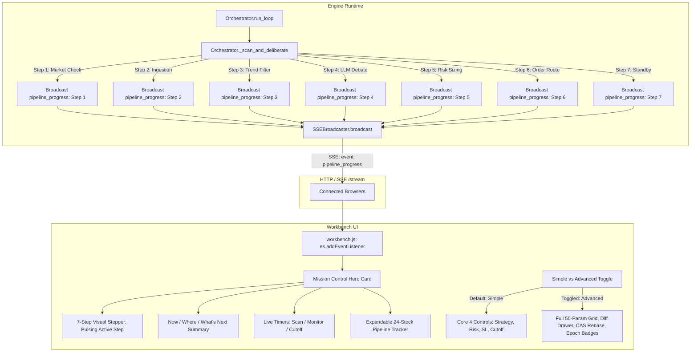

## Goal Capsule

- **Objective:** Give the operator an immediate, plain-English understanding of what the trading engine is executing right now, why specific universe stocks were or were not traded, and when the next automated action will occur, without forcing them to parse technical epoch IDs, CAS rebase panels, or raw 50-parameter grids.
- **Means:** Deploy a central "Mission Control" hero card on `#monitor` featuring a real-time 7-step pipeline stepper, an expandable 24-stock stage tracker, live countdowns to scan/stop/cutoff events, and a default Simple Mode exposing only four core operator controls (Active Strategy, Risk Level, Stop Buffer, Market Hours) while keeping technical tuning accessible behind an explicit Advanced toggle.
- **Product authority:** User confirmed scoping synthesis on 2026-11-13; governs the active UI/telemetry slice; Supertrend Strategy and historical replay simulation remain explicitly out of active scope as separate follow-up areas.
- **Open blockers:** None.

---

## Product Contract

### Summary
Replace the static and technical "Decision Funnel" card on `#monitor` with an integrated "Mission Control" hero card. The new card displays a live 7-step visual stepper that pulses during the active scan, a plain-English explanation of why assets were skipped or approved, live countdowns to upcoming scheduled events, and an expandable 24-stock pipeline tracker. Simple Mode is active by default to hide internal epoch and concurrency terminology, exposing four essential controls while preserving full configuration access via an Advanced toggle.

### Problem Frame
The current Web Control Plane (delivered in Area 1) successfully provides immutable configuration snapshots, persistent authentication, and zero-quota read models. However, its user interface exposes internal architectural machinery directly to the trader:
1. **Blind Scan Intervals:** The engine runs a 5-minute scan loop and a 30-second monitor loop (`trading_system/orchestrator.py:3105-3106`), but telemetry is only published when a cycle completes or aborts (`_publish_funnel_report`). During the multi-second scan, the UI gives no indication of active progress.
2. **Technical Gate Jargon:** Operators attempting to understand zero-trade cycles must decode static attribution chips (`min_adx_trend: 22 -> Tune MIN_ADX_TREND`) and raw count tables rather than seeing straightforward English explanations (e.g., *"20 stocks skipped: ADX trend strength < 18"*).
3. **Overwhelming Configuration Surface:** Opening the configuration interface immediately presents 50+ raw numeric fields alongside internal consensus tags like `Epoch: epoch-1`, `Staged-Intent Diff Drawer`, `Pending Restart`, and `409 Conflict Rebase`, creating cognitive friction for routine operational tasks like adjusting risk or changing market hours.

### Key Decisions
- KD1. **Central Mission Control Hero Card Over Fragmented Widgets** `(session-settled: user-directed — chosen over a thin top sticky banner or isolated kanban page: unifies live pipeline stepping, plain-English reasons, and schedule countdowns in the primary monitor view)`: Replaces the existing static `renderFunnelCard` on `#monitor` with a comprehensive mission control card. Governs R1, R2, R3, R4.
- KD2. **Combined Mission Control and Expandable Stock Tracker** `(session-settled: user-directed — chosen over standalone kanban board or purely aggregated metrics: provides immediate summary clarity with on-demand per-ticker transparency)`: Houses a collapsible 24-stock board beneath the hero card showing where each asset currently sits (Filtered Out, In Debate, Sizing, Active Trade). Governs R5, R6.
- KD3. **Simple Mode Default With Core 4 Controls** `(session-settled: user-directed — chosen over read-only summary or full 50-knob exposure: provides safe daily operation while retaining advanced access)`: Introduces a default Simple Mode hiding epoch and CAS terminology and surfacing only Active Strategy, Risk Level, Stop Buffer, and Market Hours, with an "Advanced Settings" toggle to reveal the full grid and diff drawer. Governs R7, R8, R9.
- KD4. **Lightweight Real-Time SSE Step Broadcasting** `(chosen over polling or end-of-cycle only reports: fulfills the live stepper requirement with zero Trading 212 API impact)`: Orchestrator emits lightweight progress events over `/stream` as each pipeline step starts (`1. Market Check` through `7. Standby`), keeping browser clients updated without extra broker quota. Governs R10, R11.
- KD5. **Area 2 Supertrend Separation** `(session-settled: user-directed — chosen over bundling Supertrend into this UI plan: isolates cognitive and testing surface so workflow clarity is completed before adding new mathematical strategies)`: Focuses this plan on operator workflow clarity and simple controls; Supertrend strategy math is deferred to follow-up Area 2. Governs R12.

<!-- ce-section: work-relationships -->
### How This Work Fits Together
This plan implements the operator-facing usability and workflow visualization layer atop the completed Area 1 foundation:
- **Upstream Foundation:**
  - Area 1 (Core Live Web Control Plane, `docs/plans/2026-11-11-1127-feat-core-web-control-plane-plan.md`): Delivered `ConfigBus`, fail-closed token gateway, zero-quota telemetry read model, and self-hosted `workbench.js`.
- **Active Plan:**
  - Simple Live Workflow View & Plain-English Controls: Replaces technical funnel abstractions with live step-by-step progress, plain-English rejection reasons, live countdowns, and a 4-knob Simple Mode.
- **Downstream Sibling Follow-Ups:**
  - Area 2 (`#5` Supertrend Strategy & Dynamic Universe Registry): Will implement the bar-by-bar Supertrend indicator and dynamic pair toggling, plugging directly into the Active Strategy selector established in this plan.
  - Area 3 (`#6` Pre-Flight SQLite Replay & Shadow Twin): Will attach historical simulation results directly to the Staged Diff Drawer accessible in Advanced Mode.

### Actors
- **Trader / Operator (Human):** Uses the browser dashboard to monitor bot operation, understand trade decisions, and adjust basic risk or strategy parameters without deciphering backend engineering terms.
- **Control Workbench UI (`workbench.js`):** Receives SSE events, renders the live stepper, manages Simple vs Advanced UI toggles, and translates low-level gate codes into human sentences.
- **Orchestrator (`orchestrator.py`):** Coordinates scan/deliberation cycles, evaluates session hours and stops, and broadcasts intermediate step milestones.

### Key Flows
- F1. **Live Scan Execution & Visual Progress:**
  - *Trigger:* Periodic 5-minute interval timer expires in `Orchestrator.run_loop`.
  - *Steps:*
    1. Orchestrator broadcasts `step: 1 (Market Check)`; UI highlights Step 1 as active.
    2. Orchestrator checks exchange hours; broadcasts `step: 2 (Fetch Data)`; UI shows candle retrieval for 24 assets.
    3. Orchestrator screens assets; broadcasts `step: 3 (Trend Filter)` with count of passing setups.
    4. Orchestrator spawns debate threads; broadcasts `step: 4 (AI Debate)` with active candidates (e.g. QQQ, S&P).
    5. Orchestrator sizes orders and calculates stop losses; broadcasts `step: 5 (Risk Sizing)`.
    6. Orchestrator submits orders to Trading 212; broadcasts `step: 6 (Order Route)` with result.
    7. Orchestrator publishes final cycle summary and enters sleep; broadcasts `step: 7 (Standby)` with countdown to next scan.
  - *Outcome:* UI stepper smoothly transitions from Step 1 through Step 7 in real time.
- F2. **Adjusting Parameters in Simple Mode:**
  - *Trigger:* Operator switches Risk Level from "Balanced (1.0%)" to "Conservative (0.5%)" in the Simple Controls card.
  - *Steps:*
    1. UI maps selection to underlying parameters (`RISK_PER_TRADE_PCT = 0.5`, `ATR_SL_MULTIPLIER = 2.5`).
    2. UI displays plain-English confirmation ("Applies to next scan cycle; existing trade stops remain safely locked").
    3. UI submits config patch with token auth; server increments `config_epoch_id` cleanly.
    4. UI reflects updated active profile with zero CAS rebase alerts shown.
  - *Outcome:* Risk is updated safely without the operator touching raw JSON or diff drawers.

### Requirements

#### Mission Control Hero Card & Live Stepper
- R1. The dashboard `#monitor` view must replace the static `Decision Funnel & Gate Attribution` card with a central "Mission Control" hero card.
- R2. The hero card must display a horizontal 7-step visual pipeline stepper with steps:
  1. Market Check (Exchange open/closed status)
  2. Fetch Data (Candle & indicator ingestion)
  3. Trend Filter (Screener and trend regime evaluation)
  4. AI Debate (Bull/Bear deliberation on passing setups)
  5. Risk Sizing (Position notional and stop loss calculation)
  6. Order Route (Broker GTC stop and execution placement)
  7. Standby (Inter-cycle sleep and monitoring)
- R3. The active step must visually pulse or highlight with live status text indicating current progress (e.g., *"Step 3: Screening 24 stocks for trend strength"*).
- R4. Completed steps within an active cycle must display green checkmark indicators; idle/future steps must appear muted.

#### Plain-English Trade Decision Breakdown & Schedule
- R5. The hero card must include a "Trade Decision Summary" section translating internal gate rejection metrics into human-readable sentences (e.g., *"20 stocks skipped: Trend strength ADX < 18 (low-volatility chop)"*, *"2 stocks skipped: Earnings scheduled within 48h"*).
- R6. The hero card must display real-time live countdown timers for:
  - Time remaining until next full universe scan cycle
  - Time remaining until next 30-second position monitor / trailing stop tick
  - Time remaining until daily 16:20 UTC asymmetric session cutoff (or indication of off-hours status)

#### Expandable 24-Stock Pipeline Tracker
- R7. The hero card must include an expandable/collapsible "Stock Pipeline Tracker" section showing all 24 assets in the universe grouped by their current pipeline stage (Filtered Out, In Debate, Order Routing, Open Trade).
- R8. Each asset chip in the tracker must display its ticker, primary indicator value (e.g., ADX or earnings distance), and exact reason for exit or pass.

#### Simple Mode Defaults & Core 4 Controls
- R9. The dashboard must default to "Simple Mode", hiding raw epoch tokens (`Epoch: epoch-N`), CAS conflict panels, and technical jargon from the main view.
- R10. Simple Mode must provide a dedicated "Quick Controls" section exposing exactly four essential parameters:
  - Active Strategy: Dropdown with registered strategies (`Directional Trend`, ready for `Supertrend`)
  - Risk Level: 3-way toggle between Conservative (0.5% risk, wide stop), Balanced (1.0% risk, standard stop), and Aggressive (1.5% risk, tight stop)
  - Stop Loss Buffer: Selector for standard ATR noise buffer multiplier
  - Trading Window: Inputs for trade window start and session cutoff
- R11. A persistent "Advanced Settings" toggle button must allow operators to switch into Advanced Mode, unhiding the full 50+ parameter grid, Staged-Intent Diff Drawer, and Audit History timeline.

#### SSE Real-Time Progress Broadcasting
- R12. `Orchestrator` must emit lightweight SSE events (`event: pipeline_progress`) to connected clients when each pipeline step commences, carrying `{ step: int, name: str, detail: str, timestamp: float }`.
- R13. `workbench.js` SSE client must handle `pipeline_progress` events immediately, updating the stepper state without requiring a full page refresh or heavy snapshot fetch.

### Scope Boundaries
- **In Scope:**
  - Mission Control hero card on `#monitor` with 7-step visual stepper.
  - Intermediate SSE progress broadcasting in `Orchestrator` and `server.py`.
  - Human-language translation engine in `workbench.js` for cycle gate attributions.
  - Live countdown timers (Scan interval, monitor interval, 16:20 UTC cutoff).
  - Expandable 24-stock stage tracker board.
  - Simple Mode toggle with Core 4 control inputs mapped to underlying settings.
  - Advanced Mode unhide toggle for power-user features.
- **Deferred for Later:**
  - Supertrend Strategy calculation and registration (Area 2).
  - Dynamic Universe broker validation and web CRUD (Area 2).
  - Historical SQLite replay and shadow paper simulation on diffs (Area 3).
- **Outside This Product's Identity:**
  - Multi-user authentication, roles, or cloud hosting (engine runs single-tenant on local Raspberry Pi / Mac).
  - Third-party mobile app notifications (already handled by Telegram/Discord webhooks).

### Acceptance Examples
- AE1. **Live Stepper Progression:**
  - *Given* the orchestrator begins a 5-minute scan cycle,
  - *When* the screener evaluates universe indicators,
  - *Then* the dashboard hero card highlights Step 3 ("Trend Filter") with a pulsing indicator and displays *"Screening 24 stocks..."*, without requiring a manual refresh.
- AE2. **Plain-English Rejection Clarity:**
  - *Given* 22 out of 24 stocks fail the ADX floor and 2 fail earnings proximity during a scan,
  - *When* the operator inspects the Mission Control card,
  - *Then* the card displays explicit text *"22 stocks skipped: Trend strength ADX < 18"* and *"2 stocks skipped: Earnings within 48h"*, rather than raw gate ID codes.
- AE3. **Simple Mode Operation:**
  - *Given* the dashboard is loaded by a non-technical operator,
  - *When* the page renders,
  - *Then* no mentions of `Epoch`, `CAS Rebase`, or 50-item parameter tables are visible, and the operator can change Risk Level from "Balanced" to "Conservative" with one click.
- AE4. **Advanced Mode Toggle:**
  - *Given* an operator is in Simple Mode,
  - *When* they click "Advanced Settings",
  - *Then* the full parameter grid, Staged-Intent Diff Drawer, and Audit History timeline become visible immediately.

### Success Criteria
1. An operator opening the dashboard can immediately state what step the engine is running and when the next scan will occur within 3 seconds of viewing the screen.
2. Zero-trade cycles are clearly explained in plain English without requiring the user to cross-reference configuration schema files or terminal logs.
3. Common operational tweaks (risk percentage, stop buffer, strategy selection) can be completed with a single control interaction in Simple Mode.
4. Intermediate progress events generate zero additional HTTP calls to Trading 212 and maintain 60 FPS UI responsiveness.

---

## Planning Contract

### Key Technical Decisions

- **KTD1: SSE `pipeline_progress` Event Streaming** `(session-settled: user-directed — chosen over polling or end-of-cycle only reports: fulfills the live stepper requirement with zero Trading 212 API impact)`:
  The `Orchestrator` emits lightweight SSE events named `pipeline_progress` over `/stream` at the start of each of the 7 pipeline phases. Each event carries `{ step: int, total_steps: int, name: str, detail: str, active_assets: list, timestamp: float, cycle_id: str }`. This completely decouples frontend real-time animation from heavy read-model snapshots and requires zero broker quota. Governs R1, R2, R10, R11.
- **KTD2: Plain-English Gate Attribution Translation Layer** `(session-settled: user-directed — chosen over raw parameter key chips: eliminates cognitive friction for operators)`:
  A client-side translation registry in `workbench.js` maps raw engine rejection reasons (e.g., `min_adx_trend: 14.2`, `earnings_blackout: 24h`, `spread_gate: 0.018`, `macro_regime_chop`) into clear, human-friendly sentences (e.g., *"20 stocks skipped: ADX trend strength < 18"*, *"2 stocks skipped: Earnings release within 48h blackout"*). Governs R3, R4.
- **KTD3: Modular Mission Control Hero Component with Expandable 24-Stock Board** `(session-settled: user-directed — chosen over a fragmented top banner or separate kanban page: unifies high-level status with on-demand per-ticker drill-down)`:
  Replaces `renderFunnelCard` on `#monitor` with an integrated Mission Control card. Houses the 7-step horizontal stepper, "Now / Where / What's Next" dynamic summary, live countdowns (Next Scan, Next Stop Check, Session Cutoff), and an expandable 4-stage tray (`Filtered Out`, `In Debate`, `Sizing`, `Active Trade`) displaying universe stocks. Governs R1, R2, R5, R6.
- **KTD4: Default Simple Mode View State with Core 4 Operator Controls** `(session-settled: user-directed — chosen over exposing all 50 parameters by default: protects operators from configuration fatigue and accidental misconfiguration)`:
  `workbench.js` stores a `quant_workbench_view_mode: "simple" | "advanced"` preference in `localStorage` (defaulting to `"simple"`). In Simple Mode:
  - Header hides `Epoch: epoch-N` badge, re-epoch modals, and CAS rebase panels.
  - `#config` tab presents a simplified "Quick Controls" card exposing only Active Strategy, Risk Level (Conservative 0.5% / Balanced 1.0% / Aggressive 1.5%), Stop Loss Buffer (ATR multiplier), and Market Hours.
  - A prominent "Advanced Settings" toggle smoothly unlocks the full 50-field grid, Diff Drawer, and Audit Timeline for technical tuning. Governs R7, R8, R9.
- **KTD5: Area 2 Supertrend Strategy Separation** `(session-settled: user-directed — chosen over bundling mathematical indicator implementation with workflow UI overhaul)`:
  This implementation plan focuses entirely on operator transparency, live workflow visualization, and simplified controls. The Supertrend mathematical indicator and dynamic universe registry will follow immediately in Area 2, plugging cleanly into the strategy selector built here. Governs R12.

### High-Level Technical Design



### Assumptions
1. Trading 212 API limits: Intermediate progress notifications do NOT query Trading 212 or make network requests; they only publish local engine state transitions to connected Web UI clients.
2. Browser environment: Operators use modern browsers supporting SSE (`EventSource`) and standard CSS grid/flexbox. Offline or file-protocol fallbacks render gracefully.
3. Storage: Simple/Advanced mode preference persists across reloads in browser `localStorage`.
4. Backward Compatibility: All existing endpoints (`/api/data`, `/api/config`, `/stream`, `/api/panic`) remain completely backwards-compatible and unchanged.

### Risks and Mitigations
- **Risk 1: SSE Message Flood:** Emitting too many rapid progress events could congest client message loops.
  - *Mitigation:* Events are only emitted at step boundaries (7 events total per 5-minute scan cycle, ~1 event every 0.5–2 seconds during active screening).
- **Risk 2: Disconnection / Reconnection State Drift:** A browser reconnecting mid-scan could miss intermediate progress events.
  - *Mitigation:* The read-model snapshot `/api/data` and `dashboard_update` event carry the current `pipeline_state`, so a client re-syncs immediately upon reconnect.
- **Risk 3: Configuration Schema Mismatch in Simple Mode:** Changing Risk Level (e.g. "Conservative") modifies underlying parameters (`MAX_RISK_PER_TRADE`, `ATR_SL_MULTIPLIER`).
  - *Mitigation:* Core 4 controls map explicitly to existing validated schema keys and pass standard `ConfigBus` validation before staging.

---

## Implementation Units

### U1: Orchestrator Pipeline Step Telemetry Broadcast
- **Goal:** Emit lightweight `pipeline_progress` SSE events during the scan cycle across all 7 operational steps without broker API overhead.
- **Requirements Covered:** R1, R2, R10, R11
- **Files Modified:**
  - `trading_system/orchestrator.py`
  - `trading_system/telemetry_gateway.py`
- **Approach:**
  - Add helper `_broadcast_pipeline_step(step: int, name: str, detail: str, active_assets: list = None)` to `Orchestrator`.
  - In `_scan_and_deliberate` and `run_cycle`, invoke `_broadcast_pipeline_step` at:
    - Step 1: Market Check (verifying market open, session cutoff, and circuit breakers)
    - Step 2: Fetch Data (ingesting candle bars & metrics for universe)
    - Step 3: Trend Filter (running screener & technical indicator gates)
    - Step 4: Debate (System 2 LLM consensus deliberation)
    - Step 5: Risk Sizing (computing ATR stops, target position size, portfolio heat)
    - Step 6: Order Route (pacing execution and placing broker limit/stop orders)
    - Step 7: Standby (cycle complete, monitoring active positions)
  - Include current step in `_build_read_model_snapshot()` under `funnel.pipeline_progress`.
- **Test Scenarios:**
  - *Happy path:* Running `_scan_and_deliberate` emits 7 `pipeline_progress` events with sequential step numbers 1..7.
  - *Early exit / Halted:* When halted or market closed, emits Step 1 with status="halted"/"off_hours" and transitions directly to Standby.
  - *Zero Broker Calls:* Verify no additional HTTP calls to Trading 212 occur during step broadcasts.
- **Verification:** Unit tests in `tests/test_orchestrator_pipeline_progress.py`.

### U2: Server SSE Pipeline Progress Event Streaming
- **Goal:** Ensure `server.py` forwards `pipeline_progress` events cleanly to `/stream` SSE subscribers.
- **Requirements Covered:** R10, R11
- **Files Modified:**
  - `trading_system/dashboard/server.py`
- **Approach:**
  - Verify that `SSEBroadcaster` handles event type `pipeline_progress` with correct SSE wire framing (`event: pipeline_progress\ndata: {...}\n\n`).
  - Add integration helper in test suite to verify event dispatch to connected queues.
- **Test Scenarios:**
  - *Happy path:* Subscriber receives `pipeline_progress` event frame with JSON payload.
  - *Queue full / Drop oldest:* Verify subscriber with full queue drops oldest event without blocking orchestrator thread.
- **Verification:** Unit tests in `tests/test_dashboard_sse.py`.

### U3: Workbench Mission Control Hero Card & Live 7-Step Stepper
- **Goal:** Build the Mission Control hero card on `#monitor` in `workbench.js` featuring the live 7-step horizontal stepper, dynamic "Now / Where / What's Next" callout, and 3 live countdown timers.
- **Requirements Covered:** R1, R2, R4, R5, R11
- **Files Modified:**
  - `trading_system/dashboard/assets/workbench.js`
  - `trading_system/dashboard/assets/styles.css`
- **Approach:**
  - Replace `renderFunnelCard` with `renderMissionControlCard`.
  - Add 7-step horizontal stepper UI:
    - Steps: `1. Market Check` → `2. Fetch Data` → `3. Trend Filter` → `4. Debate` → `5. Risk Sizing` → `6. Order Route` → `7. Standby`.
    - Active step has an animated pulsing emerald glow (`wb-step--active`).
    - Completed steps have checkmarks (`wb-step--completed`).
    - Pending steps are dimmed (`wb-step--pending`).
  - Render "Now / Where / What's Next" dynamic callout box:
    - "Now": current step name & description.
    - "Where": number of universe stocks currently being evaluated.
    - "What's Next": upcoming step and estimated time to next scan.
  - Render 3 countdown timers updated every second:
    - Time until next 5m universe scan.
    - Time until next 30s stop monitor check.
    - Time until 16:20 UTC LSE close cutoff.
  - Wire `es.addEventListener("pipeline_progress", ...)` to update stepper state immediately.
- **Test Scenarios:**
  - *Happy path:* Stepper correctly reflects step 3 during trend filtering and displays pulsing style.
  - *Countdowns:* Timers decrement every second accurately without page flicker.
  - *Fallback:* If no SSE, stepper shows latest cycle state from read-model snapshot.
- **Verification:** `tests/test_workbench_assets.py` static syntax & CSS checks, plus Node DOM harness tests.

### U4: Plain-English Rejection Translator & Expandable Stock Tracker
- **Goal:** Translate technical gate rejection codes into clear English and provide an expandable 24-stock board grouped by pipeline stage.
- **Requirements Covered:** R3, R4, R6
- **Files Modified:**
  - `trading_system/dashboard/assets/workbench.js`
  - `trading_system/dashboard/assets/styles.css`
- **Approach:**
  - Implement `translateGateRejection(gateId, details)`:
    - `min_adx_trend` → "Trend strength ADX below threshold (< 18.0)"
    - `earnings_blackout` → "Earnings release within 48h blackout"
    - `spread_gate` → "Bid-ask spread too wide (> 1.5%)"
    - `macro_regime_chop` → "Market regime in low-volatility chop"
    - `correlation_limit` → "Sector exposure limit reached"
  - Render plain-English summary cards in Mission Control (e.g. *"20 stocks skipped: ADX trend strength < 18"*).
  - Add collapsible "Universe Stock Tracker" tray beneath the hero card:
    - 4 Stage Columns: `1. Filtered Out`, `2. In Debate`, `3. Sizing`, `4. Active Trade`.
    - Collapsed by default with a toggle button: "Show Stock Tracker (24 assets)".
    - Each asset card displays ticker, status badge, rejection reason or conviction score.
- **Test Scenarios:**
  - *Translation accuracy:* Technical strings are cleanly converted to English sentences without undefined values.
  - *Collapsible toggle:* Clicking toggle expands and collapses the stock tracker cleanly.
- **Verification:** `tests/test_workbench_assets.py`.

### U5: Default Simple Mode & Core 4 Controls with Advanced Toggle
- **Goal:** Enable a distraction-free Simple Mode by default that hides technical epoch/CAS jargon and presents only the 4 essential operator controls, with an Advanced toggle.
- **Requirements Covered:** R7, R8, R9
- **Files Modified:**
  - `trading_system/dashboard/assets/workbench.js`
  - `trading_system/dashboard/assets/styles.css`
- **Approach:**
  - Add `state.viewMode = localStorage.getItem("quant_workbench_view_mode") || "simple"`.
  - In Simple Mode:
    - Header: Hide `Epoch: epoch-N` badge, re-epoch modals, and CAS rebase panels.
    - `#config` tab: Render "Quick Controls" card with Core 4 parameters:
      1. Active Strategy: Dropdown (`Directional Trend`, placeholder `Supertrend (Coming Soon)`).
      2. Risk Level: 3-way toggle (Conservative: 0.5% risk / 2.5x ATR SL, Balanced: 1.0% risk / 2.2x ATR SL, Aggressive: 1.5% risk / 1.8x ATR SL).
      3. Stop Loss Buffer: ATR multiplier selector (1.5x - 3.0x).
      4. Trading Window: Start & session close cutoff times (e.g. 16:20 UTC).
    - Provide a prominent button: "Advanced Settings & Full Parameter Grid".
  - In Advanced Mode:
    - Show full 50+ parameter table, Staged-Intent Diff Drawer, Audit Timeline, and epoch tags.
    - Provide a button: "Switch to Simple Mode".
- **Test Scenarios:**
  - *Default view:* First load defaults to Simple Mode with epoch jargon hidden.
  - *Quick control staging:* Selecting "Conservative" stages `MAX_RISK_PER_TRADE = 0.005` and `ATR_SL_MULTIPLIER = 2.5`.
  - *Toggle persistence:* Switching to Advanced persists in `localStorage` across page refresh.
- **Verification:** `tests/test_workbench_assets.py`.

### U6: Test Coverage & Regression Verification
- **Goal:** Provide thorough unit, static, and E2E regression tests for all new backend step broadcasts and frontend workbench behaviors.
- **Requirements Covered:** R1–R13
- **Files Modified / Created:**
  - `tests/test_orchestrator_pipeline_progress.py` (New)
  - `tests/test_workbench_assets.py` (Extended)
- **Approach:**
  - Write `tests/test_orchestrator_pipeline_progress.py` testing orchestrator intermediate event emission.
  - Extend `tests/test_workbench_assets.py` to verify:
    - Node syntax check on `workbench.js`.
    - No external CDN or remote URLs.
    - Simple Mode DOM rendering and toggle mechanics.
    - Plain-English gate translation coverage.
    - Mission control card DOM IDs and CSS classes.
  - Run full test suite `./venv/bin/python3 -m unittest discover -s tests -t .` and `./run_e2e_tests.sh`.
- **Test Scenarios:**
  - All existing 549 unit tests continue to pass.
  - All new tests pass with 100% green status.
- **Verification:** Test runner pass output.

---

## Verification Contract

### Automated Test Commands
1. **Unit & Orchestrator Progress Tests:**
   ```bash
   ./venv/bin/python3 -m unittest discover -s tests -t .
   ```
2. **Workbench Static & DOM Validation Tests:**
   ```bash
   ./venv/bin/python3 -m unittest tests/test_workbench_assets.py
   ```
3. **End-to-End Test Suite:**
   ```bash
   ./run_e2e_tests.sh
   ```

### Quality Gates
- **Zero Trading 212 Quota:** Intermediate SSE step events must generate zero broker API requests.
- **Zero External Dependencies:** No external CDNs, fonts, or tracking scripts in `styles.css` or `workbench.js`.
- **Fail-Closed Safety:** If SSE connection drops, workbench falls back gracefully to cached snapshot.
- **Responsive Layout:** Stepper and Mission Control card display cleanly on both desktop and mobile viewports.

---

## Definition of Done

- [x] Requirements preserved from `ce-brainstorm` Product Contract without scope changes.
- [ ] U1: `Orchestrator` emits sequential 7-step `pipeline_progress` events without broker calls.
- [ ] U2: `server.py` SSE broadcaster streams `pipeline_progress` events to connected clients.
- [ ] U3: `workbench.js` renders Mission Control hero card with pulsing 7-step stepper and live countdowns.
- [ ] U4: Plain-English rejection translation engine and expandable 24-stock board implemented.
- [ ] U5: Simple Mode active by default with Core 4 controls; Advanced Mode toggle accessible.
- [ ] U6: All unit, static, and E2E tests pass cleanly.
- [ ] Abandoned or experimental code pruned; working tree clean and committed locally.
