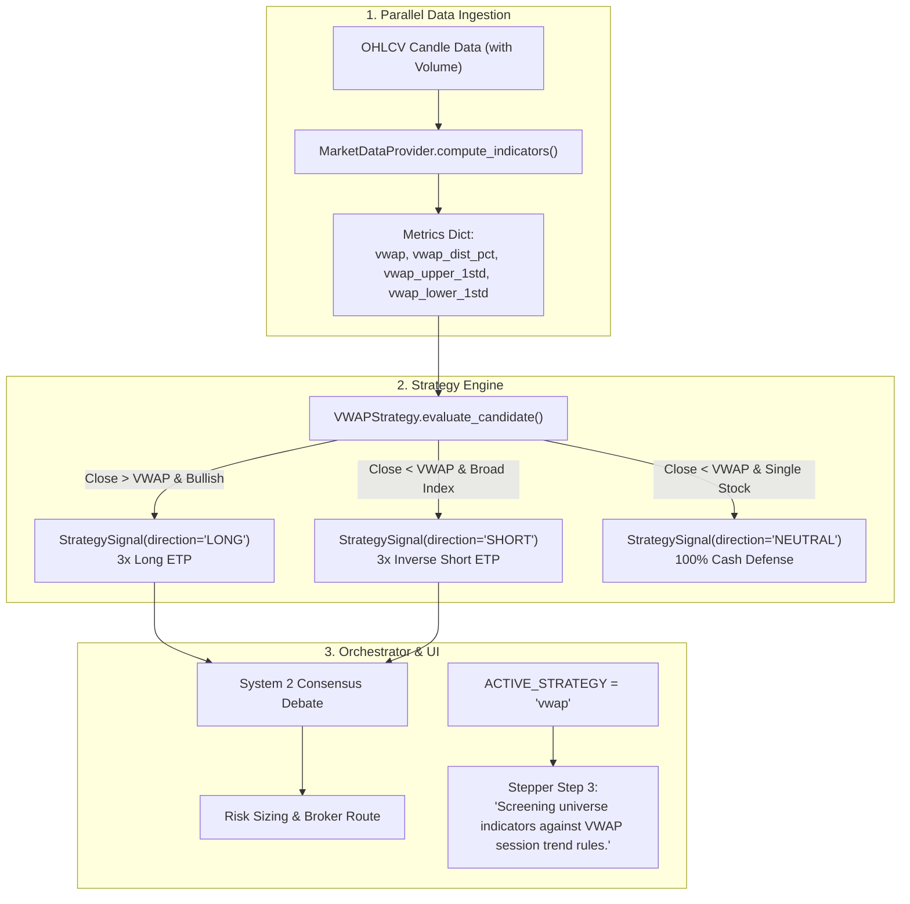

# Feature: VWAP Session Trend-Following Strategy Engine

## Product Contract

### Problem Statement
The current default strategy (`directional_trend`) relies strictly on multi-timeframe Directional Movement Index ($ADX \ge 18.0$, $+DI > -DI$) and 20/50 EMA slope alignment. In consolidation or low-volatility regimes, these filters frequently reject 100% of candidate assets across entire scan cycles, resulting in zero actionable trades and leaving capital idle.

The user selected **VWAP Session Trend-Following** to provide a responsive, institutional volume-weighted benchmark:
- Enter **3x Long ETPs** when price breaks and holds above session VWAP with confirmed institutional volume.
- Enter **3x Inverse Short ETPs** on broad market indices (`QQQ`, `SPY`, `SMH`) when price breaks and holds below session VWAP.
- For single-stock equities trading below VWAP, enforce **100% Cash Defense** to prevent knife-catching.

### User Stories & Scope Boundaries
- **US1 (VWAP Calculation & Indicators)**: As an automated engine, I compute the volume-weighted average price $\text{VWAP} = \frac{\sum (P_{\text{typical}} \times V)}{\sum V}$ and standard deviation bands ($\pm 1\sigma$) from session candles so that every asset has real-time VWAP metrics.
- **US2 (VWAP Strategy Implementation)**: As the Strategy Engine, I evaluate assets against VWAP rules and emit standardized `StrategySignal` objects with conviction scoring, bull/bear evidence, and gate rejections.
- **US3 (Dual-Track Short Execution)**: As a risk-governed execution layer, when broad index benchmarks trade below VWAP, I route to 3x Inverse Short ETPs; when single stocks trade below VWAP, I route to Cash Defense.
- **US4 (Dashboard & Quick Controls Integration)**: As a user viewing the Mission Control Web Workbench, I can select `"vwap"` from the Active Strategy dropdown in Quick Controls, see live VWAP metrics in the stock tracker, and watch Step 3 report VWAP trend screening in plain English.

### Non-Goals
- Real-time tick-by-tick level-2 order book VWAP (we compute session VWAP from 15m/hourly candle bars with volume).
- Replacing the existing `directional_trend` strategy (both strategies coexist in the StrategyRegistry).
- Changing broker order execution, position monitoring, or the 16:20 UTC cutoff protocol (all existing safety rails remain intact).

### Acceptance Criteria
- [ ] `MarketDataProvider.compute_indicators` calculates `vwap`, `vwap_dist_pct`, `vwap_upper_1std`, and `vwap_lower_1std` for both pandas and pure-python execution paths.
- [ ] `VWAPStrategy` is registered in `StrategyRegistry` under `"vwap"` and inherits from `BaseStrategy`.
- [ ] Long setups require $\text{Close} > \text{VWAP}$ and $\text{Close} > \text{SMA200}$ (or upward EMA trend), emitting `StrategySignal(direction="LONG")`.
- [ ] Short setups require $\text{Close} < \text{VWAP}$ on broad index assets (`QQQ`, `SPY`, `SMH`), emitting `StrategySignal(direction="SHORT")`. Single equities below VWAP emit `NEUTRAL` (Cash Defense).
- [ ] `ACTIVE_STRATEGY = "vwap"` is selectable via the Control Workbench Quick Controls and Config Schema.
- [ ] Mission Control stepper Step 3 dynamically displays: *"Screening universe indicators against VWAP session trend rules."*
- [ ] All unit, integration, and E2E tests pass (555+ unit tests, 201 E2E tests).

---

## Planning Contract

### Key Technical Decisions (KTDs)
- **KTD1 (Session-anchored VWAP computation)**: Compute VWAP as $\text{Typical Price} = (H+L+C)/3$, $\text{VWAP} = \sum (P_{\text{typical}} \times V) / \sum V$ from available session candles. (Rejected: Rolling multi-day VWAP or order-book L2 VWAP; Reason: Standard institutional intraday benchmark).
- **KTD2 (Dual-Track Bear Protection)**: Single equities below VWAP emit `NEUTRAL` (Cash Defense); broad indices (`QQQ`, `SPY`, `SMH`) emit `SHORT` routing to 3x Inverse Short ETPs (`QQQS`, `3USS`, `3SES`). (Rejected: Shorting single momentum stocks; Reason: High volatility drag and short squeeze risk).
- **KTD3 (StrategyRegistry Plugin Architecture)**: Implement `VWAPStrategy` as an isolated subclass of `BaseStrategy` registered via `@StrategyRegistry.register("vwap")`. (Rejected: Monolithic screener if-else branching; Reason: Clean decoupling and zero regression to `directional_trend`).
- **KTD4 (Indicator Engine Caching)**: Enrich `MarketDataProvider.compute_indicators` with `vwap`, `vwap_dist_pct`, `vwap_upper_1std`, and `vwap_lower_1std` across both pandas and pure-python list-of-dicts paths. (Rejected: Recalculating in screener loops; Reason: Thread-safe in-memory caching during parallel ingestion).
- **KTD5 (Quick Controls & Stepper Integration)**: Surface `"vwap"` as a first-class choice in Quick Controls and configure Step 3 of the 7-step stepper to display dynamic VWAP context. (Rejected: Advanced-mode-only configuration; Reason: Simplicity and immediate visual feedback).

### Architecture & Data Flow

### Assumptions, Risks & Mitigations
- **Volume Data Availability**: Free endpoints (such as Yahoo Finance / Stooq) occasionally return 0 or empty volume for exotic illiquid tickers.  
  *Mitigation*: If $\sum V \le 0$, fall back gracefully to Typical Price SMA ($P_{\text{typical}}$ average) so calculation never crashes or divides by zero.
- **Extreme VWAP Distance Disconnection**: Entering too far above VWAP can lead to buying the top of a climax run.  
  *Mitigation*: Gate long entries to a reasonable distance threshold (e.g., within $+0.1\%$ to $+3.5\%$ of VWAP); entries exceeding $+3.5\%$ are tagged `unfavorable` (exhaustion risk).

---

## Implementation Units

### Unit 1 (U1): Indicator Engine Expansion
- **Files**: `trading_system/data/trading212_client.py`
- **Tasks**:
  1. In `MarketDataProvider.compute_indicators` (pandas path), calculate:
     - `typical_price = (high + low + close) / 3.0`
     - `vwap = (typical_price * volume).sum() / (volume.sum() + 1e-9)`
     - `vwap_dist_pct = ((close - vwap) / vwap) * 100.0`
     - `vwap_std = sqrt(((typical_price - vwap) ** 2 * volume).sum() / (volume.sum() + 1e-9))`
     - `vwap_upper_1std = vwap + vwap_std`, `vwap_lower_1std = vwap - vwap_std`
  2. Implement equivalent fallback calculation in the pure-python list-of-dicts path.
  3. Include fallback when total volume is 0.

### Unit 2 (U2): VWAP Strategy Engine (`VWAPStrategy`)
- **Files**: `trading_system/strategies/vwap.py`, `trading_system/strategies/__init__.py`, `trading_system/strategies/registry.py`
- **Tasks**:
  1. Create `trading_system/strategies/vwap.py` implementing `VWAPStrategy(BaseStrategy)`.
  2. Implement `evaluate_candidate(ticker, metrics, config_snapshot) -> StrategySignal`.
  3. Evaluate Bull conditions:
     - $\text{Close} > \text{VWAP}$
     - $\text{VWAP Distance} \in [0.1\%, 3.5\%]$
     - Trend confirmation: $\text{Close} > \text{SMA200}$ or $\text{EMA20} > \text{EMA50}$
     - Conviction calculation ($0.70$ base up to $0.95$ max based on volume surge and $+DI > -DI$).
  4. Evaluate Bear conditions:
     - $\text{Close} < \text{VWAP}$
     - If `is_broad_index(ticker)`: emit `SHORT` with base conviction $0.75$.
     - If single equity: emit `NEUTRAL` with rationale *"Single equity below VWAP: Cash Defense enforced."*
  5. Wire dynamic gate evaluations via `_evaluate_dynamic_gates`.
  6. Register with `@StrategyRegistry.register("vwap")` and import in `registry.py`'s `_ensure_builtins_registered()`.

### Unit 3 (U3): Schema & Configuration Integration
- **Files**: `trading_system/config_schema.py`, `trading_system/config.py`
- **Tasks**:
  1. In `config_schema.py`, update `ACTIVE_STRATEGY` parameter spec allowed options to include `"vwap"`.
  2. Update schema validation so `ACTIVE_STRATEGY = "vwap"` is validated cleanly.

### Unit 4 (U4): Orchestrator & Mission Control UI Integration
- **Files**: `trading_system/orchestrator.py`, `trading_system/dashboard/assets/workbench.js`
- **Tasks**:
  1. In `trading_system/orchestrator.py` (`_scan_and_deliberate`):
     - When `active_strat == "vwap"`, format step 3 detail as: `"Screening universe indicators against VWAP session trend rules."`
  2. In `trading_system/dashboard/assets/workbench.js`:
     - Add `"vwap"` option with label `"VWAP Session Trend"` to `renderQuickControls` strategy selector.
     - Add VWAP gate translations to `PLAIN_ENGLISH_GATE_TRANSLATIONS` (e.g. `BELOW_VWAP` -> *"Price trading below institutional VWAP benchmark"*).

### Unit 5 (U5): Verification & Test Suite
- **Files**: `tests/test_vwap_strategy.py`, `tests/test_workbench_assets.py`
- **Tasks**:
  1. Add `tests/test_vwap_strategy.py`:
     - Test indicator calculation with volume and zero-volume fallback.
     - Test Long signal generation for asset breaking above VWAP.
     - Test Short signal generation for broad index below VWAP.
     - Test Cash Defense (NEUTRAL) for individual stock below VWAP.
     - Test dynamic gate rejections.
  2. Add test in `tests/test_workbench_assets.py` verifying Quick Controls renders `"vwap"` option.

---

## Verification Contract

1. **Unit Tests**:
   - Run `python3 -m unittest tests/test_vwap_strategy.py`
   - Run `python3 -m unittest tests/test_workbench_assets.py`
   - Full discovery: `python3 -m unittest discover -s tests -t .`
2. **E2E Tests**:
   - Run `./run_e2e_tests.sh` to confirm all 4 tiers pass without regression.

---

## Definition of Done
- All 5 Implementation Units (U1–U5) implemented and verified.
- 100% of unit tests pass (555+ existing + new VWAP tests).
- All 201 E2E tests pass.
- Clean git commit made locally.
