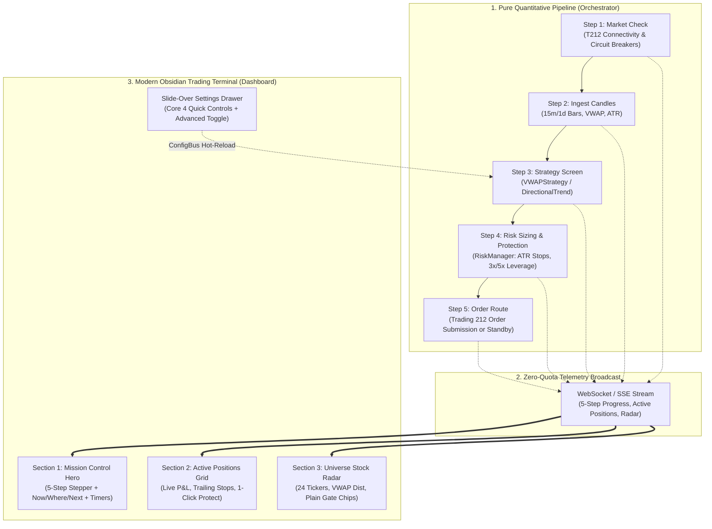

# Refactor: Full-System Optimization, Pure 5-Step Quantitative Engine & Modern Obsidian Trading Terminal

## Goal Capsule

- **Objective**: Transform the trading platform into a lean, sub-second, pure quantitative engine paired with a sleek, high-signal Modern Obsidian Trading Terminal, delivering instantaneous scan cycles and a clutter-free 3-section Command Deck.
- **Means**: Eliminate the dead multi-agent debate engine, dormant unconfigured providers (Nixtla, Olostep, Finnhub), and redundant thread pools; collapse the execution pipeline from 7 steps to 5 deterministic steps; and rebuild the web workbench into an obsidian dark command center with a slide-over settings drawer.
- **Product Authority**: Core execution mechanics (Trading 212 execution, 100% pure Trailing Stop Loss ratcheting, native broker GTC stop loss orders, 16:20 UTC cutoff) remain 100% untouched. Qualitative LLM debates and unconfigured external services are out of active scope.
- **Open Blockers**: None. Settled direction confirmed by user.

---

## Product Contract

> **Product Contract preservation**: Preserved in place from brainstorm. Requirements and user stories refined to explicitly reflect the 5-step pure quantitative engine and the 3-section Modern Obsidian Command Deck.

### Problem Statement

Over successive iterations, the trading engine and dashboard accumulated unnecessary complexity, speculative external dependencies, and visual noise:
1. **Dormant Multi-Agent Debate & Provider Bloat**: The codebase includes a 456-line `DebateEngine`, a `TechnicalAgent`, and a `FundamentalAgent` attempting to run multi-agent LLM debates via OpenAI GPT-4o. Because `OPENAI_API_KEY` is unconfigured in `.env`, every scan cycle triggers warning logs and drops into `_fallback_debate()`. This fallback merely recalculates basic technical indicators (RSI > 50, EMA20 > EMA50) that the strategy engine already computed in Step 3, wasting CPU cycles and thread pool overhead while adding no alpha. Similarly, unconfigured providers (`NixtlaProvider`, `OlostepProvider`, `FinnhubProvider`) create dead code and log warnings.
2. **Dashboard Fragmentation & Cognitive Overload**: The web workbench (`http://localhost:8888/`) exposes internal engineering jargon (CAS commit hashes like `epoch-1 [a1b2c3]`, 50+ raw technical inputs, 5 fragmented tabs). A trader cannot instantly answer: *"What is happening now, where are my active trades, and what will happen next?"*
3. **Pipeline Bloat (7 Steps ➔ 5 Steps)**: The live progress pipeline has 7 steps including "Deliberation" and "Consensus," which are confusing artifacts of the debate engine.

---

### Requirements

- **R1 (Debate & Agent Layer Pruning)**: The system shall completely excise `DebateEngine`, `TechnicalAgent`, and `FundamentalAgent`. All candidate filtering and consensus shall derive directly from strategy signals (`VWAPStrategy` or `DirectionalTrendStrategy`) and quantitative risk sizing without LLM calls, fallback warnings, or thread pool overhead.
- **R2 (5-Step Deterministic Pipeline)**: The execution cycle and telemetry stepper shall collapse from 7 steps into 5 clear stages:
  1. `Market Check` (broker connection, market open status, circuit breakers)
  2. `Ingest Candles` (live 15m/1d bars, VWAP calculation, ATR calculation)
  3. `Strategy Screen` (active strategy gate evaluation: VWAP distance or Trend alignment)
  4. `Risk Sizing & Protection` (ATR stops, leverage selection, position sizing)
  5. `Order Route` (live order dispatch or Standby when 0 candidates qualify)
- **R3 (Modern Obsidian Visual Identity)**: The web dashboard shall adopt a deep obsidian slate palette (`#0B0F17` canvas, `#111827` cards, `#1F2937` borders, `#10B981` emerald, `#F43F5E` rose) with high-contrast monospaced numerals, clean card elevations, and zero CAS commit hash clutter.
- **R4 (3-Section Command Deck)**: The primary dashboard interface shall unify into a single-view Command Deck:
  - *Section 1 (Mission Control Hero)*: 5-step visual stepper with pulsing active stage, "Now / Where / What's Next" plain-English narrative, and synchronized countdowns.
  - *Section 2 (Active Positions Grid)*: High-impact cards for open trades displaying live P&L badges, entry price, current price, ratcheted trailing stops, profit cushions, and 1-click protection actions.
  - *Section 3 (Universe Stock Radar)*: 24-stock responsive grid displaying real-time screening status, VWAP distance, and plain-English gate chips.
- **R5 (Slide-Over Settings Drawer)**: Strategy configuration shall reside in an elegant slide-over drawer triggered by a floating gear button, featuring the **Core 4 Quick Controls** (Active Strategy, Risk Profile, Stop Loss Buffer, Cutoff Time) and a collapsible Advanced Settings toggle, hot-reloading parameters via `ConfigBus` with zero page reloads.
- **R6 (Provider & Repository Hygiene)**: Prototype script `evaluate_3rsi.py` and dormant unconfigured provider classes (`NixtlaProvider`, `OlostepProvider`, `FinnhubProvider`) shall be removed from the repo, and dead configuration keys pruned from schemas.

---

### Scope Boundaries

#### In Scope
- Excising `DebateEngine`, `TechnicalAgent`, `FundamentalAgent`, `evaluate_3rsi.py`, and dormant providers (`NixtlaProvider`, `OlostepProvider`, `FinnhubProvider`).
- Re-architecting `orchestrator.py` to route candidates directly from Strategy Filter to `RiskManager` and broadcast 5-step progress telemetry.
- Overhauling `trading_system/dashboard/assets/styles.css` and `workbench.js` to render the 3-section Modern Obsidian Command Deck and Slide-over Drawer.
- Modernizing test suites to maintain 100% green verification.

#### Non-Goals (Out of Scope)
- Modifying core execution mechanics: Trading 212 order execution, pure Trailing Stop Loss ratcheting, native broker GTC stop loss orders, and the 16:20 UTC cutoff remain 100% untouched.
- Removing the backtesting engine or historical candle database.
- Introducing external CSS/JS framework bloat (dashboard remains a zero-dependency, ultra-fast vanilla application).

---

## Planning Contract

### Key Technical Decisions

- **KTD1 (Direct Risk Sizing Routing)** `(session-settled: user-directed — chosen over keeping an analytical consensus fallback: removes 1,120 lines of redundant code and worker thread pool overhead)`:
  - `RiskManager.generate_decision_card()` is updated to make `debate_outcome` optional.
  - When `debate_outcome` is omitted, `RiskManager` derives conviction score and rationale directly from `metrics["strategy_signal"]` or `candidate.overall_confidence`.
  - For backward compatibility with existing unit tests, if a `debate_outcome` object is passed, `RiskManager` gracefully extracts its attributes.
- **KTD2 (5-Step Telemetry Pipeline Protocol)** `(session-settled: user-directed — chosen over 7-step legacy flow: aligns directly with user mental model of what is happening now)`:
  - Telemetry payloads broadcast `active_step: 1..5` with human-readable labels:
    - Step 1: `Market Check`
    - Step 2: `Ingest Candles`
    - Step 3: `Strategy Screen`
    - Step 4: `Risk Sizing`
    - Step 5: `Order Route` (or `Standby`)
  - `orchestrator.py` updates `_step_progress` and `cycle_funnel_report` accordingly.
- **KTD3 (Modern Obsidian Design System)**:
  - Single-page Command Deck layout replacing multi-tab fragmentation (`#monitor`, `#trades`, `#audit`, `#config`).
  - Slide-over settings drawer using CSS transforms (`translateX`) for silky 60fps transitions without reflows.
  - Persistent state stored in `sessionStorage` (never `localStorage` per project security rules).
  - Telemetry updates patch DOM nodes in place to guarantee zero re-render flicker and zero Trading 212 API quota consumption.

---

### High-Level Technical Design



---

## Implementation Units

### U1. Pure Quantitative Consensus & Debate Layer Removal
- **Goal**: Excising `DebateEngine`, `TechnicalAgent`, and `FundamentalAgent`, updating `RiskManager` to support direct quantitative signal sizing without debate wrappers.
- **Files**:
  - `trading_system/agents/debate_engine.py` *(delete)*
  - `trading_system/agents/technical_agent.py` *(delete)*
  - `trading_system/agents/fundamental_agent.py` *(delete)*
  - `evaluate_3rsi.py` *(delete)*
  - `trading_system/agents/risk_manager.py` *(modify)*
  - `trading_system/agents/__init__.py` *(modify)*
- **Approach**:
  - Update `RiskManager.generate_decision_card()` so `debate_outcome` is optional (`Optional[Any] = None`). When `debate_outcome is None`, default consensus to `"BUY_ENTRY"`, conviction to signal confidence (default 0.85), and synthesis to `f"Quantitative {strategy_type.upper()} signal verified"`.
  - Ensure existing tests passing mocked `debate_outcome` continue to work unchanged.
  - Delete `debate_engine.py`, `technical_agent.py`, `fundamental_agent.py`, and `evaluate_3rsi.py`.
  - Clean up exports in `trading_system/agents/__init__.py`.
- **Test Scenarios**:
  - `test_risk_manager_direct_sizing`: Verify `generate_decision_card` succeeds with `debate_outcome=None`, correctly calculating ATR stop loss and position notional.
  - `test_risk_manager_backward_compatibility`: Verify `generate_decision_card` still respects `debate_outcome` when provided by legacy test fixtures.

### U2. Orchestrator 5-Step Pipeline Streamlining
- **Goal**: Simplify `orchestrator.py` execution loop and worker threads from 7 steps to 5 clean steps, routing candidates directly to `RiskManager`.
- **Files**:
  - `trading_system/orchestrator.py` *(modify)*
- **Approach**:
  - Remove imports and instantiations of `DebateEngine`, `TechnicalAgent`, and `FundamentalAgent`.
  - In `_deliberate_worker`:
    - Remove calls to `MarketDataProvider.get_company_fundamentals`, `get_company_news`, `get_sentiment_search`, `get_5day_forecast`.
    - Remove `_run_technical`, `_run_fundamental`, and `ThreadPoolExecutor(max_workers=2)`.
    - Directly invoke `self.risk_manager.generate_decision_card()` for passed candidates.
  - In `_step_progress`:
    - Update total steps from 7 to 5:
      - Step 1: `Market Check`
      - Step 2: `Ingest Candles`
      - Step 3: `Strategy Screen`
      - Step 4: `Risk Sizing`
      - Step 5: `Order Route`
  - In `cycle_funnel_report`:
    - Collapse stage counts into: `scanned` ➔ `data_fetched` ➔ `strategy_passed` ➔ `risk_approved` ➔ `orders_routed`.
- **Test Scenarios**:
  - `test_orchestrator_deliberate_worker_direct`: Mock `StrategyCandidate`, run `_deliberate_worker`, verify decision card generated without debate engine calls or thread pools.
  - `test_orchestrator_5_step_telemetry`: Trigger scan cycle, verify `_step_progress` broadcasts `active_step` 1 through 5 with corresponding step titles.

### U3. Provider Pruning & Configuration Schema Hygiene
- **Goal**: Clean up dormant third-party providers and prune dead configuration parameters.
- **Files**:
  - `trading_system/data/trading212_client.py` *(modify)*
  - `trading_system/config_schema.py` *(modify)*
  - `trading_system/config.py` *(modify)*
  - `trading_system/config_bus.py` *(modify)*
- **Approach**:
  - Remove `NixtlaProvider`, `OlostepProvider`, and `FinnhubProvider` classes from `trading212_client.py`.
  - In `config_schema.py`, prune obsolete keys (`FAST_ROUTER_*`, `ENABLE_FINNHUB_*`, `ENABLE_OLOSTEP_*`, `ENABLE_NIXTLA_*`, `DEBATE_*`).
  - In `config.py` and `config_bus.py`, remove pruned keys from `ConfigSnapshot` and default dicts.
- **Test Scenarios**:
  - `test_config_bus_pruned_snapshot`: Verify `ConfigBus.active_snapshot()` compiles cleanly without unknown argument errors and all strategy parameters (`ACTIVE_STRATEGY`, `MIN_VWAP_DIST_PCT`, etc.) load properly.
  - `test_market_data_provider_pruned`: Verify `MarketDataProvider` provides candle and quote methods without calling deleted provider classes.

### U4. Modern Obsidian Trading Terminal Dashboard Overhaul
- **Goal**: Transform web workbench into a sleek Modern Obsidian Trading Terminal with a 3-section Command Deck and slide-over settings drawer.
- **Files**:
  - `trading_system/dashboard/assets/styles.css` *(modify)*
  - `trading_system/dashboard/assets/workbench.js` *(modify)*
  - `trading_system/dashboard/server.py` *(modify)*
- **Approach**:
  - **Styles (`styles.css`)**:
    - Build cohesive Obsidian dark design system: `#0B0F17` (body canvas), `#111827` (card slate), `#1F2937` (subtle border), `#374151` (accent border), `#10B981` (emerald profit/active), `#F43F5E` (rose loss/stop), `#60A5FA` (cyan/blue focus).
    - Section 1 Hero: Horizontal 5-step stepper with glowing pulse on active stage; "Now / Where / What's Next" narrative banner; synchronized live countdown pills.
    - Section 2 Positions Grid: High-impact trade cards displaying ticker, direction badge (3x/5x), P&L percentage, entry/current price, trailing stop loss level, and 1-click protection actions.
    - Section 3 Universe Radar: Responsive 24-asset grid with pass/fail chips, VWAP distance, and plain-English gate chips.
    - Slide-over Settings Drawer: Slide-out drawer on the right side housing Core 4 Quick Controls and collapsible advanced parameters.
  - **Behavior (`workbench.js` & `server.py`)**:
    - Update progress stream to handle 5-step pipeline.
    - Hide raw epoch hashes (`epoch-1 [a1b2c3]`) and internal quarantine jargon.
    - Implement smooth slide-over drawer toggle (button click and `Esc` key).
    - Maintain zero Trading 212 API quota consumption on telemetry broadcasts.
- **Test Scenarios**:
  - `test_workbench_assets_obsidian`: Verify `styles.css` and `workbench.js` contain the 5-step pipeline identifiers, Command Deck container classes, and drawer toggle selectors.
  - `test_workbench_progress_rendering`: Verify `renderWorkflowStatus` parses 5-step telemetry and displays human-readable "Now / Where / What's Next".

### U5. Test Suite Modernization & Verification
- **Goal**: Update test suites that tested debate or provider internals, ensuring all 550+ unit tests and E2E tests pass.
- **Files**:
  - `tests/test_data_providers.py` *(modify)*
  - `tests/test_epoch_pipeline_adaptation.py` *(modify)*
  - `tests/test_orchestrator_control_plane.py` *(modify)*
  - `tests/test_workbench_assets.py` *(modify)*
- **Approach**:
  - In `test_data_providers.py`: Remove tests for Nixtla/Olostep/Finnhub/DebateEngine; verify pure market candle retrieval and VWAP calculations.
  - In `test_epoch_pipeline_adaptation.py`: Update funnel tests to verify the 5-stage funnel report.
  - In `test_orchestrator_control_plane.py`: Update tests to verify direct risk manager sizing.
  - In `test_workbench_assets.py`: Update step counts from 7 to 5.
  - Run `./venv/bin/pytest tests/` and `./venv/bin/pytest tests/e2e/`.
- **Test Scenarios**:
  - `test_full_unit_suite`: 100% of unit tests pass with zero errors or unhandled exceptions.
  - `test_opaque_box_e2e`: All 201 E2E tests pass cleanly.

---

## Verification Contract

### Automated Test Commands
- **Unit Tests**:
  ```bash
  ./venv/bin/pytest tests/test_risk_manager.py tests/test_vwap_strategy.py tests/test_orchestrator_control_plane.py tests/test_workbench_assets.py -v
  ```
- **Full Test Suite**:
  ```bash
  ./venv/bin/pytest tests/
  ```
- **Opaque-Box E2E Suite**:
  ```bash
  ./venv/bin/pytest tests/e2e/
  ```

### Manual Verification
1. Start the trading engine: `./venv/bin/python3 main.py` (dry-run mode).
2. Open `http://localhost:8888/` in the browser.
3. Verify the Modern Obsidian Command Deck:
   - Mission Control Hero displays the 5-step stepper and "Now / Where / What's Next" narrative.
   - Synchronized countdowns tick down accurately.
   - Active Positions grid displays trade cards cleanly.
   - Universe Stock Radar displays all 24 assets with clear pass/fail chips.
   - Click the Settings gear icon: slide-over drawer opens smoothly; tweak a parameter (e.g. Active Strategy to VWAP) and verify instant `ConfigBus` hot-reload.

---

## Definition of Done

- [x] `DebateEngine`, `TechnicalAgent`, `FundamentalAgent`, `evaluate_3rsi.py`, and dormant providers (`NixtlaProvider`, `OlostepProvider`, `FinnhubProvider`) are completely excised.
- [x] Pipeline is streamlined to 5 deterministic steps (`Market Check` ➔ `Ingest Candles` ➔ `Strategy Screen` ➔ `Risk Sizing` ➔ `Order Route`).
- [x] `RiskManager` sizes positions directly from strategy signals without debate wrappers.
- [x] Configuration schemas are pruned of obsolete and unused keys.
- [x] Dashboard is transformed into the Modern Obsidian Trading Terminal with a 3-section Command Deck and slide-over settings drawer.
- [x] Jargon (raw epoch commit hashes, quarantine warnings) is removed from the primary UI.
- [x] Zero Trading 212 API quota consumed on telemetry broadcasts.
- [x] Core execution mechanics (Trading 212 orders, TSL ratcheting, native GTC stops, 16:20 UTC cutoff) remain 100% intact.
- [x] All unit tests and E2E tests pass.
